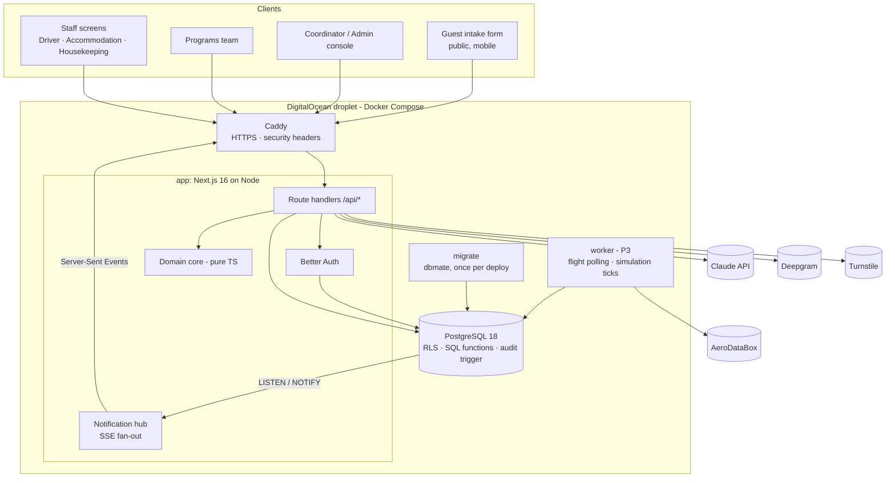

# 02 — Technical Requirements Document (TRD)

**Status:** v7, 2026-11-10. Production hosting is **Vercel + Supabase** (decision 13 in [`00`](00-Project-Breakdown.md#decisions-log), §5.2); a second production copy runs on a 1 GB DigitalOcean droplet at https://hostmark.tech with Postgres on the droplet (decision 12, §5.1, live since 2026-11-10). P1 (backend + the Figma Make frontend "Hostmark"), P2 (guest intake), P3 (flights, transport, driver app, simulation), P4 (room allocation, front desk check-in), P5 (turnaround and cleaning), P6 (event programme) and P7 (Co-Pilot, offline rules engine) are built and tested (see [`06`](06-Implementation-Plan.md)). 2026-11-10: the P8 engineering items are in place (Content-Security-Policy, Super Admin data export and post-event purge, `pnpm eval:all`, coverage above 80 %; §7, §8).

**Related:** [`01-PRD.md`](01-PRD.md) (what), [`05-Backend-Schema.md`](05-Backend-Schema.md) (data and API), [`06-Implementation-Plan.md`](06-Implementation-Plan.md) (build order).

> Versions were checked on 2026-10-16. Third-party prices change, so re-verify before paying for anything.

---

## 1. Stack

| Layer | Choice | Why this one |
|---|---|---|
| Language | **TypeScript 5.9** everywhere (API, domain logic, scripts, tests) | One language end to end. TypeScript 7 (native compiler) is out, but Next.js's build-time type-check still uses the 5.x JavaScript API. |
| Web framework | **Next.js 16** (App Router, 16.4.1), `output: 'standalone'` | Route handlers for the API today; the Figma Make frontend is integrated into the same app later. Standalone output gives a small Docker image. |
| UI | **The Figma Make design, ported**: React 19 components (`components/`, `features/`) on the design's own global CSS (`styles/`, split by screen) | The prototype used hand-written CSS with no Tailwind utilities, so Tailwind and shadcn/ui were dropped. Plus Jakarta Sans and the venue photo are self-hosted. |
| Client data | **SWR 2.5** on a small typed client for the API envelope (`lib/client`) | Caching, revalidation and de-duplication; a Server-Sent Events stream triggers revalidation. |
| Database | **PostgreSQL**: Supabase (managed Postgres **17**) in production; Postgres 18 in Docker locally and on the droplet alternative | Relational data with strong constraints suits the shared data model. Only Supabase's database is used (not its Auth, Realtime or Data API). Dev and tests run Postgres 18 (PGlite = 18.3); the migrations use no 18-only features, and production is one major version behind. |
| Data access | **Kysely 0.29** + node-postgres 8 | Typed SQL query builder; raw SQL where it is clearer. Table types are generated from the migrations (`pnpm db:types`). |
| Migrations | **dbmate 2.36** (plain SQL, up/down) | The schema leans on triggers, RLS and SQL functions, so SQL files are the source of truth. |
| Auth | **Better Auth 1.7** (email + password, admin plugin, bearer plugin) | Battle-tested sessions, password hashing, rate limiting and account management, stored in our Postgres. No self sign-up. |
| Authorization | **Postgres row-level security** with two runtime roles | Roles are enforced in the database, not only in the API (FR-PL-02). See §2.1. |
| Realtime | **Postgres LISTEN/NOTIFY → Server-Sent Events** | Instead of Supabase Realtime. One LISTEN connection per server instance; on Vercel it goes through Supabase's session pooler and streams reconnect every ~5 min (§5.2). |
| Scheduled jobs | **Worker** (same codebase) ✅ P3: runs inside the app server by default (`WORKER_MODE=in-process`, started from `instrumentation.ts`), or as its own process (`pnpm worker` with `WORKER_MODE=off` on the app). **On Vercel:** `WORKER_MODE=off`, and Supabase `pg_cron` + `pg_net` call `GET /api/internal/worker-tick` | A pass every 5 s (simulation steps) and every minute (flight checks, driver suggestions). A 30-second lease row (`worker_leases`), renewed between units of work, makes sure only one process works at a time; a crashed holder's lease runs out. Vercel keeps no process running, so the schedule lives in the database and each pass is one HTTP call (§5.2). |
| Validation | **Zod 4** | One schema per input, used for API validation and (from P2) AI structured outputs. |
| AI (LLM) | **Claude API** via `@anthropic-ai/sdk`, model **`claude-opus-5-5`** *(P2, P7)* | Strong at messy-text extraction and tool use. See §4.3. |
| Speech-to-text | **Deepgram Nova-3** with keyterm prompting *(P7)* | Keyterms (guest names, titles) address misheard names. |
| Flight data | **AeroDataBox** (primary), **FlightAware AeroAPI** (fallback), **simulated provider** *(P3)* | See §4.1. |
| Bot protection | **Cloudflare Turnstile** on the public intake form *(P2)* | Free and low-friction. |
| Hosting | **Vercel** (app, Fluid compute, `lhr1`) + **Supabase** (Postgres, `eu-west-2`), free plans. Alternative: one DigitalOcean droplet with Docker Compose (Caddy, app, Postgres, migrate job) | Decision 13 (Vercel + Supabase), decision 12 (droplet). See §5. |
| Testing | **Vitest 5** (unit), **Vitest + jsdom + Testing Library** (components and screens), **Vitest on PGlite** (SQL and route integration tests), **Playwright** + axe (E2E and accessibility) | PGlite is real Postgres compiled to WebAssembly: the whole suite runs without Docker. |
| Tooling | pnpm 11 (its `minimumReleaseAge` supply-chain check is respected), tsx, ESLint 10 + `eslint-config-next`, `tools/docx-export` | |

**Alternatives considered:** self-hosting Supabase on the droplet (rejected: about ten containers and 4 GB+ RAM to run features that Postgres plus one library cover); Auth.js credentials provider or hand-rolled sessions (rejected: discouraged or security-sensitive to write ourselves); Drizzle or Prisma (rejected: the schema's triggers, RLS and SQL functions would still be raw SQL, so SQL-first migrations are simpler); pgTAP (rejected: needs a running server for every test run, while Vitest on PGlite needs nothing).

## 2. Architecture



### 2.1 Key architectural decisions

1. **Domain core is pure TypeScript.** Validation, duplicate scoring, the allocator, the driver matcher, cascade planning and estimates are pure functions `(state snapshot, now) → result` with no database or network calls, so they are unit-testable and the evaluation harness can run them directly.
2. **Access model: two runtime roles and a per-transaction identity.**
   - `vip_app` is the API's login role. Row-level security applies to it.
   - Every API request runs in one transaction that starts with `set_config('role', 'vip_app', true)` and `set_config('app.user_id', <staff id>, true)`. Policies read the user through `private.current_user_id()`. Both settings are transaction-local, so a pooled connection never carries one request's identity into the next.
   - `vip_system` (no login) is for trusted server work. Each table gives it an explicit `system_all` policy. Only the separate login **`vip_service`** (`SERVICE_DATABASE_URL`) can switch to it: Better Auth's pool, the scripts and, from P3, the worker. The API's own credential (`vip_app`) is not a member, so a bug or injection in the API cannot step outside RLS. No superuser-only `BYPASSRLS` is needed, so the same migrations would run on DigitalOcean Managed Postgres.
3. **Deny by default.** A global `ALTER DEFAULT PRIVILEGES … REVOKE EXECUTE ON FUNCTIONS FROM PUBLIC` plus explicit grants. A **security-baseline test** fails the build if any table lacks RLS or a `system_all` policy, any project function is executable by PUBLIC, any `SECURITY DEFINER` function has no pinned `search_path`, or the audit log becomes writable.
4. **Every write is audited by one trigger.** A generic `audit_row_change` trigger on every business table records actor, action, before and after. Writes by the system are automatic and undoable. Undo restores the `before` image only if the row still equals the entry's `after` image, or refuses with "Changed since by X at T".
5. **Multi-row writes in SQL functions.** Anything that must be atomic (approve or reject a proposal, undo, reorder, and from P3/P5 flight ingest and first-wins checkout) is one SQL function call inside the request's transaction.
6. **Proposal engine.** Anything on the "propose" side of PRD P1 becomes a `proposals` row with an executable `payload` and a human `rationale`. Approval re-validates against current data. Executors arrive with their modules (P3, P4, P7).
7. **Injected clock** (`lib/domain/clock.ts`). Simulated mode runs virtual time (`virtual_start + elapsed × speed`), so a 6-hour scenario plays in 6 minutes.
8. **Realtime without a realtime server.** An insert into `notifications` fires `pg_notify('vip_notifications', {id, recipient_id, kind, priority})`. One `LISTEN` connection in the app fans events out to each recipient's SSE streams. Events carry only ids; clients fetch the content through the RLS-protected API.
9. **Better Auth is fenced in.** Its HTTP surface is an allowlist (sign-in, sign-out, session). Sign-up, the admin plugin's endpoints and profile or password changes are reachable only through our routes, which enforce rules Better Auth does not know (e.g. an Admin may not manage Admin or Super Admin accounts).

### 2.2 Code layout (as built)

```
app/(console)/**         console pages (sidebar + top bar); each page checks its role on the server
app/(staff)/**           phone-sized staff app (driver, front desk, housekeeping)
app/sign-in, app/account/password, app/register/**   auth and public pages
app/api/**/route.ts      thin route handlers (see 05-Backend-Schema.md §7)
components/ui, components/shell   design-system pieces (Icon, Button, Modal, Toast, …) and the console/staff frames
features/<screen>/       screen components by feature (dashboard, activity, settings, …)
styles/                  the Figma design's CSS split by screen (01–18) + app additions (19)
lib/client/              browser code: API client, SWR hooks, formatting, realtime, labels
design/figma-make/       the original Figma Make export (reference only, not built)
lib/api/                 route wrapper (auth, roles, validation, rate limits, envelope), errors, CORS, CRUD route factory
lib/auth/                Better Auth config, roles, permissions, session, password policy, HTTP allowlist, page access and page guard
lib/db/                  pools, withUser transaction helper, generated table types, pglite:// development mode
lib/domain/              pure logic: clock, room CSV parsing, temporary passwords (grows per phase)
lib/repositories/        data access: generic CRUD, event, activity (audit, notifications, decisions)
lib/resources/           CRUD resource definitions: venue, drivers, VIP categories
lib/services/            multi-step operations: accounts, room import
lib/realtime/            notification hub, Postgres LISTEN source
lib/validation/          Zod schemas per area
db/migrations/           dbmate SQL migrations: schema, RLS, functions (source of truth)
db/docker-init/          first-boot script creating the vip_app login
db/tooling/              PGlite helpers and the dev seed (tests and tooling only)
scripts/                 db:types, db:seed, admin:create
tests/db/                SQL tests (RLS, triggers, functions) on PGlite
tests/integration/       route handlers end to end on PGlite with real Better Auth
proxy.ts                 CORS for a separately hosted frontend
Dockerfile, compose.yaml, Caddyfile   production; compose.dev.yml for local Postgres
tools/docx-export/       Markdown → Word export of docs/
```

## 3. Module technical design

### 3.0 Platform (M0) — built in P1

- **Sign-in:** `POST /api/auth/sign-in/email` (Better Auth). It sets an httpOnly session cookie (same-origin clients) and returns a `set-auth-token` header (clients on another origin send `Authorization: Bearer <token>`).
- **Accounts:** Admin creates staff with a generated 14-character temporary password. With email on (§4.5) the new member gets a one-time link instead and the password is never shown; otherwise it is shown once. Until it is changed, every route except `GET /api/me` and `POST /api/account/password` answers `403 password_change_required`. Deactivation sets `banned` and revokes sessions.
- **Route wrapper** (`lib/api/handler.ts`): rate limit by IP → resolve session → active? → password change pending? → role allowed? → rate limit by user → validate params, query and body with Zod → run the handler, with `asActor()` giving it an RLS transaction → map any error to the envelope. 500s get a `requestId` and are logged; the client never sees a raw database message.

### 3.1 Intake pipeline (M1) — P2

```
submit → [Turnstile + rate limit] → store raw submission
       → normalize (deterministic)
       → AI extract "others" (structured output → Zod-validated)
       → validate (rule checks, optional flight lookup)
       → dedupe (exact / likely / none)
       → high-confidence?  yes → auto-create records (SQL function, logged, undoable)
                           no  → review queue + coordinator notification
```

- **Duplicate scoring:** normalized-name trigram similarity (`pg_trgm`, candidates ≥ 0.3) combined with the same flight + date, the same arrival date, or the same contact phone/email. *Exact* = same name, arrival and contact, **and nothing new** (same party size and departure, no note) → auto-link. *Likely* = similarity ≥ 0.6, the same name, or a partial name ("Okafor" in "Augustine Okafor"), with a matching date/flight or contact → review.
- **AI cost and latency** are recorded per submission (model, tokens, ms) for the evaluation chapter.

**As built (P2).** `POST /api/intake/[token]` (`lib/services/intake/public-submit.ts`): link check and per-IP-hash allowance (one vip_system transaction) → Turnstile → read the "others" note (outside any transaction) → one vip_system transaction that stores the submission, then links an exact duplicate, creates the records (savepoint: a failure leaves the submission in review with `auto_process_failed`) or queues it and notifies coordinators. The pipeline's pure parts live in `lib/domain/intake/` (schema, normalize, extract-rules, validate, duplicates); record creation in `lib/services/intake/records.ts` serves auto-processing, approval, manual entry and the seed.
- **Readers** (`lib/ai/intake-reader.ts`): Claude when `ANTHROPIC_API_KEY` is set, otherwise the offline rules. Guest text is wrapped as data with every `<`/`>` escaped; output is Zod-validated twice. A **safety floor** applies whatever the model says: medical, security, schedule and other items always need attention, medical/security/contradiction items the rules find are added if the model left them out, and a note that reads as empty goes to review (`ai_empty`). Refusal, invalid output, timeout or network failure fall back to the rules and mark `ai_unavailable`, which also forces review.
- **Undo:** intake rows are audited as automatic but not undoable row by row; *Undo automatic processing* works per submission (deletes the delegation it created and returns the submission to review).
- **Abuse limits:** 30 requests/min per IP (page and API, in memory) and 10 registrations per 15 min per IP hash (Postgres). The IP is stored only as an HMAC under a key derived from `BETTER_AUTH_SECRET`. The guest learns only their reference code and whether a coordinator will follow up because of problems in what they sent — never whether someone similar is already registered.

### 3.2 Flight tracking (M2) — P3

Built in P3 (`lib/flights/*`, `lib/services/flights/*`, `lib/services/worker/*`).

- **`FlightProvider` interface:** `getStatus(flight, now) → FlightSnapshot | null`. Implementations: `AeroDataBoxProvider` (only with `AERODATABOX_API_KEY`; validated loosely with Zod, 10 s timeout, the leg landing at the event's airport) and `SimulatedProvider` (times stay as they are; the phase follows the clock). Scripted scenarios are not a provider: they are versioned in code (`lib/domain/simulation/scenarios.ts`) and their steps go through the same ingestion. `events.flight_mode` (`live | simulated`) picks the provider; live mode without a key polls nothing.
- **Adaptive polling:** each flight row stores `next_check_at`. The **worker** polls flights where `next_check_at ≤ now` that someone is still expected on, one provider call per flight **outside any transaction**, then each answer is ingested in its own transaction and the next check is set by distance to arrival:

  | Time to scheduled arrival | Check every |
  |---|---|
  | > 24 h | once at T−24h |
  | 24 h → 6 h | 2 h |
  | 6 h → 2 h | 30 min |
  | < 2 h, until landed/cancelled | 10 min |

  This is about 15–25 calls per flight, and many guests share one flight. For example, 50 distinct flights ≈ 1,000 calls, which fits AeroDataBox's paid "Pro" quota once the per-endpoint unit cost is confirmed (§4.1).
- **Quota:** live calls are counted per UTC day (`provider_usage_daily`, `FLIGHT_POLL_DAILY_LIMIT`, default 160 ≈ Pro's 5,000 units a month); coordinators are warned at 80%, polling pauses at 100% until the next day. "Check now" may use at most 80% of the day's calls, waits a minute between checks of the same flight and is refused for flights that have landed or will not arrive. A failed call is logged and the flight is retried 10 minutes later.
- **Ingestion** (`ingestFlightUpdate`): lock the flight row, merge the snapshot (a provider's `unknown` phase never overwrites a known one; a manual time changes only through an override), record the change in `flight_updates`, and run the cascade (§3.3) when a time or the phase changed. The coordinator's manual landing time (FR-FT-11) and simulation steps enter here too.
- **Push upgrade (optional):** AeroDataBox's Flight Alert API can POST to `/api/webhooks/flights`, so polling can become a safety net. Not required for the MVP.
- **Delay is a badge, not a phase:** `status` ∈ {scheduled, in_air, landed, cancelled, diverted, unknown}; *delayed* = `estimated_arrival − scheduled_arrival > threshold`.

### 3.3 Transport and cascade (M2) — P3

- **Trip window** for a pickup = `[pickup_at − travel_time, pickup_at + travel_time]`, using fixed event buffers (no traffic prediction).
- **Driver feasibility:** active, on shift for the whole window, no overlapping active assignment, capacity ≥ passengers (or a minimal set of drivers whose capacities add up).
- **Ranking:** keep the current driver if feasible → fewest jobs that day → smallest idle gap → smallest adequate vehicle. The top choice becomes the proposal, with up to 2 alternatives in `rationale`.
- **Held drivers:** a driver named in a pending suggestion counts as busy for other overlapping trips until it is approved, rejected or superseded; a suggestion made for a pickup time that has since moved is withdrawn (`expired`). Approval re-checks everything in SQL (`private.driver_unavailability`, seats) with the drivers' rows locked, and marks a proposal that no longer fits `failed` with the reason.
- **Cascade** (pure plan in `lib/domain/transport/cascade.ts`, applied by `lib/services/transport/apply.ts`): new venue ETA; pickup moves when it differs by ≥ 1 minute and nobody is on the way yet; the current driver keeps the trip if still feasible (told, asked to confirm), else a reassignment proposal, else a coordinator alert; a party without a pickup gets one plus an assignment proposal; cancelled/diverted flights flag the parties and propose releasing their pickups (withdrawn again if the flight flies after all). The what-if preview runs the same planner without writing.
- **Latency metric:** ingestion start (`flight_updates.created_at`, the transaction start) → cascade done (`cascade_completed_at`), stored as `cascade_ms` per update. `pnpm eval:cascade`: p95 10 ms on a 30-flight synthetic day (target ≤ 5 s; see `06` P3).

### 3.4 Room allocator (M3) — ✅ P4

- **Model:** guests are grouped into *room groups* (one guest, or a coordinator-defined share group). Each room group gets one room.
- **Hard constraints** (filter): free for the stay window (capacity-aware across overlapping stays, each stay keeping the room until it has been cleaned after checkout), capacity ≥ group size, ready by expected arrival, not out of service, never move checked-in guests. Until P5 brings cleaning tasks, "ready" means `clean`, or `now + cleaning minutes + the event's buffer ≤ arrival`; P5 swaps in the task's `estimated_ready_at`. The same rules exist twice — `lib/domain/rooms/rules.ts#roomBlocker` for planning and `private.room_unavailability` for execution — and execution always re-checks.
- **Soft score** (weighted, normalized to 0–100%): tier ↔ VIP rank match (principals: the category's preferred tier, else the rank; weight 3; one tier off scores half); accessible room for an accessibility need (weight 3); ground floor when requested or for an accessibility need (weight 2); **proximity to principal** = 3 × floor difference + min(3, door difference) in the same wing, + 7 across wings, scored 1 − distance / 9, weighted high 3 / normal 2 / low 1. Accessibility is a weighted preference, not a hard rule (PRD FR-RA-02). ⏸ Same-team clustering beyond "near the principal" is not scored.
- **Algorithm:** (1) order delegations by principal rank, then size; (2) place the principal in the best-scoring feasible room (ties: fewest spare beds, then leaving top tiers free for guests who want them); (3) place members, minimizing distance to the principal; (4) **local search**: pairwise swaps that raise the total score, 3 passes; only the two groups and the groups placed relative to them are re-scored per swap, with a room-keyed occupancy index (300 guests in 0.4 s); (5) emit the plan plus a per-line explanation. Deterministic for a given input; pure TypeScript (`lib/domain/rooms/allocator.ts`).
- **Proposals:** a plan is one `room_plan` proposal with one `room_assignment` line per guest (`parent_id`); the coordinator approves all or chosen lines. Single suggestions (a guest added later, FR-RA-05) and moves after an arrival change (`replaces`, FR-RA-07) are standalone `room_assignment` proposals. A pending suggestion holds its room for the guest's current window. Approval executes for the guest's stay window **at that moment**, not the one the suggestion was made for.
- **Locks:** every room function locks guest → room → stay in that order; check-in share-locks the rooms; one allocator run at a time (`pg_advisory_xact_lock`), at most 6 runs per minute per user.
- **Baseline for evaluation:** a naive "first free room that fits" allocator (`allocateFirstFree`). ⏸ Optional exact ILP comparison not done.
- **Evaluation** (`pnpm eval:allocation`, 2026-10-21, 10 seeds per scenario, synthetic venues and guest lists generated from the seed; hard rules re-checked by an independent checker in `eval/allocation.ts`):

| Scenario | Guests | Hard rules | Placed | Preferences: allocator / no swaps / baseline | Runtime mean / max |
|---|---|---|---|---|---|
| Seeded venue, two days out (120 rooms) | 92 | 100% (0 violations) | 100% | **84.1%** / 81.9% / 51.3% (+32.8 pts) | 34 / 74 ms |
| Arrival morning, full house (dirty rooms not ready for early arrivals) | 121 | 100% | 98.9% | **83.1%** / 78.5% / 49.4% (+33.7 pts) | 52 / 67 ms |
| Small hotel overbooked (60 rooms) | 75 | 100% | 88.9% | **75.9%** / 68.2% / 46.0% (+29.9 pts) | 18 / 28 ms |

### 3.5 Turnaround and cleaning (M5) — P5

- **First confirmation wins:** `check_out_stay(id)` runs `UPDATE … SET checked_out_at = now(), checked_out_by = private.current_user_id() WHERE id = $1 AND checked_out_at IS NULL RETURNING *`. Zero rows updated → return the existing `checked_out_by/at`, shown as "Already checked out by X at T". Postgres row-level atomicity is enough; this is tested with two real concurrent connections against Docker Postgres (PGlite has a single connection).
- **Estimate:** `estimated_ready_at = checkout_at + room_type.cleaning_minutes + event.cleaning_delay_buffer_min`.
- **Priority:** `needed_by` = the next allocation's expected arrival for that room; queue ordered by `needed_by` (nulls last), then `estimated_ready_at`.

### 3.6 Co-Pilot (M4) — P7

- **Surface:** Claude API **tool use** through the SDK's tool runner, streaming to the chat panel.
- **Read tools** are typed, parameterized query functions that run inside the signed-in user's `withUser` transaction, so RLS applies to the Co-Pilot too: `find_arrivals`, `get_guest`, `get_flight_status`, `list_pickups`, `list_rooms`, `get_cleaning_queue`, `get_program`, `who_is_affected`, `get_pending_decisions`.
- **Write tools** (`propose_room_move`, `propose_driver_assignment`, `add_note`) **only create proposals**. Approval happens in the UI, never through the model.
- **Why not text-to-SQL:** typed tools give RLS and parameterization by construction, a small action space to measure, and reproducible answers on a seed dataset.
- **Prompting and caching:** a stable system prompt + tool list first (prompt-cached), volatile context after the cache breakpoint.
- **Voice:** browser `MediaRecorder` (push-to-talk) → `/api/copilot/transcribe` → Deepgram Nova-3 with keyterms. Audio is not stored; only original and edited transcripts are kept (for the WER metric). Caddy's `Permissions-Policy` already allows the microphone for this site only.

### 3.7 Program (M6) — P6

- `v_program_conflicts` is a SQL view: participant `expected_arrival_at + venue_travel_buffer + lead_time > item.starts_at`, re-evaluated after every arrival change. Newly at-risk items notify the programs team and the coordinator.
- As built (P6, `05` §3.7): the function `private.program_item_risks` and triggers instead of a view; since 2026-11-10 a change of the event's lead time re-checks every item too, and items must start on an event day.

## 4. Integrations

### 4.1 Flight data API — recommendation

| Option | Cost (checked 2026-10-12) | Pros | Cons |
|---|---|---|---|
| **AeroDataBox** (API.Market / RapidAPI / direct) — **recommended** | Free "Basic": 400 units/mo. **Pro: $7.50/mo for 5,000 units.** Direct "Starter": $19/mo for 40,000. Calls cost 1–6 units by endpoint. | Cheapest viable paid tier. Status by number + date. Optional Flight Alert webhooks. | "Best-effort" positioning. Coverage of specific (especially African) airports must be **tested**. |
| **FlightAware AeroAPI** — fallback | "Personal": no monthly minimum, about $5/mo free usage. **Alerts require "Standard" ($100/mo).** | High-quality data and global coverage. | Per-query billing; push alerts too expensive here. |
| Aviationstack | Free: 100 requests/mo. Paid from about $49.99/mo. | Simple. | Free tier too small; expensive for what it adds. |

**Recommendation:** build against the `FlightProvider` interface, implement AeroDataBox first, keep the simulated provider as the dev default. Before committing: (1) query 10–20 real flights into the event's arrival airport(s) on AeroDataBox and AeroAPI and compare; (2) confirm the unit cost of `/flights/number/{number}/{date}`; (3) subscribe to Pro only for the evaluation/demo month.

### 4.2 Speech-to-text

- **Deepgram Nova-3, pre-recorded.** Third-party sources report about $0.0043/min, keyterm prompting as a small add-on, and $200 free starting credit. **Verify on deepgram.com/pricing.** Opt out of model-improvement programs where offered.

### 4.3 Claude API

| Use | Model | Settings | Notes |
|---|---|---|---|
| Intake extraction | `claude-opus-5-5` | Structured output from the Zod schema; effort `low` (to tune) | Short, high-volume calls. |
| Pasted-message → draft intake | `claude-opus-5-5` | Same schema as the form; effort `low`–`medium` | |
| Co-Pilot | `claude-opus-5-5` | Tool runner, strict tools, streaming, effort `medium` (to tune) | Check `stop_reason` (including `refusal`) before reading content. |

- **Pricing (Opus 5.5):** $4 / $20 per million input/output tokens; cache reads $0.20 per million.
- **Cost lever:** once the eval sets exist, measure whether Claude Haiku 5.5 ($0.10 / $0.50 per million) holds the extraction F1 target. Switch only if the numbers support it.

### 4.4 Cloudflare Turnstile
- Widget on the registration form (rendered only when `TURNSTILE_SITE_KEY` is set), verified server-side in `POST /api/intake/[token]` with `TURNSTILE_SECRET_KEY`, including the hostname the token was solved on; Cloudflare unreachable = refused (fails closed). Without keys the check is skipped and the per-IP limits are the only protection; production logs a warning at startup. The Content-Security-Policy (2026-11-10, §7) allows `https://challenges.cloudflare.com` in `frame-src`; its script loads under `'strict-dynamic'` from the nonce-carrying page script.

### 4.5 Email (Resend)
- **What is sent** (2026-11-10, `lib/mail/`): staff **invitations** and **admin password resets** carry a one-time link to `/reset-password?token=…` (valid 72 h, `STAFF_LINK_HOURS`), so nobody ever sees or passes on a password; **"Forgot password?"** on the sign-in page emails a 1-hour link (Better Auth's `/request-password-reset`, same answer for every address, 3 requests/min per IP, nothing sent to deactivated accounts); **guests** who give an email on the public registration form get a confirmation with their reference, the event and venue, and their arrival date and flight.
- **How:** one REST call per email (`POST https://api.resend.com/emails`, 10 s timeout) behind the `Mailer` interface; templates in plain text and HTML with every person-supplied value escaped. Staff links are Better Auth verification records (`reset-password:<token>`, 24 random bytes) written by `lib/services/password-delivery.ts`; Better Auth's `/reset-password` consumes them once and `onPasswordReset` clears `must_change_password`.
- **Abuse safeguards** (security review 2026-11-10: no critical or high findings; three medium ones fixed): deactivating an account cancels its unused links, and a link used on a deactivated account keeps the forced password change; a failed invitation email leaves no working link behind; "Forgot password?" does not wait for the email, so real and unknown addresses answer equally fast; at most 2 guest confirmations per address per day, however many registrations name it. Accepted for now: no per-address limit on "Forgot password?" beyond 3 requests/min per IP.
- **Failure never blocks:** if Resend refuses or is unreachable, an invitation or reset falls back to the temporary password on screen (with a note), and a registration still succeeds with its on-screen confirmation. Failures are logged without addresses.
- **Set-up:** a Resend account with the sending domain verified (SPF and DKIM records at the DNS host); the key goes in the server environment only. Resend processes staff and guest email addresses and the content above (privacy notice, §7).

### 4.6 Configuration for external services

| Variable | Default | Without it |
|---|---|---|
| `ANTHROPIC_API_KEY` | unset | Free text is read by the offline rules (no network, no cost) |
| `INTAKE_AI_MODEL` | `claude-opus-5-5` | — |
| `TURNSTILE_SITE_KEY`, `TURNSTILE_SECRET_KEY` | unset | No bot check; rate limits only |
| `AERODATABOX_API_KEY` | unset | Live mode polls nothing; landing times change only by hand or in simulated mode |
| `FLIGHT_POLL_DAILY_LIMIT` | `160` | — (live calls per UTC day) |
| `RESEND_API_KEY` | unset | No email: invitations and resets show a temporary password once; no "Forgot password?" link; no guest confirmations |
| `MAIL_FROM` | unset (required with the key) | e.g. `Hostmark <noreply@hostmark.tech>`; its domain must be verified in Resend |
| `DEMO_REQUEST_TO` | unset | The landing page's **Request a demo** form says requests are not open yet (needs email on too) |
| `WORKER_MODE` | `in-process` | `off`: run `pnpm worker` as its own process (not with a `pglite://` database) |

## 5. Hosting, environments, deployment

| Environment | App | Database | Flight provider |
|---|---|---|---|
| Local (no Docker) | `pnpm local:setup` once, then `pnpm dev` (or `pnpm build && pnpm start`) | In-process PGlite (`DATABASE_URL=pglite://.pglite/dev`), migrations applied on start; never allowed in production unless `ALLOW_PGLITE=true` is set for a local production build | Simulated |
| Local (Docker) | `pnpm dev` | Docker Postgres 18 via `pnpm db:up` (port 5433) | Simulated |
| Tests | Vitest | PGlite in-process (no Docker) | Simulated |
| **Production / demo** | **Vercel** project `hostmark-vip` → `https://hostmark-vip.vercel.app` (§5.2) | **Supabase** project `hostmark-vip` (Postgres 17, London) | Live (switchable to simulated) |
| **Production (droplet)** | DigitalOcean droplet → `https://hostmark.tech`: `compose.yaml` + `compose.droplet.yaml` (Caddy + app + Postgres + migrate) (§5.1) | Postgres 18 on the same droplet | Live (switchable to simulated) |

### 5.1 DigitalOcean droplet — live at https://hostmark.tech

- **Droplet (live since 2026-11-10):** `hostmark-vip`, Ubuntu 24.04, **1 vCPU / 1 GB RAM** (`s-1vcpu-1gb`, about $6/mo), London (`lon1`), IP 178.62.105.236, with 2 GB swap. Domain `hostmark.tech` (registered at Hostinger): A records for `@` and `www` point to the droplet; `www` redirects to the bare domain.
- **1 GB layout:** `compose.droplet.yaml` is layered over `compose.yaml` and sets memory limits (Postgres 320 MB with `shared_buffers=96MB`, `max_connections=40`; app 512 MB with a 384 MB Node heap; Caddy and migrate 128 MB), uses the prebuilt image `vip-gcs-app:latest` instead of building, and publishes Postgres on `127.0.0.1:5432` only (for SSH tunnels). Measured at start: app ~110 MB, Postgres ~45 MB, Caddy ~60 MB.
- **Deploy:** `bash scripts/droplet-deploy.sh` from a laptop. It builds the `linux/amd64` image locally (`next build` needs more than 1 GB), streams it to the droplet with `docker save | ssh docker load`, copies the Compose files, Caddyfile and migrations to `/opt/hostmark`, and runs `docker compose -f compose.yaml -f compose.droplet.yaml --env-file .env.production up -d`. The `migrate` service applies `db/migrations` and exits; the app starts only if it succeeded. The worker runs inside the app (`WORKER_MODE` default). A settings change alone (for example a new `RESEND_API_KEY`): `bash scripts/droplet-deploy.sh --settings-only`.
- **Data: no demo data.** The droplet is the real test system: its database was wiped on 2026-11-10 (the demo dump is kept as `/opt/hostmark/backups/demo-data-before-wipe.sql.gz`) and starts empty. The owner creates the first Super Admin with `bash scripts/droplet-admin.sh --email … --name …` (an SSH tunnel to the loopback-only Postgres, then `scripts/create-super-admin.ts`; the temporary password is printed only in the owner's terminal), then sets up the event, rooms, drivers and tester accounts in Settings ([`07`](07-Tester-Guide.md) §5). Until the event exists, the worker skips flight checks quietly.
- **Static files:** the `runner` image copies `public/` (logo, favicon, images) next to the standalone server, which does not include it by itself (fixed 2026-11-10; Vercel serves `public/` on its own).
- **Server hardening (done):** key-only SSH (`PasswordAuthentication no`, `PermitRootLogin prohibit-password`), `ufw` allowing only 22, 80, 443/tcp and 443/udp, `fail2ban`, unattended security upgrades.
- **Secrets:** `.env.production` on the droplet only (`chmod 600`, never in git): `POSTGRES_PASSWORD`, `APP_DB_PASSWORD`, `SERVICE_DB_PASSWORD` (all URL-safe, e.g. `openssl rand -hex 32`, because they are embedded in connection URLs), `BETTER_AUTH_SECRET` (`openssl rand -base64 32`), `SITE_ADDRESS`, `API_ALLOWED_ORIGINS`, and for email `RESEND_API_KEY` and `MAIL_FROM`. They live in `.env.droplet.local` on the deploy laptop (gitignored); `scripts/droplet-deploy.sh` copies them to the droplet on every deploy. The app validates them at startup (`instrumentation.ts`) and refuses to start with missing or weak values.
- **TLS and headers:** Caddy obtains Let's Encrypt certificates automatically (the domain's DNS A record must point to the droplet) and adds HSTS, `nosniff`, `X-Frame-Options: DENY`, `Referrer-Policy` and `Permissions-Policy`.
- **Firewall:** `ufw` on the droplet (above). Postgres and the app are not published to the internet.
- **Backups:** `/usr/local/bin/hostmark-backup` runs nightly at 02:30 UTC (`/etc/cron.d/hostmark-backup`): `pg_dump | gzip` into `/opt/hostmark/backups`, keeping 7 days (first dump 2026-11-10). Still open: copying dumps off the droplet (Spaces or a laptop) and a restore drill before the demo.
- **Managed database option:** point `DATABASE_URL` at DigitalOcean Managed Postgres. The access model needs no superuser-only features (§2.1).
- **Monitoring:** `/api/health` (database check) for an uptime monitor and the Docker healthcheck; structured JSON logs via `docker compose logs`.

### 5.2 Vercel + Supabase (production, decision 13)

**What runs where.** The Next.js app runs on **Vercel** (team "Zacchaeus' projects", Hobby plan, Fluid compute, functions in `lhr1` London via `vercel.json`). Postgres runs on **Supabase** (project `hostmark-vip`, ref `zmtoicrkeodfmvboyhzx`, `eu-west-2` London, free plan, Postgres 17). Both are in London, so a query costs a few milliseconds. Only Supabase's database is used: sign-in stays Better Auth, live updates stay LISTEN/NOTIFY → SSE, and roles stay enforced by row-level security.

**Connections.** All go through Supabase's shared pooler (Supavisor, `aws-0-eu-west-2.pooler.supabase.com`, IPv4; Vercel has no IPv6 for the direct connection). Custom roles log in as `<role>.<project ref>`.

| Variable | Role | Port / mode | Why this mode |
|---|---|---|---|
| `DATABASE_URL` | `vip_app` | 6543 transaction | The API pool: `withUser` only sets transaction-local settings, so connections can be shared between requests |
| `DATABASE_LISTEN_URL` | `vip_app` | 5432 session | LISTEN needs a connection of its own (the transaction pooler cannot hold one) |
| `SERVICE_DATABASE_URL` | `vip_service` | 5432 session | The Better Auth pool runs `SET ROLE vip_system` once per connection |
| `DATABASE_MIGRATION_URL` / `DBMATE_URL` | `vip_owner` | 5432 session | Migrations, seed and admin scripts, **from your machine only**; never stored in Vercel |

Connections are encrypted (`sslmode=no-verify` for node-postgres, `require` for dbmate), but the server certificate is not checked against Supabase's CA. **To tighten:** download the CA certificate from the Supabase dashboard (Database → SSL) and switch to `verify-full`. `attachDatabasePool` (`@vercel/functions`) closes idle connections before Vercel suspends an instance, so a frozen instance never holds pooler connections.

**Database set-up (once).** [`db/supabase/01-bootstrap.sql`](../db/supabase/01-bootstrap.sql) creates `vip_owner` and the two runtime logins (from SCRAM-SHA-256 verifiers, so no plaintext password reaches Supabase), and the `btree_gist` and `pg_trgm` extensions. Then `pnpm hosted:migrate` runs dbmate as `vip_owner`. Every object is owned by `vip_owner`, so Supabase's automatic grants to its Data API roles (`anon`, `authenticated`) never apply: the auto-generated REST API cannot reach app data, and RLS stays on every table. `grant vip_owner to postgres` lets Supabase Studio and pg_cron read the tables.

**Background worker.** Vercel keeps no process running, so the app runs with `WORKER_MODE=off`, and [`db/supabase/02-scheduler.sql`](../db/supabase/02-scheduler.sql) schedules Supabase `pg_cron` + `pg_net` to call `GET /api/internal/worker-tick` with `Authorization: Bearer <CRON_SECRET>`:

- every minute with `?poll=1` (flight checks, driver and room suggestions, due simulation steps);
- every 5 seconds, but only while a simulation runs (no call otherwise, which keeps Vercel usage low);
- the URL and secret sit in Supabase Vault, and `cron.job_run_details` is trimmed nightly.

Every scheduled call uses one lease holder (`scheduler`), so a call is never locked out by the previous call's lease. Vercel Cron could replace pg_cron on the Pro plan (Hobby runs crons at most daily); the route accepts the same header.

**Notification stream.** Vercel ends a function at `maxDuration` (300 s), so on Vercel the stream closes after 280 s and the browser reconnects 5 s later (`retry:`), re-checking the session each time.

**Secrets.** `.env.deploy.local` (gitignored, `chmod 600`, and not a file Next.js loads, so a local build never points at production) holds every generated secret. `scripts/hosted-setup.sh` copies the runtime ones into Vercel's Production environment as sensitive variables. Preview deployments get no database settings on purpose: they would share production data.

**First deploy.** `bash scripts/hosted-setup.sh --seed` (migrations, demo data, Vercel project and variables, production deploy), then run `02-scheduler.sql` once in Supabase. **Later deploys:** `pnpm hosted:migrate && vercel deploy --prod` (migrations first; keep them backward-compatible with the running version). **Super Admin:** `pnpm hosted:admin --email … --name …`.

**Headers and HTTPS.** Vercel provides HTTPS; `next.config.ts` sends the same security headers as the Caddyfile. The Content-Security-Policy comes from the app itself (`proxy.ts`, §7), so it is the same on both hosts.

**One sign-in address.** Better Auth accepts sign-ins only from `BETTER_AUTH_URL` (`https://hostmark-vip.vercel.app`). Vercel also serves production on a team alias and on each deployment's own URL, both behind Vercel Authentication, so only team members reach them. There, a correct password is refused with 403 `INVALID_ORIGIN`. `proxy.ts` therefore redirects `/sign-in` on any other production address to the main one, and the form reports a blocked address or a server fault as such, keeping "Email or password is incorrect" for refused credentials only.

**Limits of this host.**

- The in-memory rate limiters are per function instance. Fluid compute reuses instances, so they still slow abuse, but they are not global (§6).
- Free Supabase projects pause after about a week without activity. Resume from the dashboard before a demo.
- The Hobby plan is for non-commercial use, with about 4 active-CPU hours a month (hence the conditional 5-second job).

**Monitoring.**

- `/api/health`, Vercel runtime logs, and Supabase logs and advisors.
- The scheduler's calls: `select * from cron.job_run_details order by start_time desc limit 20` and `net._http_response`.

**Backups.** Before a demo or a data change that matters, take a `pg_dump` as `vip_owner` (`DATABASE_MIGRATION_URL`); check the Supabase plan's backup terms.

## 6. Constraints

From [`00` §10](00-Project-Breakdown.md#10-boundaries-to-keep-the-project-realistic): one venue and one coordinating team per event (several events per installation since P9, each isolated by row-level security; [`05`](05-Backend-Schema.md) §6); seeded/synthetic plus volunteer data; real flight API plus simulated mode; every important action confirmed and logged; each part measurable.

Technical constraints:
- No outbound WhatsApp or SMS. Email is limited to staff account links and a registration confirmation to guests (§4.5); operational updates stay in-app notifications.
- No live traffic data. Fixed, configurable buffers.
- No trained ML models. AI is limited to LLM extraction/Co-Pilot and speech-to-text. Estimates are arithmetic.
- **One app process.** The in-memory rate limiters and the notification hub assume a single app container; running several would need a shared store (e.g. Redis). On Vercel there can be several instances: notifications still reach everyone (each instance LISTENs to Postgres), but rate limits are per instance (§5.2).

## 7. Non-functional requirements

| Area | Requirement (✅ = in place since P1) |
|---|---|
| **Security** | ✅ RLS on every table, deny by default; ✅ roles checked by the route wrapper *and* by RLS; ✅ Better Auth HTTP surface limited to an allowlist; ✅ temporary passwords with a forced change, or emailed one-time links (72 h for staff, 1 h for "Forgot password?", rate limited, no account enumeration); ✅ sessions last 24 h, extended while used; ✅ sign-in limited to 5 attempts/min per IP; ✅ API limits of 120 req/min per user and 600 per IP; ✅ JSON bodies ≤ 1 MB and only `application/json`; ✅ CSV ≤ 2 MB, `text/csv` only; ✅ body limits enforced while streaming (chunked uploads cannot be buffered whole) and by Caddy (2 MB, slow-client timeouts); ✅ CSRF: cookie-authenticated writes must carry an allowed `Origin`; ✅ notification streams close after 15 min and reconnect through a fresh session check; ✅ password changes limited to 5 attempts/min; ✅ CORS allowlist; ✅ HSTS and security headers (Caddy; `next.config.ts` on Vercel); ✅ **Content-Security-Policy** (2026-11-10) on every page, set in the app by `proxy.ts` with a fresh nonce per request (`lib/api/csp.ts`): scripts `'self'` + nonce + `'strict-dynamic'`, frames only Turnstile, `object-src 'none'`, `base-uri 'self'`, `form-action 'self'`, `frame-ancestors 'none'`; styles still allow `'unsafe-inline'` (React style attributes); ✅ append-only audit log for the API (the post-event purge, run by a Super Admin, deletes its own row entries and anonymises earlier guest-data entries, see Privacy); ✅ error responses never contain database messages. ✅ P2 public intake: per-IP limits in memory and in Postgres, optional Turnstile with hostname check, prompt-injection wrapping and a safety floor on AI output, no disclosure of other registrations (security review 2026-10-20: no critical or high findings; the medium ones fixed). ✅ P4 rooms (security review 2026-10-21: one high and four medium findings, all fixed — see `06` P4): proposals re-checked for the current stay window, cancelled guests release their rooms, "assign anyway" needs every warning acknowledged and a 10-character reason, check-in refuses a room still occupied, consistent lock order, override reasons hidden from the front desk, allocator runs rate-limited and serialised. ✅ Housekeeping problem reports limited to 5 a minute per person (2026-11-10). |
| **Privacy** | VIP itineraries are sensitive. Collect only what is needed. Least-privilege views (housekeeping sees no guest names; drivers see only their own jobs). Consent notice on intake. ✅ **Post-event purge** (2026-11-10, `05` §5 `purge_guest_data`): a Super Admin removes guest personal data from Settings → System once the event's last day is over, typing the event name to confirm. Names become pseudonyms; contact details, diets, accessibility needs, notes, registrations and Co-Pilot questions and answers are removed; known names, e-mail addresses and phone numbers are scrubbed from the free text that stays, including earlier audit values; figures stay for the evaluation. ✅ Super Admin **data export** (JSON, no accounts or auth data), recorded in the audit log. The purge is run by hand: the **[Proposed]** 90-day deadline after the event is not enforced by the system. The applicable law depends on the venue country (e.g. Nigeria's NDPA 2023). TBD. |
| **Performance** | A dashboard update appears within **2 s** of a database change (SSE). Cascade from flight update to proposal p95 ≤ 5 s. Intake submit → confirmation ≤ 3 s. Co-Pilot first token ≤ 3 s typical. |
| **Reliability** | The LISTEN connection reconnects with backoff. Idempotent jobs. Provider errors mark the flight `unknown` and never crash the cascade. Approval re-validates against current data. Containers restart automatically (`unless-stopped`). |
| **Accessibility** | WCAG 2.2 AA (see `04`). Status never by color alone. Full keyboard support on the console. 48 px touch targets on staff screens. |
| **Time** | ✅ All timestamps `timestamptz` (UTC), displayed in the event timezone. ✅ `date` columns stay `YYYY-MM-DD` strings end to end (no time-zone shift). |
| **Browser support** | Latest two versions of Chrome, Safari, Edge and Firefox. Staff screens tested on a mid-range Android phone and an iPhone. |
| **Observability** | ✅ Structured JSON logs with a request id for every 500. Per-call AI usage (P2). Per-update cascade timings (P3). Provider call counts per day (P3). |
| **Testability** | ✅ Pure domain core, ✅ injected clock, ✅ whole test suite runs without Docker, seed generators per scenario (grows per phase). |

## 8. Testing and evaluation strategy

| Layer | Tooling | What | Status (2026-11-10) |
|---|---|---|---|
| Unit | Vitest | Pure modules: roles, page access, envelope, error mapping, rate limiter, clock, CSV, passwords, env, CORS, route wrapper, notification hub; intake schema, normalisers, rule reader, checks, duplicates; the Claude reader against a fake SDK (fallbacks, injection wrapping, safety floor); Turnstile; eval metrics; browser helpers; and the domain and service code of every later phase (transport, rooms, cleaning, programme, Co-Pilot, CSP, link updates) | ✅ 408 tests |
| UI | Vitest + jsdom + Testing Library | Modal focus trap, form dialog, toasts, sidebar by role, simulated-mode badge, change-password screen, activity rows; registration form and confirmation, intake queue + paste drawer, review screen, guests list, add guest, guest profile; since then every console and staff screen, including settings, activity, the shells and sign-in | ✅ 283 tests |
| Database | Vitest + PGlite | RLS per role (incl. guests and intake), column grants, triggers, SQL functions, the security baseline; the post-event purge | ✅ 122 tests |
| Integration | Vitest + PGlite + real Better Auth | Route handlers end to end: auth, accounts, event, venue, CSV import, drivers, categories, audit/undo and filters, notifications incl. SSE, decisions, dashboard summary, seed; public registration, review queue, pasted messages, guests; every later phase's routes, export and purge, rooms taken out of service, room scenarios | ✅ 169 tests |
| End-to-end | Playwright + axe, against `pnpm build && pnpm start` on PGlite | Main flows in `03-App-Flow.md` across roles, accessibility scan per screen | 🟨 `pnpm test:e2e`: 22/22 against the demo build (2026-10-27, `06` P8); axe on three screens |
| **Evaluation** | `eval/` runners (`pnpm eval:<module>`) | The PRD §8 metrics as JSON + Markdown tables | ✅ `pnpm eval:intake` (offline rules by default; `--reader claude` with a key), `eval:cascade`, `eval:allocation`, `eval:cleaning`, `eval:copilot`; `pnpm eval:all` runs all five and writes `eval/results/summary.md` |

Commands: `pnpm test` (unit), `pnpm test:ui`, `pnpm test:db`, `pnpm test:integration`, `pnpm test:all`, `pnpm vitest run --coverage`, `pnpm lint`, `pnpm typecheck`, `pnpm test:e2e`, `pnpm eval:build`, `pnpm eval:<module>`, `pnpm eval:all`.

**Coverage (2026-11-10):** 90.6 % of lines, 81.8 % of branches and 86.5 % of functions across `lib`, `components` and `features`, above the 80 % target (2026-10-20: 64 % of lines). The db and integration fixtures take their event dates relative to today (`tests/support/event-dates.ts`), so rules that depend on the date (intake window, purge, "upcoming") do not drift as time passes.

**Evaluation datasets** (versioned in `eval/datasets/`): `intake.jsonl` (≥ 100 texts), `scenarios/*.json` (flight scenarios), `allocation/*.json` (venues and guest sets), `copilot.jsonl` (≥ 50 questions, ≥ 20 actions), `voice/` (recorded name-heavy questions, with consent).

## 9. Rough running costs (development + one evaluation month)

| Item | Estimate (verify current prices) |
|---|---|
| **Vercel Hobby** (app) + **Supabase Free** (Postgres) — current hosting | $0 (Pro plans, if limits are hit: Vercel $20/mo, Supabase $25/mo) |
| DigitalOcean droplet, 1 vCPU / 1 GB (`hostmark.tech`) | about $6/mo |
| *Alternative:* droplet backups (weekly) | +20% of the droplet price |
| *Alternative:* DigitalOcean Spaces (database dumps) | about $5/mo |
| Domain name | about $10–15/yr |
| AeroDataBox (Basic free for development, Pro for one month) | $0–7.50 |
| Deepgram (free starting credit) | ~$0 |
| Cloudflare Turnstile | $0 |
| Claude API (Opus 5.5): about $0.01–0.03 per intake, $0.03–0.10 per Co-Pilot question; eval runs dominate | Roughly $20–60 total |

## 10. Risks

| Risk | Mitigation |
|---|---|
| Flight API lacks coverage for the event's airports | Coverage test before committing; FlightAware fallback; simulated mode for the demo. |
| API quota exhausted mid-event | Adaptive polling; one poll per distinct flight; daily quota counter with a warning at 80%. |
| AI extracts wrongly and it is auto-processed | Rule-based confidence gate; flags force review; everything undoable; "auto-processing safety" metric. |
| Co-Pilot takes an unsafe action | Write tools only create proposals; RLS applies to tool calls; approval only in the UI. |
| Race conditions between staff | Atomic SQL functions (first-wins checkout); proposals re-validated on approval; concurrency tests on real Postgres. |
| **Single droplet = single point of failure** | Nightly dumps off the droplet, weekly droplet backups, a restore drill, Compose restart policies. |
| **Operating our own server** | Unattended security upgrades, Docker images pinned to major versions, firewall limited to 22/80/443, dependency updates gated by pnpm's release-age check. |
| Running out of memory on the 1 GB droplet | The image is built on a laptop (`scripts/droplet-deploy.sh`), never on the droplet; per-service memory limits, a small Postgres configuration and 2 GB swap. |
| **Free Supabase project paused** before a demo (about a week without activity) | Open the dashboard and resume it the day before; or move to the Pro plan for the evaluation month. |
| **Vercel Hobby limits** (active CPU, function time) during a long simulation | The 5-second job only calls while a simulation runs; watch Vercel usage; Pro if needed. |

## 11. Open technical decisions

1. Venue country, timezone and arrival airport(s): needed for the flight coverage test, the droplet region and the data-protection regime.
2. Custom domain (optional): `hostmark-vip.vercel.app` works today; a custom domain needs adding in Vercel and `BETTER_AUTH_URL` updated (on the droplet alternative: `SITE_ADDRESS` with a DNS A record).
3. Confirm AeroDataBox after the coverage test (§4.1).
4. Whether to add the ILP exact-solver comparison (§3.4) to the evaluation chapter.
5. Whether to adopt AeroDataBox Flight Alert webhooks (push) or stay with polling.
6. Whether to move the database to DigitalOcean Managed Postgres for the demo window.
