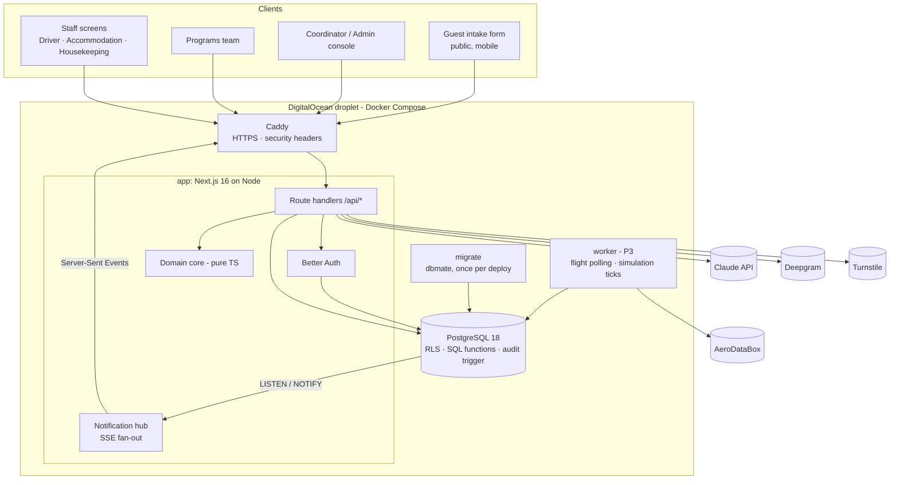

# 02 — Technical Requirements Document (TRD)

**Status:** v2, 2026-10-16. Hosting changed from Vercel + Supabase to **one DigitalOcean droplet** (decision 12 in [`00`](00-Project-Breakdown.md#decisions-log)). The P1 backend is built and tested (see [`06`](06-Implementation-Plan.md)).

**Related:** [`01-PRD.md`](01-PRD.md) (what), [`05-Backend-Schema.md`](05-Backend-Schema.md) (data and API), [`06-Implementation-Plan.md`](06-Implementation-Plan.md) (build order).

> Versions were checked on 2026-10-16. Third-party prices change, so re-verify before paying for anything.

---

## 1. Stack

| Layer | Choice | Why this one |
|---|---|---|
| Language | **TypeScript 5.9** everywhere (API, domain logic, scripts, tests) | One language end to end. TypeScript 7 (native compiler) is out, but Next.js's build-time type-check still uses the 5.x JavaScript API. |
| Web framework | **Next.js 16** (App Router, 16.4.1), `output: 'standalone'` | Route handlers for the API today; the Figma Make frontend is integrated into the same app later. Standalone output gives a small Docker image. |
| UI | **Tailwind CSS + shadcn/ui** *(planned with the Figma Make export)* | Accessible primitives; the design brief (`04`) applies directly. |
| Database | **PostgreSQL 18** in Docker on the droplet | Relational data with strong constraints suits the shared data model. The same major version runs in dev, tests (PGlite = Postgres 18.3) and production. |
| Data access | **Kysely 0.29** + node-postgres 8 | Typed SQL query builder; raw SQL where it is clearer. Table types are generated from the migrations (`pnpm db:types`). |
| Migrations | **dbmate 2.36** (plain SQL, up/down) | The schema leans on triggers, RLS and SQL functions, so SQL files are the source of truth. |
| Auth | **Better Auth 1.7** (email + password, admin plugin, bearer plugin) | Battle-tested sessions, password hashing, rate limiting and account management, stored in our Postgres. No self sign-up. |
| Authorization | **Postgres row-level security** with two runtime roles | Roles are enforced in the database, not only in the API (FR-PL-02). See §2.1. |
| Realtime | **Postgres LISTEN/NOTIFY → Server-Sent Events** | Replaces Supabase Realtime. A long-lived Node process on a droplet can hold the connections. |
| Scheduled jobs | **Worker process** (same codebase, own Compose service) *(P3)* | Replaces `pg_cron` + `pg_net`. A one-minute loop with a Postgres advisory lock, so only one instance polls. |
| Validation | **Zod 4** | One schema per input, used for API validation and (from P2) AI structured outputs. |
| AI (LLM) | **Claude API** via `@anthropic-ai/sdk`, model **`claude-opus-5-5`** *(P2, P7)* | Strong at messy-text extraction and tool use. See §4.3. |
| Speech-to-text | **Deepgram Nova-3** with keyterm prompting *(P7)* | Keyterms (guest names, titles) address misheard names. |
| Flight data | **AeroDataBox** (primary), **FlightAware AeroAPI** (fallback), **simulated provider** *(P3)* | See §4.1. |
| Bot protection | **Cloudflare Turnstile** on the public intake form *(P2)* | Free and low-friction. |
| Hosting | **One DigitalOcean droplet**: Docker Compose with Caddy (HTTPS), app, Postgres, a one-shot migrate job, and later the worker | Decision 12. See §5. |
| Testing | **Vitest 5** (unit), **Vitest on PGlite** (SQL and route integration tests), **Playwright** (E2E, with the frontend) | PGlite is real Postgres compiled to WebAssembly: the whole suite runs without Docker. |
| Tooling | pnpm 11 (its `minimumReleaseAge` supply-chain check is respected), tsx, `tools/docx-export` | |

**Alternatives considered:** self-hosting Supabase on the droplet (rejected: about ten containers and 4 GB+ RAM to run features that Postgres plus one library cover); Auth.js credentials provider or hand-rolled sessions (rejected: discouraged or security-sensitive to write ourselves); Drizzle or Prisma (rejected: the schema's triggers, RLS and SQL functions would still be raw SQL, so SQL-first migrations are simpler); pgTAP (rejected: needs a running server for every test run, while Vitest on PGlite needs nothing).

## 2. Architecture



### 2.1 Key architectural decisions

1. **Domain core is pure TypeScript.** Validation, duplicate scoring, the allocator, the driver matcher, cascade planning and estimates are pure functions `(state snapshot, now) → result` with no database or network calls, so they are unit-testable and the evaluation harness can run them directly.
2. **Access model: two runtime roles and a per-transaction identity.**
   - `vip_app` is the API's login role. Row-level security applies to it.
   - Every API request runs in one transaction that starts with `set_config('role', 'vip_app', true)` and `set_config('app.user_id', <staff id>, true)`. Policies read the user through `private.current_user_id()`. Both settings are transaction-local, so a pooled connection never carries one request's identity into the next.
   - `vip_system` (no login) is for trusted server work. Each table gives it an explicit `system_all` policy. Only the separate login **`vip_service`** (`SERVICE_DATABASE_URL`) can switch to it: Better Auth's pool, the scripts and, from P3, the worker. The API's own credential (`vip_app`) is not a member, so a bug or injection in the API cannot step outside RLS. No superuser-only `BYPASSRLS` is needed, so the same migrations would run on DigitalOcean Managed Postgres.
3. **Deny by default.** A global `ALTER DEFAULT PRIVILEGES … REVOKE EXECUTE ON FUNCTIONS FROM PUBLIC` plus explicit grants. A **security-baseline test** fails the build if any table lacks RLS or a `system_all` policy, any project function is executable by PUBLIC, any `SECURITY DEFINER` function has no pinned `search_path`, or the audit log becomes writable.
4. **Every write is audited by one trigger.** A generic `audit_row_change` trigger on every business table records actor, action, before and after. Writes by the system are automatic and undoable. Undo restores the `before` image only if the row still equals the entry's `after` image, or refuses with "Changed since by X at T".
5. **Multi-row writes in SQL functions.** Anything that must be atomic (approve or reject a proposal, undo, reorder, and from P3/P5 flight ingest and first-wins checkout) is one SQL function call inside the request's transaction.
6. **Proposal engine.** Anything on the "propose" side of PRD P1 becomes a `proposals` row with an executable `payload` and a human `rationale`. Approval re-validates against current data. Executors arrive with their modules (P3, P4, P7).
7. **Injected clock** (`lib/domain/clock.ts`). Simulated mode runs virtual time (`virtual_start + elapsed × speed`), so a 6-hour scenario plays in 6 minutes.
8. **Realtime without a realtime server.** An insert into `notifications` fires `pg_notify('vip_notifications', {id, recipient_id, kind, priority})`. One `LISTEN` connection in the app fans events out to each recipient's SSE streams. Events carry only ids; clients fetch the content through the RLS-protected API.
9. **Better Auth is fenced in.** Its HTTP surface is an allowlist (sign-in, sign-out, session). Sign-up, the admin plugin's endpoints and profile or password changes are reachable only through our routes, which enforce rules Better Auth does not know (e.g. an Admin may not manage Admin or Super Admin accounts).

### 2.2 Code layout (as built)

```
app/api/**/route.ts      thin route handlers (see 05-Backend-Schema.md §7)
lib/api/                 route wrapper (auth, roles, validation, rate limits, envelope), errors, CORS, CRUD route factory
lib/auth/                Better Auth config, roles, permissions, session, password policy, HTTP allowlist
lib/db/                  pools, withUser transaction helper, generated table types
lib/domain/              pure logic: clock, room CSV parsing, temporary passwords (grows per phase)
lib/repositories/        data access: generic CRUD, event, activity (audit, notifications, decisions)
lib/resources/           CRUD resource definitions: venue, drivers, VIP categories
lib/services/            multi-step operations: accounts, room import
lib/realtime/            notification hub, Postgres LISTEN source
lib/validation/          Zod schemas per area
db/migrations/           dbmate SQL migrations: schema, RLS, functions (source of truth)
db/docker-init/          first-boot script creating the vip_app login
db/tooling/              PGlite helpers and the dev seed (tests and tooling only)
scripts/                 db:types, db:seed, admin:create
tests/db/                SQL tests (RLS, triggers, functions) on PGlite
tests/integration/       route handlers end to end on PGlite with real Better Auth
proxy.ts                 CORS for a separately hosted frontend
Dockerfile, compose.yaml, Caddyfile   production; compose.dev.yml for local Postgres
tools/docx-export/       Markdown → Word export of docs/
```

## 3. Module technical design

### 3.0 Platform (M0) — built in P1

- **Sign-in:** `POST /api/auth/sign-in/email` (Better Auth). It sets an httpOnly session cookie (same-origin clients) and returns a `set-auth-token` header (clients on another origin send `Authorization: Bearer <token>`).
- **Accounts:** Admin creates staff with a generated 14-character temporary password, shown once. Until it is changed, every route except `GET /api/me` and `POST /api/account/password` answers `403 password_change_required`. Deactivation sets `banned` and revokes sessions.
- **Route wrapper** (`lib/api/handler.ts`): rate limit by IP → resolve session → active? → password change pending? → role allowed? → rate limit by user → validate params, query and body with Zod → run the handler, with `asActor()` giving it an RLS transaction → map any error to the envelope. 500s get a `requestId` and are logged; the client never sees a raw database message.

### 3.1 Intake pipeline (M1) — P2

```
submit → [Turnstile + rate limit] → store raw submission
       → normalize (deterministic)
       → AI extract "others" (structured output → Zod-validated)
       → validate (rule checks, optional flight lookup)
       → dedupe (exact / likely / none)
       → high-confidence?  yes → auto-create records (SQL function, logged, undoable)
                           no  → review queue + coordinator notification
```

- **Duplicate scoring:** normalized-name trigram similarity (`pg_trgm`) combined with the same flight + date, the same arrival date, or the same contact phone/email. *Exact* = all key fields identical after normalization → auto-link. *Likely* = similarity ≥ threshold (tuned on the eval set, start at 0.6) with a matching date/flight or contact → review.
- **AI cost and latency** are recorded per submission (model, tokens, ms) for the evaluation chapter.

### 3.2 Flight tracking (M2) — P3

- **`FlightProvider` interface:** `getStatus(flightNumber, date) → FlightSnapshot`. Implementations: `AeroDataBoxProvider`, `SimulatedProvider` (reads `simulation_scenarios`), optionally `FlightAwareProvider`. `events.flight_mode` (`live | simulated`) picks the provider.
- **Adaptive polling:** each flight row stores `next_check_at`. The **worker** wakes every minute, takes a Postgres advisory lock (so only one instance polls), polls only flights where `next_check_at ≤ now`, then sets the next check by distance to arrival:

  | Time to scheduled arrival | Check every |
  |---|---|
  | > 24 h | once at T−24h |
  | 24 h → 6 h | 2 h |
  | 6 h → 2 h | 30 min |
  | < 2 h, until landed/cancelled | 10 min |

  This is about 15–25 calls per flight, and many guests share one flight. For example, 50 distinct flights ≈ 1,000 calls, which fits AeroDataBox's paid "Pro" quota once the per-endpoint unit cost is confirmed (§4.1).
- **Push upgrade (optional):** AeroDataBox's Flight Alert API can POST to `/api/webhooks/flights`, so polling can become a safety net. Not required for the MVP.
- **Delay is a badge, not a phase:** `status` ∈ {scheduled, in_air, landed, cancelled, diverted, unknown}; *delayed* = `estimated_arrival − scheduled_arrival > threshold`.

### 3.3 Transport and cascade (M2) — P3

- **Trip window** for a pickup = `[pickup_at − travel_time, pickup_at + travel_time]`, using fixed event buffers (no traffic prediction).
- **Driver feasibility:** active, on shift for the whole window, no overlapping active assignment, capacity ≥ passengers (or a minimal set of drivers whose capacities add up).
- **Ranking:** keep the current driver if feasible → fewest jobs that day → smallest idle gap. The top choice becomes the proposal, with up to 2 alternatives in `rationale`.
- **Latency metric:** `flight_updates.observed_at` → `proposals.created_at`, stored per update.

### 3.4 Room allocator (M3) — P4

- **Model:** guests are grouped into *room groups* (one guest, or a coordinator-defined share group). Each room group gets one room.
- **Hard constraints** (filter): free for the stay window (capacity-aware across overlapping stays), capacity ≥ group size, ready by expected arrival (`clean`, or the cleaning task's `estimated_ready_at ≤ expected_arrival`), not out of service, never move checked-in guests.
- **Soft score** (weighted, normalized to 0–100%): tier ↔ VIP rank match; ground floor when requested or when an accessibility need was extracted; **proximity to principal** = f(floor difference, same wing, |position difference|), weighted by proximity priority; same-team clustering.
- **Algorithm:** (1) order delegations by principal rank, then size; (2) place the principal in the best-scoring feasible room; (3) place members, minimizing distance to the principal; (4) **local search**: pairwise swaps that raise the total score, up to an iteration cap; (5) emit the plan plus a per-line explanation. Deterministic for a given input.
- **Baseline for evaluation:** a naive "first free room that fits" allocator. **Optional:** an exact ILP (HiGHS, WASM) on small instances to report how close the heuristic gets.

### 3.5 Turnaround and cleaning (M5) — P5

- **First confirmation wins:** `check_out_stay(id)` runs `UPDATE … SET checked_out_at = now(), checked_out_by = private.current_user_id() WHERE id = $1 AND checked_out_at IS NULL RETURNING *`. Zero rows updated → return the existing `checked_out_by/at`, shown as "Already checked out by X at T". Postgres row-level atomicity is enough; this is tested with two real concurrent connections against Docker Postgres (PGlite has a single connection).
- **Estimate:** `estimated_ready_at = checkout_at + room_type.cleaning_minutes + event.cleaning_delay_buffer_min`.
- **Priority:** `needed_by` = the next allocation's expected arrival for that room; queue ordered by `needed_by` (nulls last), then `estimated_ready_at`.

### 3.6 Co-Pilot (M4) — P7

- **Surface:** Claude API **tool use** through the SDK's tool runner, streaming to the chat panel.
- **Read tools** are typed, parameterized query functions that run inside the signed-in user's `withUser` transaction, so RLS applies to the Co-Pilot too: `find_arrivals`, `get_guest`, `get_flight_status`, `list_pickups`, `list_rooms`, `get_cleaning_queue`, `get_program`, `who_is_affected`, `get_pending_decisions`.
- **Write tools** (`propose_room_move`, `propose_driver_assignment`, `add_note`) **only create proposals**. Approval happens in the UI, never through the model.
- **Why not text-to-SQL:** typed tools give RLS and parameterization by construction, a small action space to measure, and reproducible answers on a seed dataset.
- **Prompting and caching:** a stable system prompt + tool list first (prompt-cached), volatile context after the cache breakpoint.
- **Voice:** browser `MediaRecorder` (push-to-talk) → `/api/copilot/transcribe` → Deepgram Nova-3 with keyterms. Audio is not stored; only original and edited transcripts are kept (for the WER metric). Caddy's `Permissions-Policy` already allows the microphone for this site only.

### 3.7 Program (M6) — P6

- `v_program_conflicts` is a SQL view: participant `expected_arrival_at + venue_travel_buffer + lead_time > item.starts_at`, re-evaluated after every arrival change. Newly at-risk items notify the programs team and the coordinator.

## 4. Integrations

### 4.1 Flight data API — recommendation

| Option | Cost (checked 2026-10-12) | Pros | Cons |
|---|---|---|---|
| **AeroDataBox** (API.Market / RapidAPI / direct) — **recommended** | Free "Basic": 400 units/mo. **Pro: $7.50/mo for 5,000 units.** Direct "Starter": $19/mo for 40,000. Calls cost 1–6 units by endpoint. | Cheapest viable paid tier. Status by number + date. Optional Flight Alert webhooks. | "Best-effort" positioning. Coverage of specific (especially African) airports must be **tested**. |
| **FlightAware AeroAPI** — fallback | "Personal": no monthly minimum, about $5/mo free usage. **Alerts require "Standard" ($100/mo).** | High-quality data and global coverage. | Per-query billing; push alerts too expensive here. |
| Aviationstack | Free: 100 requests/mo. Paid from about $49.99/mo. | Simple. | Free tier too small; expensive for what it adds. |

**Recommendation:** build against the `FlightProvider` interface, implement AeroDataBox first, keep the simulated provider as the dev default. Before committing: (1) query 10–20 real flights into the event's arrival airport(s) on AeroDataBox and AeroAPI and compare; (2) confirm the unit cost of `/flights/number/{number}/{date}`; (3) subscribe to Pro only for the evaluation/demo month.

### 4.2 Speech-to-text

- **Deepgram Nova-3, pre-recorded.** Third-party sources report about $0.0043/min, keyterm prompting as a small add-on, and $200 free starting credit. **Verify on deepgram.com/pricing.** Opt out of model-improvement programs where offered.

### 4.3 Claude API

| Use | Model | Settings | Notes |
|---|---|---|---|
| Intake extraction | `claude-opus-5-5` | Structured output from the Zod schema; effort `low` (to tune) | Short, high-volume calls. |
| Pasted-message → draft intake | `claude-opus-5-5` | Same schema as the form; effort `low`–`medium` | |
| Co-Pilot | `claude-opus-5-5` | Tool runner, strict tools, streaming, effort `medium` (to tune) | Check `stop_reason` (including `refusal`) before reading content. |

- **Pricing (Opus 5.5):** $4 / $20 per million input/output tokens; cache reads $0.20 per million.
- **Cost lever:** once the eval sets exist, measure whether Claude Haiku 5.5 ($0.10 / $0.50 per million) holds the extraction F1 target. Switch only if the numbers support it.

### 4.4 Cloudflare Turnstile
- Widget on the intake form, verified server-side in `POST /api/intake/[token]`, combined with per-IP-hash rate limiting stored in Postgres (P2).

## 5. Hosting, environments, deployment

| Environment | App | Database | Flight provider |
|---|---|---|---|
| Local | `pnpm dev` | Docker Postgres 18 via `pnpm db:up` (port 5433) | Simulated |
| Tests | Vitest | PGlite in-process (no Docker) | Simulated |
| Production / demo | Droplet: `compose.yaml` (Caddy + app + Postgres + migrate) | Postgres 18 on the same droplet | Live (switchable to simulated) |

- **Droplet:** Ubuntu LTS with Docker. **2 vCPU / 4 GB RAM** is recommended (building the Next.js image needs memory; alternatively build the image elsewhere and pull it). Choose the region closest to the venue (DigitalOcean has no African region; Frankfurt or London for West Africa — TBD).
- **Deploy:** `git pull` → `docker compose --env-file .env.production up -d --build`. The `migrate` service applies `db/migrations` and exits; the app starts only if it succeeded.
- **First run:** `docker compose --env-file .env.production run --rm tools pnpm admin:create --email you@example.com --name "Your Name"` prints a one-time Super Admin password.
- **Secrets:** `.env.production` on the droplet only (`chmod 600`, never in git): `POSTGRES_PASSWORD`, `APP_DB_PASSWORD`, `SERVICE_DB_PASSWORD` (all URL-safe, e.g. `openssl rand -hex 32`, because they are embedded in connection URLs), `BETTER_AUTH_SECRET` (`openssl rand -base64 32`), `SITE_ADDRESS`, `API_ALLOWED_ORIGINS`. The app validates them at startup (`instrumentation.ts`) and refuses to start with missing or weak values.
- **TLS and headers:** Caddy obtains Let's Encrypt certificates automatically (the domain's DNS A record must point to the droplet) and adds HSTS, `nosniff`, `X-Frame-Options: DENY`, `Referrer-Policy` and `Permissions-Policy`.
- **Firewall:** DigitalOcean cloud firewall allowing only 22 (from known IPs), 80 and 443. Postgres and the app are not published.
- **Backups (P8):** nightly `pg_dump` (`docker compose exec -T db pg_dump …| gzip`) to DigitalOcean Spaces plus weekly droplet backups; a restore drill before the demo.
- **Managed database option:** point `DATABASE_URL` at DigitalOcean Managed Postgres. The access model needs no superuser-only features (§2.1).
- **Monitoring:** `/api/health` (database check) for an uptime monitor and the Docker healthcheck; structured JSON logs via `docker compose logs`.

## 6. Constraints

From [`00` §10](00-Project-Breakdown.md#10-boundaries-to-keep-the-project-realistic): one event, one venue, one coordinating team; seeded/synthetic plus volunteer data; real flight API plus simulated mode; every important action confirmed and logged; each part measurable.

Technical constraints:
- No outbound WhatsApp/SMS/email to guests. In-app notifications only.
- No live traffic data. Fixed, configurable buffers.
- No trained ML models. AI is limited to LLM extraction/Co-Pilot and speech-to-text. Estimates are arithmetic.
- **One app process.** The in-memory rate limiters and the notification hub assume a single app container; running several would need a shared store (e.g. Redis).

## 7. Non-functional requirements

| Area | Requirement (✅ = in place since P1) |
|---|---|
| **Security** | ✅ RLS on every table, deny by default; ✅ roles checked by the route wrapper *and* by RLS; ✅ Better Auth HTTP surface limited to an allowlist; ✅ temporary passwords with a forced change; ✅ sessions last 24 h, extended while used; ✅ sign-in limited to 5 attempts/min per IP; ✅ API limits of 120 req/min per user and 600 per IP; ✅ JSON bodies ≤ 1 MB and only `application/json`; ✅ CSV ≤ 2 MB, `text/csv` only; ✅ body limits enforced while streaming (chunked uploads cannot be buffered whole) and by Caddy (2 MB, slow-client timeouts); ✅ CSRF: cookie-authenticated writes must carry an allowed `Origin`; ✅ notification streams close after 15 min and reconnect through a fresh session check; ✅ password changes limited to 5 attempts/min; ✅ CORS allowlist; ✅ HSTS and security headers (Caddy); ✅ append-only audit log; ✅ error responses never contain database messages. P2: Turnstile + rate limiting on public intake. |
| **Privacy** | VIP itineraries are sensitive. Collect only what is needed. Least-privilege views (housekeeping sees no guest names; drivers see only their own jobs). Consent notice on intake. **[Proposed]** Purge or anonymize guest PII 90 days after the event. The applicable law depends on the venue country (e.g. Nigeria's NDPA 2023). TBD. |
| **Performance** | A dashboard update appears within **2 s** of a database change (SSE). Cascade from flight update to proposal p95 ≤ 5 s. Intake submit → confirmation ≤ 3 s. Co-Pilot first token ≤ 3 s typical. |
| **Reliability** | The LISTEN connection reconnects with backoff. Idempotent jobs. Provider errors mark the flight `unknown` and never crash the cascade. Approval re-validates against current data. Containers restart automatically (`unless-stopped`). |
| **Accessibility** | WCAG 2.2 AA (see `04`). Status never by color alone. Full keyboard support on the console. 48 px touch targets on staff screens. |
| **Time** | ✅ All timestamps `timestamptz` (UTC), displayed in the event timezone. ✅ `date` columns stay `YYYY-MM-DD` strings end to end (no time-zone shift). |
| **Browser support** | Latest two versions of Chrome, Safari, Edge and Firefox. Staff screens tested on a mid-range Android phone and an iPhone. |
| **Observability** | ✅ Structured JSON logs with a request id for every 500. Per-call AI usage (P2). Per-update cascade timings (P3). Provider call counts per day (P3). |
| **Testability** | ✅ Pure domain core, ✅ injected clock, ✅ whole test suite runs without Docker, seed generators per scenario (grows per phase). |

## 8. Testing and evaluation strategy

| Layer | Tooling | What | Status (2026-10-16) |
|---|---|---|---|
| Unit | Vitest | Pure modules: roles, envelope, error mapping, rate limiter, clock, CSV, passwords, env, CORS, route wrapper, notification hub | ✅ 86 tests |
| Database | Vitest + PGlite | RLS per role, triggers, SQL functions, the security baseline | ✅ 56 tests |
| Integration | Vitest + PGlite + real Better Auth | Route handlers end to end: auth, accounts, event, venue, CSV import, drivers, categories, audit/undo, notifications incl. SSE, decisions, seed | ✅ 51 tests |
| End-to-end | Playwright | Main flows in `03-App-Flow.md` across roles | With the frontend |
| **Evaluation** | `eval/` runners (`pnpm eval:<module>`) | The PRD §8 metrics as JSON + Markdown tables | From P2 |

Coverage across all projects: **94% statements, 90% branches** (threshold 80%). Commands: `pnpm test`, `pnpm test:db`, `pnpm test:integration`, `pnpm test:all`, `pnpm vitest run --coverage`.

**Evaluation datasets** (versioned in `eval/datasets/`): `intake.jsonl` (≥ 100 texts), `scenarios/*.json` (flight scenarios), `allocation/*.json` (venues and guest sets), `copilot.jsonl` (≥ 50 questions, ≥ 20 actions), `voice/` (recorded name-heavy questions, with consent).

## 9. Rough running costs (development + one evaluation month)

| Item | Estimate (verify current prices) |
|---|---|
| DigitalOcean droplet, 2 vCPU / 4 GB | about $24/mo |
| Droplet backups (weekly) | +20% of the droplet price |
| DigitalOcean Spaces (database dumps) | about $5/mo |
| Domain name | about $10–15/yr |
| AeroDataBox (Basic free for development, Pro for one month) | $0–7.50 |
| Deepgram (free starting credit) | ~$0 |
| Cloudflare Turnstile | $0 |
| Claude API (Opus 5.5): about $0.01–0.03 per intake, $0.03–0.10 per Co-Pilot question; eval runs dominate | Roughly $20–60 total |

## 10. Risks

| Risk | Mitigation |
|---|---|
| Flight API lacks coverage for the event's airports | Coverage test before committing; FlightAware fallback; simulated mode for the demo. |
| API quota exhausted mid-event | Adaptive polling; one poll per distinct flight; daily quota counter with a warning at 80%. |
| AI extracts wrongly and it is auto-processed | Rule-based confidence gate; flags force review; everything undoable; "auto-processing safety" metric. |
| Co-Pilot takes an unsafe action | Write tools only create proposals; RLS applies to tool calls; approval only in the UI. |
| Race conditions between staff | Atomic SQL functions (first-wins checkout); proposals re-validated on approval; concurrency tests on real Postgres. |
| **Single droplet = single point of failure** | Nightly dumps off the droplet, weekly droplet backups, a restore drill, Compose restart policies. |
| **Operating our own server** | Unattended security upgrades, Docker images pinned to major versions, firewall limited to 22/80/443, dependency updates gated by pnpm's release-age check. |
| Running out of memory while building on the droplet | Build the image on a laptop or CI and pull it, or use the recommended 4 GB droplet. |

## 11. Open technical decisions

1. Venue country, timezone and arrival airport(s): needed for the flight coverage test, the droplet region and the data-protection regime.
2. Domain name for `SITE_ADDRESS` (DNS A record to the droplet).
3. Confirm AeroDataBox after the coverage test (§4.1).
4. Whether to add the ILP exact-solver comparison (§3.4) to the evaluation chapter.
5. Whether to adopt AeroDataBox Flight Alert webhooks (push) or stay with polling.
6. Whether to move the database to DigitalOcean Managed Postgres for the demo window.
