# 03 — App Flow

**Status:** v3, 2026-10-20. Routes follow the Figma Make design (Hostmark). Built: sign-in, password change, dashboard, activity, settings (P1); registration, intake, review, guests and guest profile (P2). The other screens show "coming soon" until their phase lands.

**Related:** requirements in [`01-PRD.md`](01-PRD.md), routes/API in [`05-Backend-Schema.md` §7](05-Backend-Schema.md#7-api-surface-nextjs), visual rules in [`04-UI-UX-Design-Brief.md`](04-UI-UX-Design-Brief.md).

---

## 1. Surfaces

| Surface | Who | Form factor | Shell |
|---|---|---|---|
| **Public intake** | Guests / secretariat (no login) | Mobile-first web form | Minimal: event name, form, confirmation |
| **Console** | Super Admin, Admin, Coordinator, Programs | Desktop/tablet (phone usable for the Co-Pilot) | Sidebar nav, top bar (event clock, simulated-mode banner, decisions badge, notifications, Co-Pilot button) |
| **Staff app** (installable PWA) | Driver, Accommodation & logistics, Housekeeping | Phone | Single screen: task list + one status button per task, notification banner |
| **Co-Pilot panel** | Coordinator, Admin, Super Admin | Right-side drawer (full screen on phone) | Chat, push-to-talk mic, inline proposal cards |

## 2. Screen inventory

Routes follow the Figma Make design ("Hostmark", see [`design/figma-make/`](../design/figma-make/README.md)); every page checks its role on the server (`lib/auth/page-access.ts`) before rendering, and the API and row-level security still decide what data each role gets. Status: ✅ built · 🟨 placeholder ("coming soon" until its phase lands).

### Public
| Route | Screen | Purpose | Status |
|---|---|---|---|
| `/register/[token]` | Registration form | Four steps (delegation, arrival, party + needs + "anything else", review) with conditional arrival-mode fields, consent, Turnstile when configured; no VIP category | ✅ |
| `/register/[token]/done` | Confirmation | Reference code (copy), summary, "we may contact you" when something needs checking | ✅ |

### Auth
| Route | Screen | Purpose | Status |
|---|---|---|---|
| `/sign-in` | Sign in | Email + password (Better Auth); `?reason=inactive` explains a deactivated account | ✅ |
| `/account/password` | Choose a new password | Forced after a temporary password; also reachable from the account menu | ✅ |
| `/forbidden` | Not part of your role | Link back to the role's home | ✅ |

### Console (sidebar + top bar) — Coordinator, Admin, Super Admin; Programs sees Programme only
| Route | Screen | Purpose / key actions | Status |
|---|---|---|---|
| `/dashboard` | **Home** | Greeting and data mode, KPI tiles, **Waiting for your approval** (one-tap approve/reject), recent activity with Undo, quick actions. Flight alert and today's timeline arrive with P3. | ✅ (P1 data) |
| `/programme` | Programme | Timeline by day, at-risk items, venues (programs team edits) | 🟨 P6 |
| `/guests` | Guests | One row per delegation: arrival, transport, room (P4), open issues; tabs, search, category filter; **Add guest** | ✅ |
| `/guests/[id]` | Guest profile | Party (add/remove), arrival, transport, room (P4), contact, open issues (Dismiss / Add as guest), history, registrations; **Edit** (category, proximity, share group, dietary, notes) | ✅ |
| `/intake` | Intake | Submissions by reason (needs review, likely duplicates, missing details, flagged, processed); search, source filter; **Paste a message**; copy registration link | ✅ |
| `/intake/[id]` | Review submission | Original vs what was read (editable), checks, VIP category; duplicate side-by-side; approve / link / treat as new / reject; **Undo automatic processing** on processed ones | ✅ |
| `/arrivals` | Arrivals | Flight board by hour: flight phase and delay, pickup, driver, suggestions | 🟨 P3 |
| `/transport` | Transport | Driver lanes timeline, suggested assignments/reassignments, driver drawer | 🟨 P3 |
| `/rooms` | Rooms | Building grid by floor × wing with status, room inspector, run allocator | 🟨 P4 |
| `/rooms/plan/[id]` | Allocation plan | Plan lines with match and rule checks, approve selected/all, reject | 🟨 P4 |
| `/sanitation` | Sanitation | Cleaning queue by priority, estimated ready vs needed by, reverse checkout | 🟨 P5 |
| `/activity` | Activity | Audit log by day with who/type filters, sentence + field changes, **Undo** on automatic changes | ✅ |
| `/simulation` | Simulation | What-if scenarios (flight delay, room out of service, extra guests, driver unavailable) | 🟨 P3 |
| `/settings?tab=` | Settings | **Users** (invite with one-time temporary password, role, reset, deactivate), **Rooms** (room types, rooms, CSV import with dry run), **Drivers** (vehicles, app login, shifts), **VIP categories** (rank order), **System** (event, registration link, flight data mode). Coordinators see VIP categories only. | ✅ |

The **Co-Pilot** drawer (top bar, coordinator+) and the **notifications** drawer (everyone) open over any console screen. The decisions queue lives on the dashboard (`/dashboard#approvals`) rather than on a separate page.

### Staff app (phone)
| Route | Role | Screen | Status |
|---|---|---|---|
| `/driver` | Driver | My pickups: current/next pickup with live flight status, Start → Picked up, later and done lists | 🟨 P3 |
| `/staff/front-desk` | Accommodation (and coordinator+) | Arriving / In house / Leaving tabs, **Check in** / **Check out** (first wins) | 🟨 P4 |
| `/staff/sanitation` | Housekeeping | Rooms to clean in priority order, **Start cleaning** → **Mark ready**, report a problem | 🟨 P5 |

## 3. Navigation map

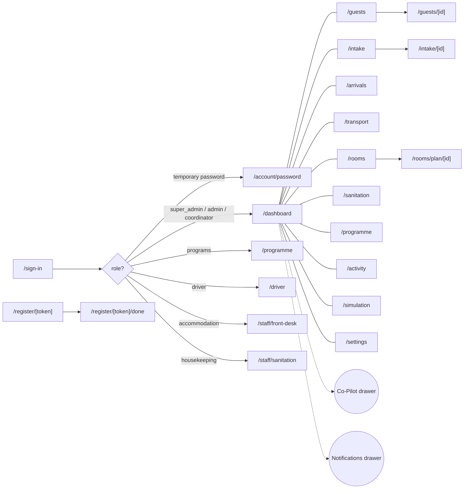

**After sign-in:** users go to their role's home route (`HOME_ROUTES` in `lib/auth/roles.ts`). A user who opens a route their role cannot access is sent to `/forbidden` with a link to their home (the API and RLS block the data either way). A user with `must_change_password` is sent to `/account/password` first.

**Simulated mode:** while `events.flight_mode = simulated`, the console top bar shows a **Simulated** badge (a link to Settings → System for admins) and the staff app shows a strip above each screen (FR-PL-10).

**Deep links:** every notification links to its entity (`/guests/[id]`, `/intake/[id]`, `/dashboard#approvals`, `/driver`, …; `lib/client/labels.ts`).

## 4. Key flows

### F1 — Guest registration (shared link)

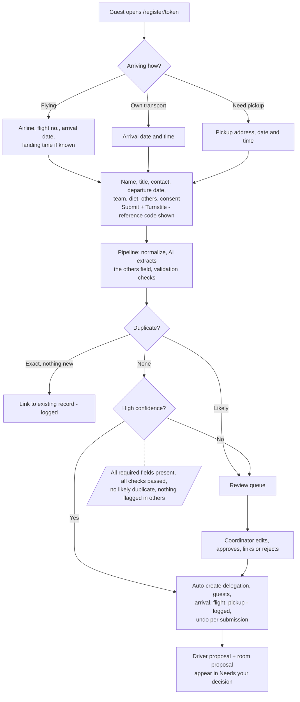

### F2 — Pasted message
1. The coordinator opens **Intake → Paste a message**, pastes the text and presses **Read message**. Nothing is saved.
2. The drawer shows what was found (*Suggested*), what is *Missing* and what is *Uncertain*.
3. **Create draft** saves it as a submission in *Needs review* (the same reading is reused, so the AI is not called twice) and opens the review screen. The coordinator completes the form; **Approve and create** re-checks it and refuses while required fields are missing. Because a person created it, it is never processed automatically.

### F3 — Duplicate review
Side-by-side view: the existing delegation vs the new submission, with differences highlighted. Actions: **Link to existing** (the submission becomes a linked duplicate), **Treat as new** (approve), **Reject**. Nothing is auto-merged. Copying chosen field updates onto the existing delegation is deferred (⏸).

### F4 — Flight delay cascade

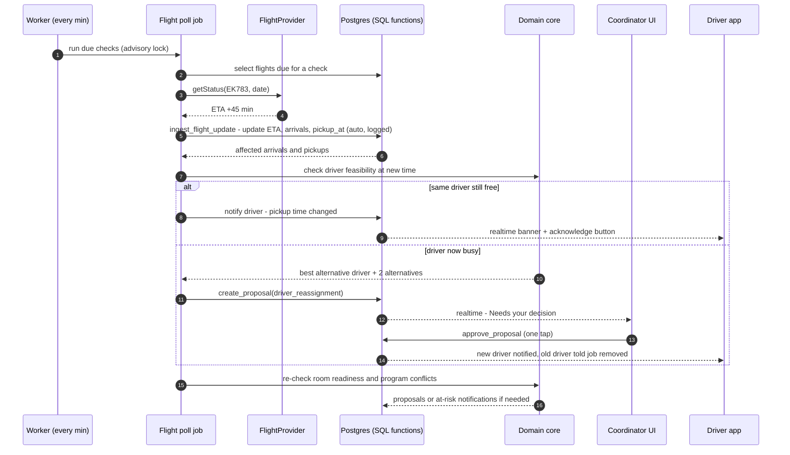

### F5 — Driver trip lifecycle

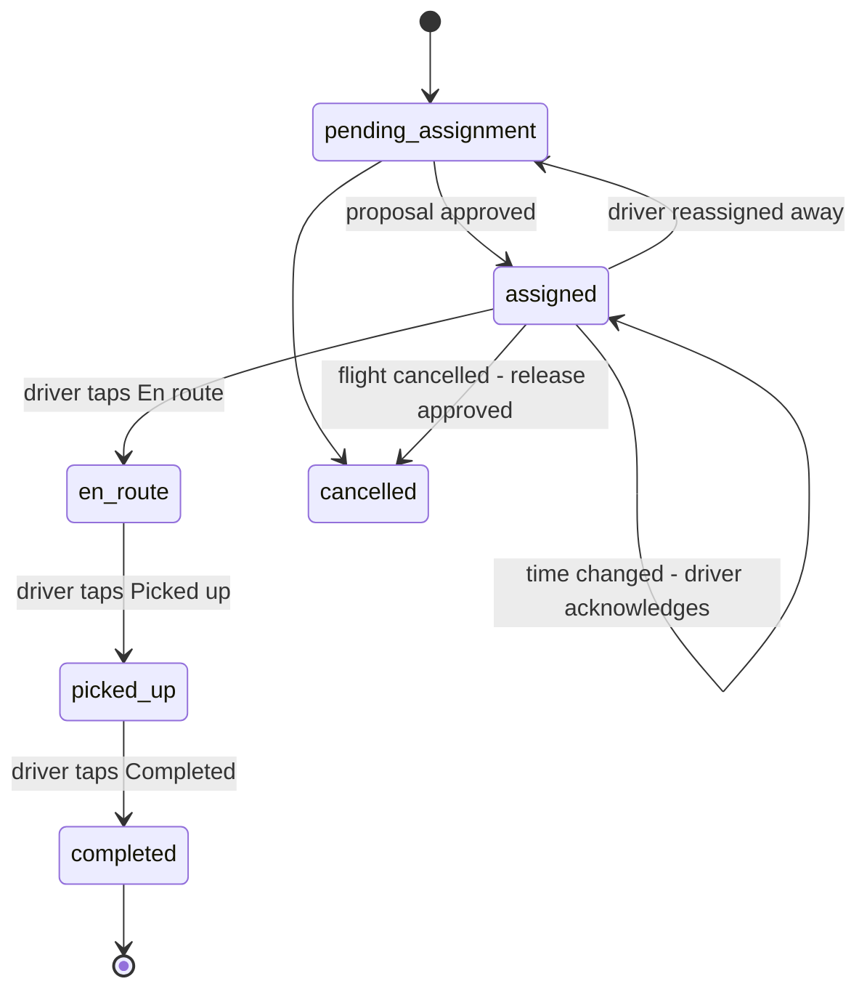

### F6 — Room plan and manual override

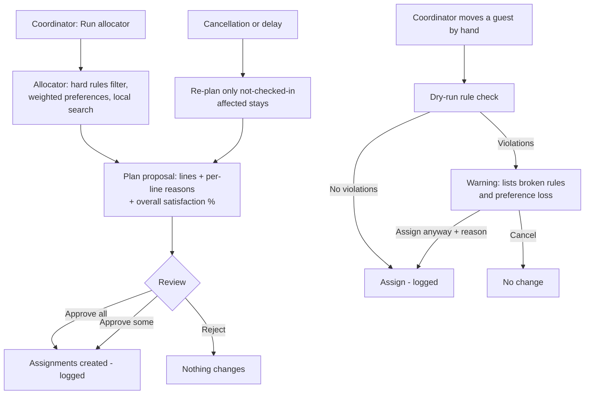

### F7 — Check-in, check-out and cleaning (first confirmation wins)

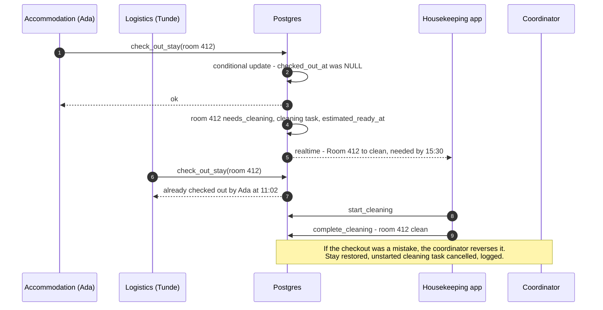

### F8 — Co-Pilot question and action (typed or voice)

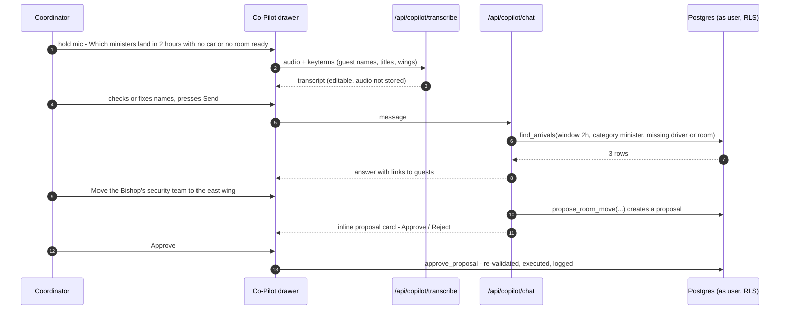

### F9 — Program at risk
1. The programs team publishes "Opening ceremony 10:00" with speakers A, B and C.
2. Speaker B's flight ETA moves, so B's `expected_at_venue_at + lead time` is now later than 10:00.
3. `v_program_conflicts` returns B. The programs team and the coordinator are notified ("Opening ceremony at risk: Speaker B expected 10:20").
4. The programs team adjusts the order or time, or the coordinator acts on transport. The badge clears automatically when the conflict is gone.

### F10 — Undo an automatic action
**Activity** → filter Who: "Automatic" → choose an entry (e.g. "Auto-created delegation from VIP-7K3Q" or "Arrival time changed by flight API") → **Undo** → confirm. The system checks that the record hasn't changed since (`version`). If it has, undo is refused with "Changed since by <who> at <when>; edit manually instead." The undo itself is logged.

### F11 — Simulation demo
**Simulation** → choose a scenario (e.g. "3 flights delayed, 1 cancelled, shared flight") → speed ×60 → **Start**. A banner shows "SIMULATED MODE · virtual time 14:20" on every console screen and staff screen. Worker ticks apply steps through the same `ingest_flight_update` path, so all of F4–F9 happen live. **Stop** ends the run, and the metrics (cascade latency, proposal correctness) are viewable afterwards.

### F12 — First-run setup (Admin)
Settings → **System** (create the event: dates, time zone, airports, buffers) → **Rooms** (room types with cleaning minutes, then rooms by hand or CSV import with a dry run) → **VIP categories** → **Drivers** (vehicles, app logins, shifts) → **Users** (staff accounts with one-time temporary passwords) → **System** → **Open link** → copy the registration link and share it with the secretariats. For local development, `pnpm local:setup` does all of this with demo data.

## 5. Status lifecycles (reference)

**Intake submission**

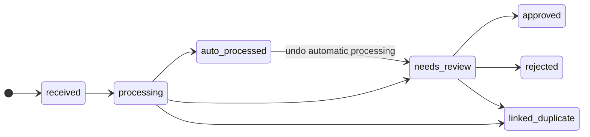

Pasted messages start at `needs_review`.

**Stay (room assignment)**

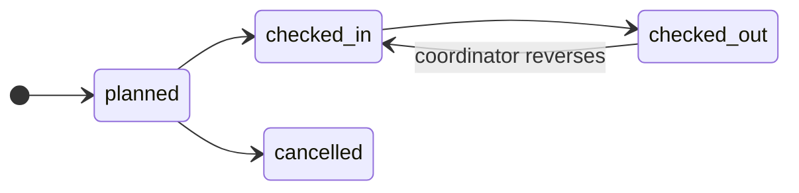

**Cleaning task**

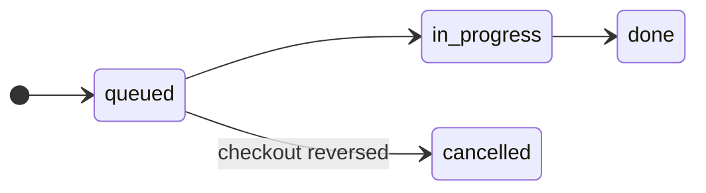

**Proposal**

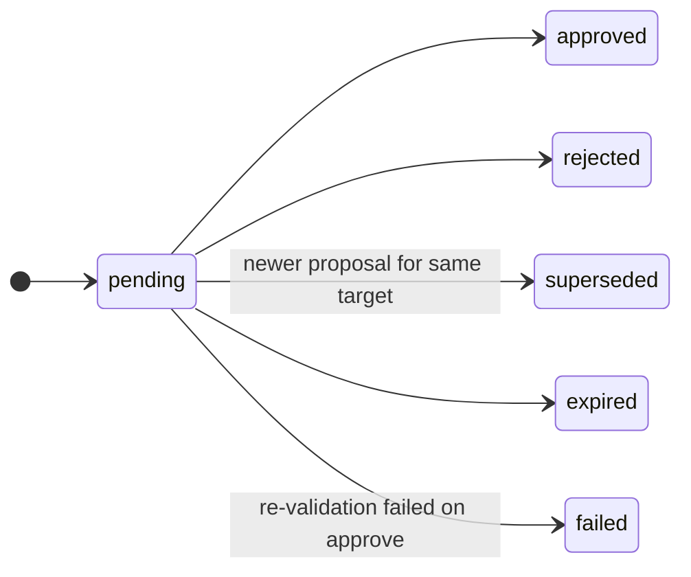
