# 03 — App Flow

**Status:** v3.3, 2026-11-10. Routes follow the Figma Make design (Hostmark). Built: sign-in, password change, dashboard, activity, settings (P1); registration, intake, review, guests and guest profile (P2); arrivals, transport, simulation and the driver app (P3); rooms, the allocation plan, the move dialog and the front desk (P4); check-out and both Sanitation screens (P5); the Programme (P6); the Co-Pilot drawer (P7), shown as **"Ask Victoria"** since 2026-11-10. 2026-11-10: F3 copies chosen updates, the dashboard's "Programme at risk" card, room scenarios and a room what-if in the simulation, Settings → System → Event data (export and purge), "Call coordinator" in the driver app, and items outside the event days on the Programme.

**Related:** requirements in [`01-PRD.md`](01-PRD.md), routes/API in [`05-Backend-Schema.md` §7](05-Backend-Schema.md#7-api-surface-nextjs), visual rules in [`04-UI-UX-Design-Brief.md`](04-UI-UX-Design-Brief.md).

---

## 1. Surfaces

| Surface | Who | Form factor | Shell |
|---|---|---|---|
| **Public intake** | Guests / secretariat (no login) | Mobile-first web form | Minimal: event name, form, confirmation |
| **Console** | Super Admin, Admin, Coordinator, Programs | Desktop/tablet (phone usable for the Co-Pilot) | Sidebar nav, top bar (event clock, simulated-mode banner, decisions badge, notifications, Co-Pilot button) |
| **Staff app** (installable PWA) | Driver, Accommodation & logistics, Housekeeping | Phone | Single screen: task list + one status button per task, notification banner |
| **Co-Pilot panel** | Coordinator, Admin, Super Admin | Right-side drawer (full screen on phone) | Chat, push-to-talk mic, inline proposal cards |

## 2. Screen inventory

Routes follow the Figma Make design ("Hostmark", see [`design/figma-make/`](../design/figma-make/README.md)); every page checks its role on the server (`lib/auth/page-access.ts`) before rendering, and the API and row-level security still decide what data each role gets. Status: ✅ built · 🟨 placeholder ("coming soon" until its phase lands).

### Public
| Route | Screen | Purpose | Status |
|---|---|---|---|
| `/` | Landing page (2026-11-16) | For people not signed in; signed-in staff are sent to their home screen. What Hostmark does, how a late flight is handled, the modules with screenshots, measured results, safeguards, **Request a demo** (`POST /api/demo-requests`) and **Staff sign in** | ✅ |
| `/register/[token]` | Registration form | Four steps (delegation, arrival, party + needs + "anything else", review) with conditional arrival-mode fields, consent, Turnstile when configured; no VIP category | ✅ |
| `/register/[token]/done` | Confirmation | Reference code (copy), summary, "we may contact you" when something needs checking | ✅ |

### Auth
| Route | Screen | Purpose | Status |
|---|---|---|---|
| `/sign-in` | Sign in | Email + password (Better Auth); `?reason=inactive` explains a deactivated account | ✅ |
| `/account/password` | Choose a new password | Forced after a temporary password; also reachable from the account menu | ✅ |
| `/forgot-password` | Forgot password | Email → a 1-hour link; same answer for every address. Only while email is on (otherwise back to sign-in, whose "Forgot password?" says to ask an admin) | ✅ 2026-11-10 |
| `/reset-password?token=…` | Choose your password | Opened from an emailed link (invitation, admin reset, forgot password); then sign in. An expired or used link offers a new one | ✅ 2026-11-10 |
| `/forbidden` | Not part of your role | Link back to the role's home | ✅ |

### Console (sidebar + top bar) — Coordinator, Admin, Programme Manager, Super Admin; Programs sees Programme only
| Route | Screen | Purpose / key actions | Status |
|---|---|---|---|
| `/dashboard` | **Home** | Greeting and data mode, KPI tiles, **Waiting for your approval** (one-tap approve/reject; driver proposals from P3, and an approval that no longer fits says why instead of acting), **Programme at risk** (✅ 2026-11-10: today's published items at risk, who is late and when they are expected; each row opens the Programme), recent activity with Undo, quick actions. With no event to work in (2026-11-14), no tiles: a Programme Manager or Super Admin is pointed to **Events**, other staff are told to ask their Programme Manager to add them | ✅ |
| `/programme` | Programme | Day tabs; timeline (on track / at risk / done, drafts marked) with the at-risk detail (who is late, **Open guest**, **Notify programme team** for coordinators) and each item's participants; at-risk count and venues. Programs team and Admin: **Add item** / **Edit item** dialog (times in the event time zone, participants with roles, publish, cancel, delete). Coordinators read the published programme. Items must start on an event day; items left outside after the event dates change appear under **Outside the event days** (a note with one button per day) so they can be moved or cancelled (✅ 2026-11-10) | ✅ P6 |
| `/guests` | Guests | One row per delegation: arrival, transport, room (the principal's room, "n of m placed", in house, suggested), open issues; tabs, search, category filter; **Add guest** | ✅ |
| `/guests/[id]` | Guest profile | Party (add/remove), arrival, transport, **room** (each member's room or pending suggestion with a link to its plan; **Change room** / **Assign a room** open the move dialog), contact, open issues (Dismiss / Add as guest), history, registrations; **Edit** (category, proximity, share group, dietary, notes) | ✅ |
| `/intake` | Intake | Submissions by reason (needs review, likely duplicates, missing details, flagged, processed); search, source filter; **Paste a message**; copy registration link | ✅ |
| `/intake/[id]` | Review submission | Original vs what was read (editable), checks, VIP category; duplicate side-by-side with **Apply** tickboxes on differing contact, diet and guest rows (F3); approve / link / treat as new / reject; **Undo automatic processing** on processed ones | ✅ |
| `/arrivals` | Arrivals | Day board grouped by hour: landing time (with the old time struck through when it moved), principal, category, party, flight + status (landed / delayed / cancelled / early / time set by hand), pickup status, driver(s) or suggestion chip; next 2 h / 6 h / all day, status, search, day; rows open the guest profile, pickup/driver cells open Transport; a "now" line on today | ✅ P3 |
| `/transport` | Transport | Day tabs; **decision cards** (assign / reassign / release: why, what else changes, alternatives, Approve / Reject; hovering lights the ghost block); **timeline** per driver (done, in progress, assigned, suggested; off-shift shaded; now line) with a "Needs a driver" row whose blocks ask for a suggestion; **driver drawer** (shift, trips, unconfirmed changes) | ✅ P3 |
| `/rooms` | Rooms | Seven status tiles that filter (ready, proposed, reserved, occupied, needs cleaning, cleaning, out of service), wing / floor / guest-or-room filters, building grid by floor × wing, **room inspector** (who is in it or kept for whom and when, or why it is empty; **Move guest**, **Open plan**, **View guest**), **Run allocator** → the plan; "Allocation plan" tab while a plan waits | ✅ P4 |
| `/rooms/plan/[id]` | Allocation plan | Overall satisfaction, guests, lines meeting every preference, lines with warnings; guests no room was found for (with why); one line per guest: room, why, preference match, rules, and the reasons on demand; warning lines start unticked; **Approve selected** / **Approve all** / **Reject plan**; after a decision, the result per line (assigned / not applied with the reason / not chosen) | ✅ P4 |
| `/sanitation` | Sanitation | Summary (not started, in progress, clean today); Queue / Done today tabs; queue in priority order with checked-out time, live ready estimate, "Ready N min after it is needed", needed by, problems housekeeping reported; **Reverse check-out** (confirm dialog) while cleaning has not started | ✅ P5 |
| `/activity` | Activity | Audit log by day with who/type filters, sentence + field changes, **Undo** on automatic changes | ✅ |
| `/simulation` | Simulation | **What-if preview** (flight delay ± minutes; driver unavailable from a time; ✅ 2026-11-10 room out of service, for rooms with guests): what would move, who keeps a trip or a room, decisions and conflicts — nothing written. **Scripted scenarios** (7, 1×–600×, simulated mode only) replay changes through the live services, with progress and a simulated clock: five flight scenarios and (✅ 2026-11-10) **Room out of service** and **Extra guests**. "Send to Co-Pilot" is not built | ✅ P3, rooms 2026-11-10 |
| `/settings?tab=` | Settings | **Users** (invite with one-time temporary password, role, reset, deactivate), **Rooms** (room types, rooms, CSV import with dry run), **Drivers** (vehicles, app login, shifts), **VIP categories** (rank order), **System** (event incl. the coordination desk phone, registration link, flight data mode; for a Super Admin, **Event data**: export and post-event purge, F13). Coordinators see VIP categories only; Programme Managers see every tab (P9). With no event to work in, **System** points to the Events page. Taking a room out of service (by hand or by CSV) re-plans its stays: move proposals, or alerts | ✅ |

| `/events` | Events (P9 9.4, Programme Manager and Super Admin) | The events they manage (a Super Admin: all), each with dates, status (Draft / Live / Archived), team size and, for a Super Admin, its Programme Manager. **New event** (a draft), **Work in this event**, **Team** (tick staff), **Copy setup** (drafts: settings, rooms, VIP categories, drivers, staff from an earlier event), **Go live** (one live event per manager), **Archive** (confirmed; read-only for good) | ✅ branch |

The **event switcher** (top bar, P9 9.4) shows the event the screen works in, labelled Draft or Archived when it is not live; someone on several events opens it to pick another, which reopens their home screen in that event.

The **Co-Pilot** drawer (top bar, coordinator+; ✅ P7: suggested questions, answers with linked records, "Suggested" cards with Approve / Dismiss, hold-to-talk where the browser supports speech) and the **notifications** drawer (everyone) open over any console screen. The decisions queue lives on the dashboard (`/dashboard#approvals`) rather than on a separate page.

### Staff app (phone)
| Route | Role | Screen | Status |
|---|---|---|---|
| `/driver` | Driver | My pickups (today / tomorrow): the current or next trip big with live flight status and one button (Start pickup → Picked up → Dropped off), "Time changed from …" / "New pickup" with **Got it**, later / moved / done lists, trip details sheet (destination, pickup point, passengers, flight), **Call coordinator** (✅ 2026-11-10: a phone link on the current trip, the quiet day and the trip sheet; hidden when Settings has no desk phone), notifications, sign out | ✅ P3 |
| `/staff/front-desk` | Accommodation (and coordinator+) | Arriving / In house / Leaving tabs, search by guest or room; one card per party (the principal's room on the key tag, category, expected / checked-in / departure time, on the way / expected / room not ready, the party's rooms); **Check in** with a confirm sheet, then **Undo** in the toast (10 min); a second confirmation is told who checked the party in and when; a room still being cleaned keeps the button off ("Housekeeping is on it."); offline banner. **Check out** on In house and Leaving with a confirm sheet ("The room goes to housekeeping."); a lost race is told who checked the party out | ✅ P4, check-out ✅ P5 |
| `/staff/sanitation` | Housekeeping | Summary and progress bars; rooms to clean in priority order (in progress first), then today's done rooms; **Start cleaning** → **Mark ready** (confirm sheet, Undo in the toast); **Report a problem** (maintenance / missing supplies / other + note); Profile tab with sign out; offline banner. Never shows guest names | ✅ P5 |

## 3. Navigation map

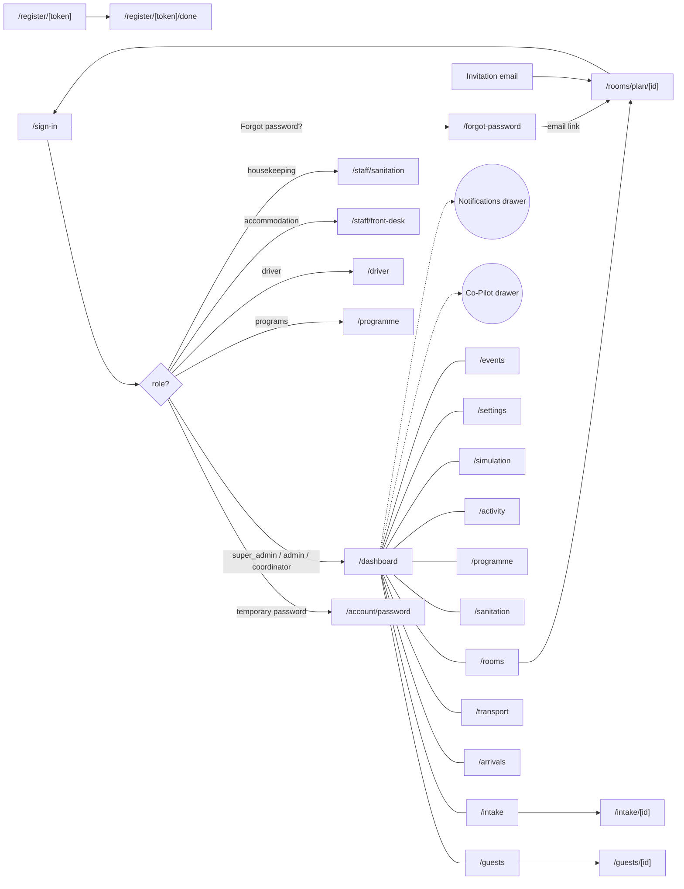

**After sign-in:** users go to their role's home route (`HOME_ROUTES` in `lib/auth/roles.ts`). A user who opens a route their role cannot access is sent to `/forbidden` with a link to their home (the API and RLS block the data either way). A user with `must_change_password` is sent to `/account/password` first.

**Simulated mode:** while `events.flight_mode = simulated`, the console top bar shows a **Simulated** badge (a link to Settings → System for admins) and the staff app shows a strip above each screen (FR-PL-10).

**Deep links:** every notification links to its entity (`/guests/[id]`, `/intake/[id]`, `/dashboard#approvals`, `/driver`, …; `lib/client/labels.ts`), but only to a screen the reader's role can open; otherwise it is read in place (2026-11-10).

## 4. Key flows

### F1 — Guest registration (shared link)

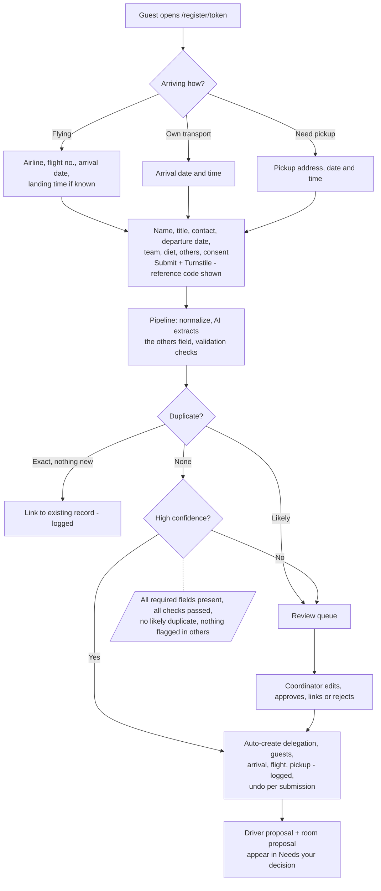

### F2 — Pasted message
1. The coordinator opens **Intake → Paste a message**, pastes the text and presses **Read message**. Nothing is saved.
2. The drawer shows what was found (*Suggested*), what is *Missing* and what is *Uncertain*.
3. **Create draft** saves it as a submission in *Needs review* (the same reading is reused, so the AI is not called twice) and opens the review screen. The coordinator completes the form; **Approve and create** re-checks it and refuses while required fields are missing. Because a person created it, it is never processed automatically.

### F3 — Duplicate review
Side-by-side view: the existing delegation vs the new submission, with differences highlighted. Actions: **Link to existing** (the submission becomes a linked duplicate), **Treat as new** (approve), **Reject**. Nothing is auto-merged. ✅ 2026-11-10: while the submission is open, differing rows offer an **Apply** tickbox — new contact details, new dietary needs (added to the principal's), extra guests (only when the new party is larger). **Link to existing** copies only what is ticked onto the existing delegation; nothing is removed, and arrival details are never copied (flight times come from flight tracking; moving a party to another flight is a separate change).

### F4 — Flight delay cascade

```mermaid
sequenceDiagram
  autonumber
  participant W as Worker (lease; every min)
  participant FP as FlightProvider
  participant Ing as ingestFlightUpdate (one transaction)
  participant Plan as Cascade planner (pure)
  participant DB as Postgres
  participant Coord as Coordinator UI
  participant Drv as Driver app

  W->>DB: flights due for a check (someone still expected on them)
  W->>FP: getStatus(EK783, date) (outside any transaction; live calls counted)
  FP-->>W: ETA +45 min
  W->>Ing: snapshot
  Ing->>DB: lock flight, diff, update times and next check, record flight_updates
  Ing->>Plan: flight, parties, pickups, drivers, shifts, live and held trips
  Plan-->>Ing: new venue ETAs, moved pickups, kept drivers, proposals, alerts
  Ing->>DB: move pickups (previous time kept), withdraw suggestions for the old time
  alt same driver can still make it
    Ing->>DB: keep the trip, ask the driver to confirm, notify
    DB-->>Drv: live: "Time changed from 14:10" + Got it
  else driver now busy
    Ing->>DB: create_proposal(driver_reassignment) - the proposed driver is held
    DB-->>Coord: live: decision card on Transport and the dashboard
    Coord->>DB: approve_proposal (re-checks shift, overlap, seats)
    DB-->>Drv: new driver notified, old driver told the trip moved
  else nobody free
    Ing->>DB: alert coordinators
  end
  Note over Ing,DB: cascade_ms = ingestion to cascade done (PRD M2)
```

✅ P4: the cascade also moves the party's planned stays to the new arrival time and, when a room no longer works for it (not cleanable in time, or someone else's stay now overlaps), proposes another room or alerts the coordinators (F6). Programme conflicts (P6) join in their phase. A coordinator's manual landing time and the simulation's scripted steps enter at `ingestFlightUpdate` too.

### F5 — Driver trip lifecycle

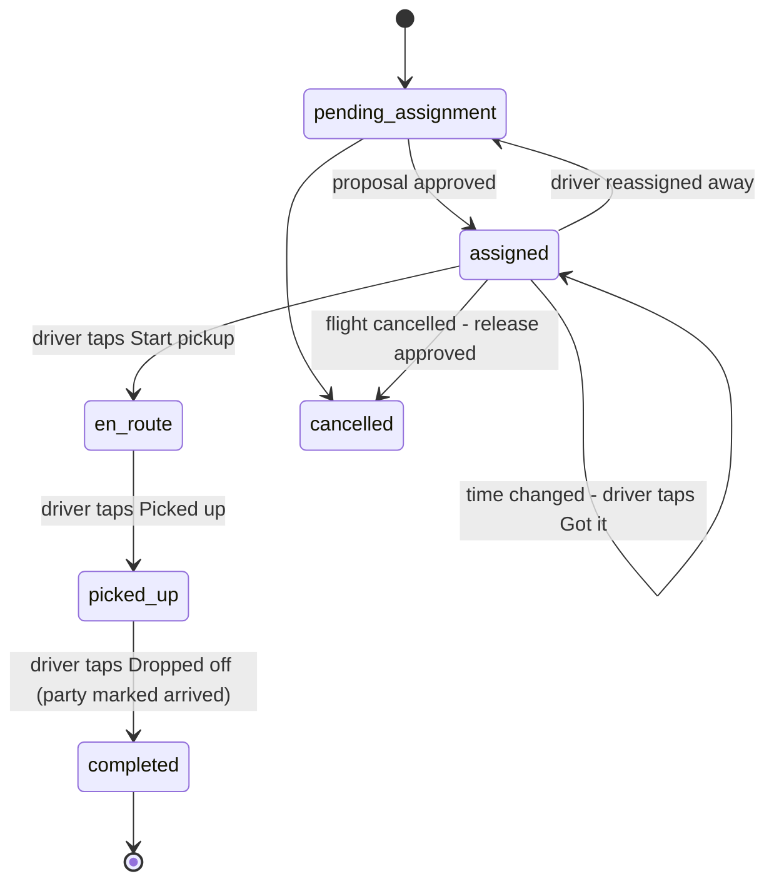

### F6 — Room plan and manual override

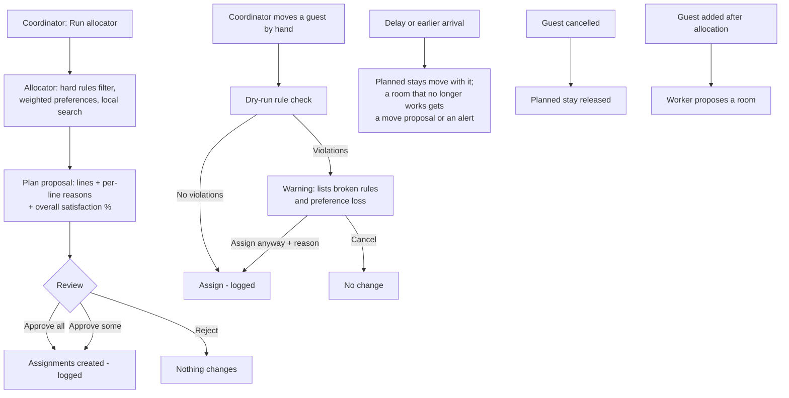

Notes (✅ P4): "Assign anyway" needs every warning acknowledged and a reason of at least 10 characters; if something changed since the warning was shown, the dialog refreshes with what is true now. A suggestion or plan line is checked again at approval **for the guest's stay as it is then**, and fails with its reason if a rule no longer holds. Checked-in guests are never moved by the allocator; a coordinator may move one by hand (warned), which checks the old room out and continues the stay in the new one.

### F7 — Check-in, check-out and cleaning (first confirmation wins)

✅ P4 builds the check-in half: `check_in_party` checks the whole party in at once, the second confirmation gets "Already checked in by Tolu at 14:05", a room not ready or still occupied by someone else refuses with the room numbers, and Undo works for 10 minutes. ✅ P5 builds the checkout and cleaning half below as drawn, with two refinements: the cleaning task is created by a trigger on any check-out that empties a room (so moving a checked-in guest queues their old room too), and a reversal is refused once cleaning has started or when more than one party's stays are on the task.

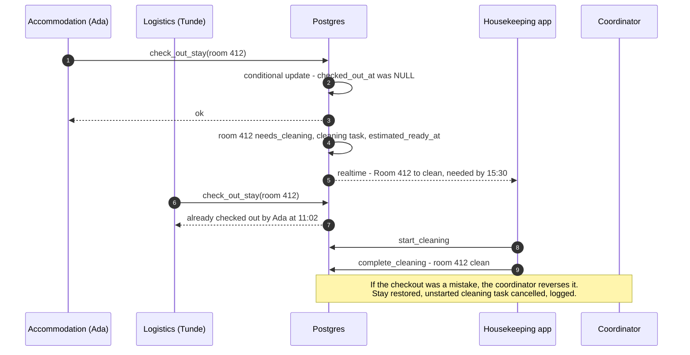

### F8 — Co-Pilot question and action (typed or voice)

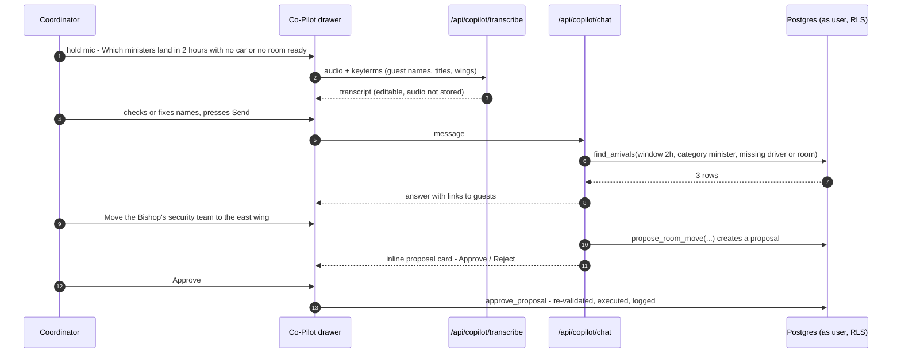

### F9 — Program at risk
1. The programs team publishes "Opening ceremony 10:00" with speakers A, B and C.
2. Speaker B's flight ETA moves, so B's `expected_at_venue_at + lead time` is now later than 10:00.
3. `v_program_conflicts` returns B. The programs team and the coordinator are notified ("Opening ceremony at risk: Speaker B expected 10:20").
4. The programs team adjusts the order or time, or the coordinator acts on transport. The badge clears automatically when the conflict is gone.

✅ P6 builds this as drawn. `v_program_conflicts` is the function `private.program_item_risks`, and triggers on arrivals, guests, items and participants re-check it, so step 2 needs no polling. The coordinator can also press **Notify programme team** once per risk.

### F10 — Undo an automatic action
**Activity** → filter Who: "Automatic" → choose an entry (e.g. "Auto-created delegation from VIP-7K3Q" or "Arrival time changed by flight API") → **Undo** → confirm. The system checks that the record hasn't changed since (`version`). If it has, undo is refused with "Changed since by <who> at <when>; edit manually instead." The undo itself is logged.

### F11 — Simulation demo
**Simulation** → choose a scenario (e.g. "3 flights delayed, 1 cancelled, shared flight") → speed ×60 → **Start**. A banner shows "SIMULATED MODE · virtual time 14:20" on every console screen and staff screen. Worker ticks apply steps through the same `ingest_flight_update` path, so all of F4–F9 happen live. **Stop** ends the run, and the metrics (cascade latency, proposal correctness) are viewable afterwards.

✅ 2026-11-10: two room scenarios. **Room out of service** takes the room of the next guest due in out of service, as an Admin would; its stays get a move proposal, or the coordinators an alert when no room fits or the guest is checked in. **Extra guests** adds two unnamed companions to the next delegation due in that has rooms; they join the party and its pickup, and the worker suggests rooms for them within a minute. A run fixes its rooms and delegations when it starts, like its flights; without enough of them it does not start ("Approve some room assignments first").

### F12 — First-run setup (Programme Manager or Super Admin, then Admin)
**Events** → **New event** (dates, time zone, airports, buffers; it starts as a draft) → **Work in this event** → Settings → **Rooms** (room types with cleaning minutes, then rooms by hand or CSV import with a dry run) → **VIP categories** → **Drivers** (vehicles, app logins, shifts) → **Users** (staff accounts with one-time temporary passwords) → **System** → **Open link** → copy the registration link and share it with the secretariats. For local development, `pnpm local:setup` does all of this with demo data.

### F14 — Running several events (P9) ✅ on branch `feat/multi-event`
1. A Programme Manager opens **Events** → **New event**: a draft owned by them, while their live event keeps running.
2. **Copy setup** from last year's event (rooms, VIP categories, drivers, settings, staff), then **Team** to add or remove people. Only accounts that work on no other manager's event are offered.
3. **Work in this event** to finish its setup in Settings; staff on both events pick it in the top-bar switcher.
4. When the old event is over: **Archive** it (read-only, registration link closed), then **Go live** on the new one. Another Programme Manager runs their own live event at the same time; neither team sees the other's data.

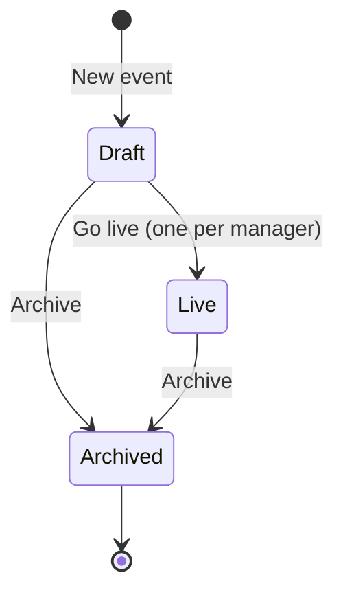

### F13 — Event data export and purge (Super Admin) ✅ 2026-11-10
Settings → **System** → **Event data**.
1. **Download export** saves the event's operational data as a JSON file (guests, arrivals, pickups, rooms, programme, cleaning; no accounts). Each export is recorded in Activity.
2. **Guest personal data**: the button stays off until the event's last day is over (in the event time zone). After that, **Remove guest personal data** opens a confirmation that asks for the event name.
3. On confirm, names become pseudonyms and contact details, diets, notes, registrations and Co-Pilot questions are removed; counts, times, rooms and statuses stay for reporting. One "event.purge" entry appears in Activity. The server applies the same rules, whatever the screen shows.

## 5. Status lifecycles (reference)

**Intake submission**

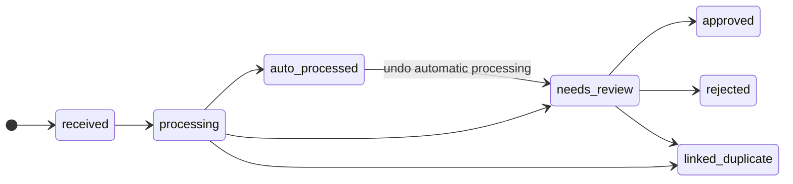

Pasted messages start at `needs_review`.

**Stay (room assignment)**

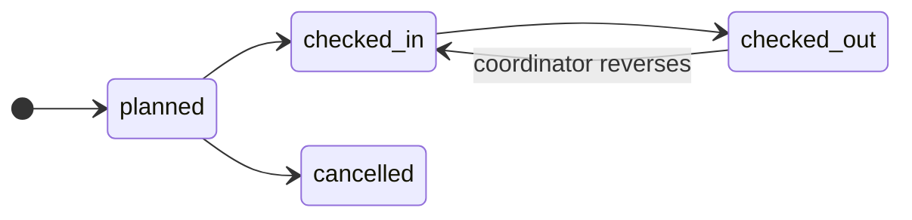

**Cleaning task**

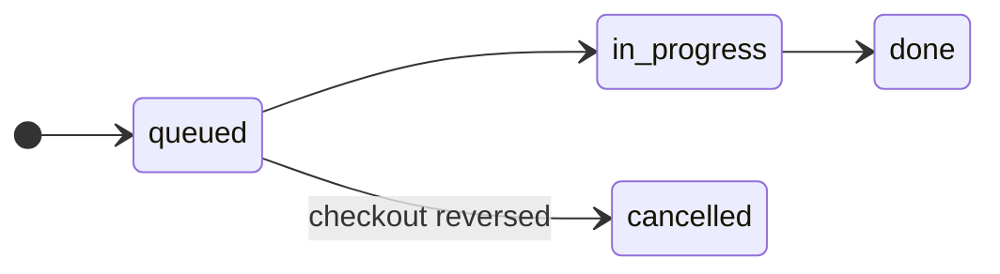

**Proposal**

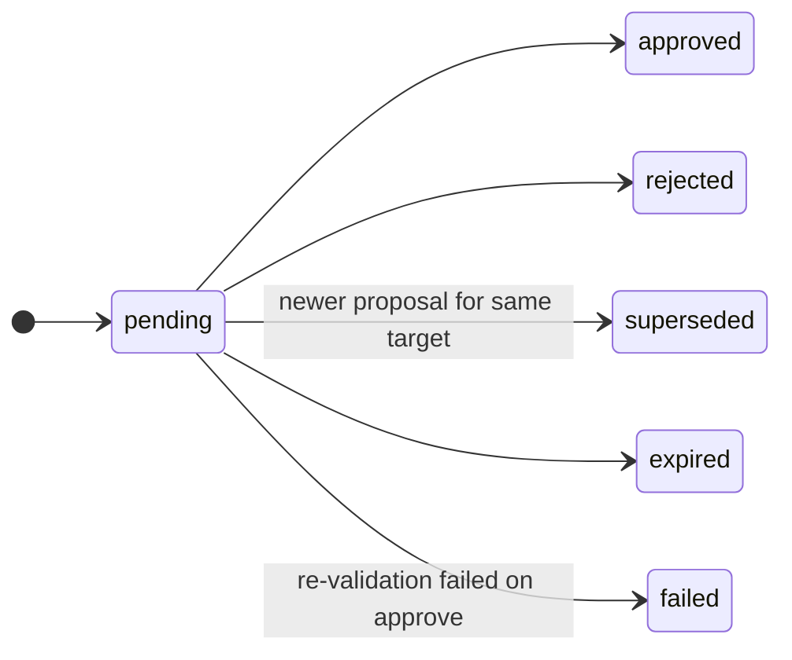
