# 03 — App Flow

**Status:** Draft v1, 2026-10-12. Planned screens, none built yet.

**Related:** requirements in [`01-PRD.md`](01-PRD.md), routes/API in [`05-Backend-Schema.md` §7](05-Backend-Schema.md#7-api-surface-nextjs), visual rules in [`04-UI-UX-Design-Brief.md`](04-UI-UX-Design-Brief.md).

---

## 1. Surfaces

| Surface | Who | Form factor | Shell |
|---|---|---|---|
| **Public intake** | Guests / secretariat (no login) | Mobile-first web form | Minimal: event name, form, confirmation |
| **Console** | Super Admin, Admin, Coordinator, Programs | Desktop/tablet (phone usable for the Co-Pilot) | Sidebar nav, top bar (event clock, simulated-mode banner, decisions badge, notifications, Co-Pilot button) |
| **Staff app** (installable PWA) | Driver, Accommodation & logistics, Housekeeping | Phone | Single screen: task list + one status button per task, notification banner |
| **Co-Pilot panel** | Coordinator, Admin, Super Admin | Right-side drawer (full screen on phone) | Chat, push-to-talk mic, inline proposal cards |

## 2. Screen inventory

### Public
| Route | Screen | Purpose |
|---|---|---|
| `/intake/[token]` | Intake form | Conditional fields by "How are you arriving?", team members, diet, others, consent, Turnstile |
| `/intake/[token]/done` | Confirmation | Reference code, what happens next |
| `/intake/closed` | Closed/invalid link | Plain message with a contact line |

### Auth
| Route | Screen | Purpose |
|---|---|---|
| `/login` | Sign in | Email + password |
| `/account/password` | Change password | Forced on first sign-in |

### Console — Coordinator (also Admin, Super Admin)
| Route | Screen | Purpose / key actions |
|---|---|---|
| `/dashboard` | **Home** | ① **Needs your decision** (proposals + review items, one-tap approve/reject) ② **Next 6 hours** arrivals timeline (flight phase, delay badge, pickup and room readiness) ③ Alerts (program at risk, flights unknown, quota warnings) ④ Counters |
| `/decisions` | Decisions queue | Full list of pending proposals and review items. Filters by kind. Bulk approve plans. |
| `/guests` | Guests | Table of delegations/guests: filters (VIP category, arrival mode, status, missing driver, no room, needs attention) |
| `/guests/[id]` | Guest / delegation detail | Profile, members (add/rename placeholders, member role, proximity priority, share groups), VIP category, requirements, arrival(s) + flight, pickup + driver, room(s), program participation, history (audit) |
| `/intake-review` | Intake review | Submissions needing review: issues list, AI-extracted items, duplicate side-by-side. Approve (with edits) / link / reject. **Paste a message** tool. |
| `/flights` | Flight board | All tracked flights: phase, scheduled vs estimated, delay, guests on board, last checked. Refresh, override time. |
| `/transport` | Transport board | Pickups timeline by driver (lanes) + an unassigned lane. Propose/assign driver. Driver shifts. |
| `/rooms` | Room plan | Grid by floor × wing with room status and occupants. Unallocated guests tray. **Run allocator** → plan review. Drag or pick to move (with rule check). |
| `/rooms/plan/[proposalId]` | Plan review | Per-line assignments with score breakdown, overall satisfaction %. Approve all/selected. |
| `/housekeeping` | Cleaning overview | Same queue housekeeping sees, plus estimates vs needed-by |
| `/program` | Program timeline | Read-only for the coordinator. At-risk items highlighted. |
| `/activity` | Activity log | Audit log, filters, **Undo** on automatic entries |
| `/simulation` | Simulation | Scenarios list, start/stop a run, speed, live event feed |

### Console — Programs team
| Route | Screen | Purpose |
|---|---|---|
| `/program` | Program editor | Timeline + list. Create/edit/publish items. At-risk badges. |
| `/program/[id]` | Program item | Details, participants (search guests), each participant's arrival status and at-risk reason |

### Console — Admin (also Super Admin)
| Route | Screen | Purpose |
|---|---|---|
| `/admin/event` | Event settings | Dates, timezone, airports, buffers, intake link (open/close/regenerate/copy) |
| `/admin/venue` | Venue | Wings, floors, room types (tier, capacity, cleaning minutes), rooms (CSV import, out of service) |
| `/admin/drivers` | Drivers | Drivers, vehicles, shifts, linked logins |
| `/admin/vip-categories` | VIP categories | Ordered rank list (coordinators can also edit) |
| `/admin/users` | Users | Create (temporary password), role, deactivate. Only Super Admin can manage Admin/Super Admin accounts. |
| `/admin/system` | System (**Super Admin only**) | Flight provider mode (live/simulated), provider status and quota, AI usage, data export, post-event purge |

### Staff app
| Route | Role | Screen | Single status button |
|---|---|---|---|
| `/driver` | Driver | My pickups (next first): time, guest title + name, flight + live status, pickup point, passengers, changes highlighted | Acknowledge change → En route → Picked up → Completed |
| `/accommodation` | Accommodation & logistics | Today's arrivals (expected time, room(s), readiness) and in-house guests | **Check in** / **Check out** (first wins) |
| `/cleaning` | Housekeeping | Prioritized rooms: number, floor/wing, type, needed by, estimated ready | Start → Done |

## 3. Navigation map

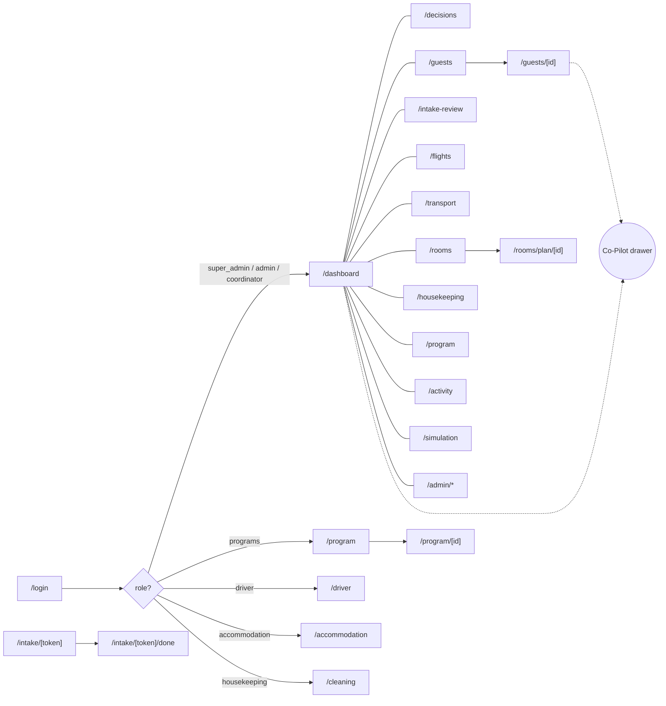

**After sign-in:** users go to their role's home route. A user who opens a route their role cannot access gets a 403 page with a link to their home (RLS blocks the data either way). A user with `must_change_password` is sent to `/account/password` first.

**Deep links:** every notification links to its entity (`/guests/[id]`, `/decisions?focus=<proposal>`, `/driver#<pickup>`, …).

## 4. Key flows

### F1 — Guest intake (shared link)

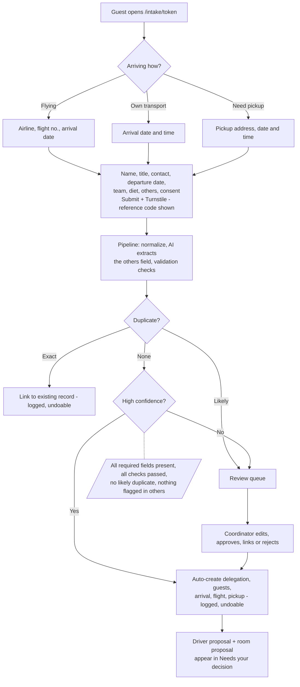

### F2 — Pasted message
1. The coordinator opens **Intake review → Paste a message**, pastes the text and presses **Extract**.
2. The AI returns a draft in the same shape as the form, with missing fields highlighted and extracted items listed.
3. The coordinator completes or corrects the draft and presses **Create**. It then goes through validation and duplicate checks. Because a human created it, it never auto-processes silently: the coordinator sees the issues before confirming.

### F3 — Duplicate review
Side-by-side view: the existing delegation vs the new submission, with differences highlighted. Actions: **Link** (the submission becomes a linked duplicate; optionally apply chosen field updates), **Treat as new**, **Reject**. Nothing is auto-merged.

### F4 — Flight delay cascade

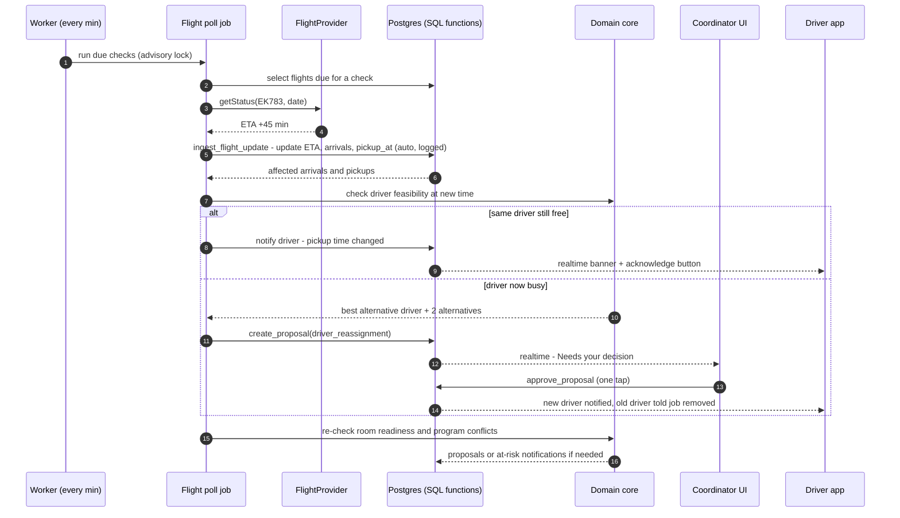

### F5 — Driver trip lifecycle

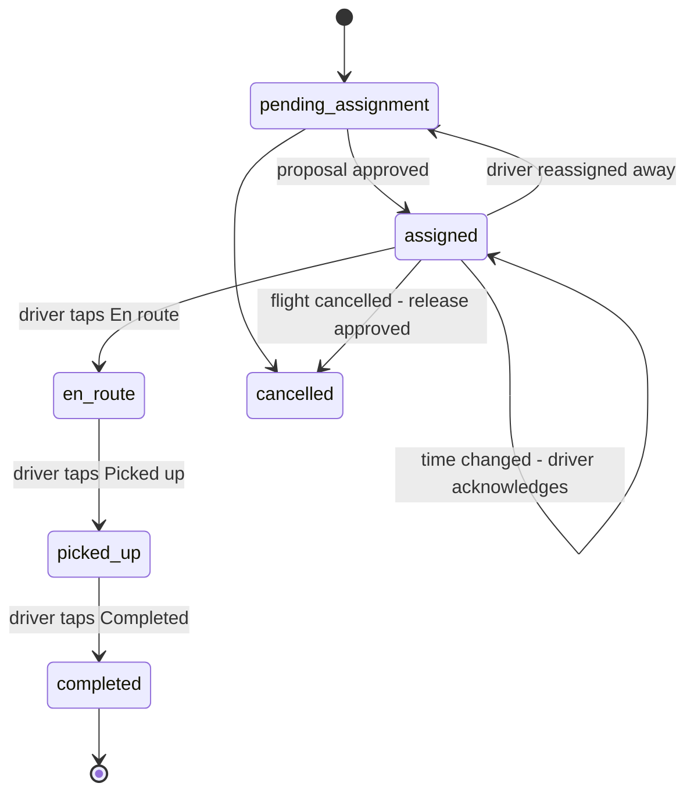

### F6 — Room plan and manual override

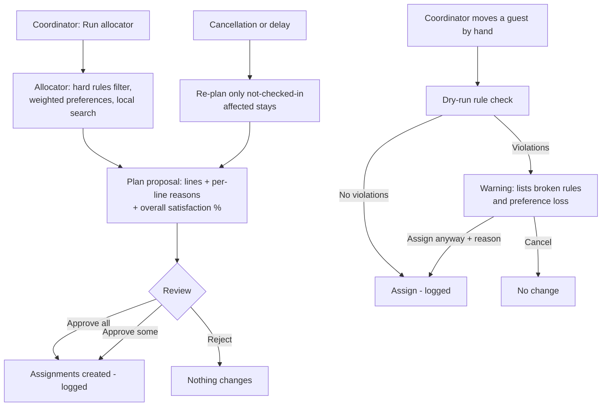

### F7 — Check-in, check-out and cleaning (first confirmation wins)

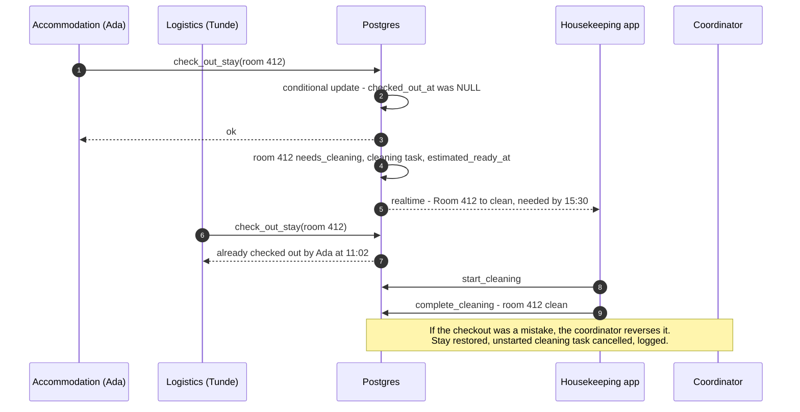

### F8 — Co-Pilot question and action (typed or voice)

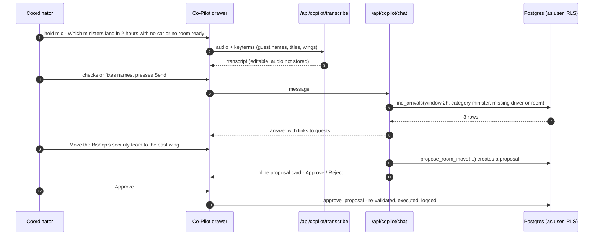

### F9 — Program at risk
1. The programs team publishes "Opening ceremony 10:00" with speakers A, B and C.
2. Speaker B's flight ETA moves, so B's `expected_at_venue_at + lead time` is now later than 10:00.
3. `v_program_conflicts` returns B. The programs team and the coordinator are notified ("Opening ceremony at risk: Speaker B expected 10:20").
4. The programs team adjusts the order or time, or the coordinator acts on transport. The badge clears automatically when the conflict is gone.

### F10 — Undo an automatic action
**Activity** → filter "Automatic" → choose an entry (e.g. "Auto-created delegation from VIP-7K3Q" or "Arrival time changed by flight API") → **Undo** → confirm. The system checks that the record hasn't changed since (`version`). If it has, undo is refused with "Changed since by <who> at <when>; edit manually instead." The undo itself is logged.

### F11 — Simulation demo
**Simulation** → choose a scenario (e.g. "3 flights delayed, 1 cancelled, shared flight") → speed ×60 → **Start**. A banner shows "SIMULATED MODE · virtual time 14:20" on every console screen and staff screen. Worker ticks apply steps through the same `ingest_flight_update` path, so all of F4–F9 happen live. **Stop** ends the run, and the metrics (cascade latency, proposal correctness) are viewable afterwards.

### F12 — First-run setup (Admin)
`/admin/event` (dates, timezone, airports, buffers) → `/admin/venue` (room types with cleaning minutes → rooms CSV import) → `/admin/vip-categories` → `/admin/drivers` (drivers, vehicles, shifts) → `/admin/users` (create staff accounts) → `/admin/event` **Open intake** → copy the link and share it with the secretariats.

## 5. Status lifecycles (reference)

**Intake submission**

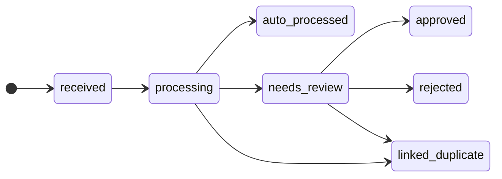

**Stay (room assignment)**

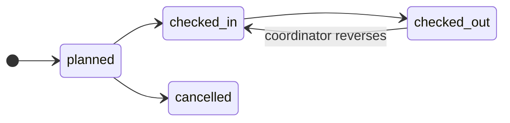

**Cleaning task**

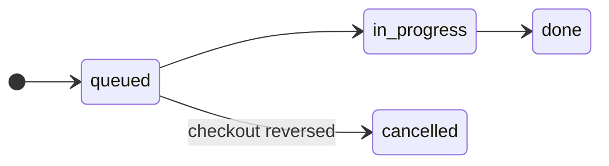

**Proposal**

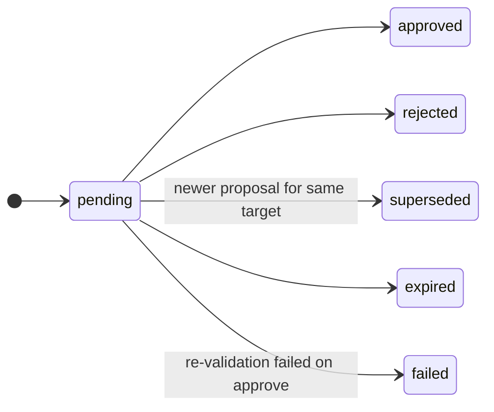
