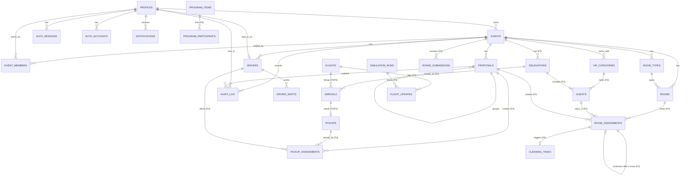

# 05 — Backend Schema & API Surface

**Status:** v2.5, 2026-11-10. **P1–P7 tables are built** (`db/migrations/20261016100000…100400`, `20261019100000_guests_intake.sql`, `20261020100000_flights_transport.sql`, `20261021100000_rooms_allocation.sql`, `20261027100000_turnaround_cleaning.sql`, `20261027110000_programme.sql`, `20261027120000_copilot.sql`) and covered by tests. 2026-11-10 follow-ups: `20261110100000_coordinator_phone.sql` (`events.coordinator_phone`, `get_event_context`), `20261110110000_programme_rechecks.sql` (lead-time trigger), `20261110120000_event_data_purge.sql` (export and purge) and `20261110130000_simulation_rooms.sql` (`simulation_runs.room_ids` / `delegation_ids`). Anything not built is marked as planned. Update this file in the same change as any migration.

**Database:** PostgreSQL 18, self-hosted on the droplet (see [`02-TRD.md`](02-TRD.md) §5). Extensions: `btree_gist` (P1), `pg_trgm` (P2, duplicate detection).

**Conventions:**
- `uuid` primary keys (`gen_random_uuid()`), except the append-only `audit_log` (`bigint` identity).
- All times are `timestamptz` (UTC, displayed in `events.timezone`). `date` columns travel as `YYYY-MM-DD` strings end to end.
- `snake_case` everywhere, including API JSON.
- `created_at` and `updated_at` on every mutable table (`updated_at` maintained by a trigger).
- A `version int` column, bumped by a trigger, on records edited concurrently (`delegations`, `arrivals`, `guests`, `pickups`; optimistic locking).
- Every business table carries `event_id`, defaulting to `private.current_event_id()`. **Since P9 step 9.1 (2026-11-11, branch `feat/multi-event`)** an installation may hold several events: `current_event_id()` returns the event chosen for the request (`app.event_id`, set per transaction like `app.user_id`) and, while none is chosen, falls back to the live event (or the oldest one). Isolation between events is enforced by the database (step 9.2, §6), references between tables stay inside one event (step 9.6, §6), and events are created, taken live, archived and staffed from the Events page (step 9.4).
- Every business table has the `audit_row_change` trigger and row-level security (§6).

---

## 1. Entity-relationship overview

Relationships marked P5 or later are planned; the rest are built (P1–P4).

**Core idea (unchanged):** a **delegation** is the VIP plus their entourage; an **arrival** is a party travelling together; a **flight** is tracked once and shared; a **pickup** belongs to an arrival; rooms are allocated **per guest** through `room_assignments`.

## 2. Enumerated types

| Type | Values | Status |
|---|---|---|
| `app_role` | `super_admin`, `programme_manager` (✅ P9 step 9.1), `admin`, `coordinator`, `programs`, `driver`, `accommodation`, `housekeeping` | ✅ |
| `actor_type` | `user`, `system`, `copilot`, `guest_intake` | ✅ |
| `housekeeping_status` | `clean`, `needs_cleaning`, `cleaning` | ✅ |
| `proposal_kind` | `room_plan`, `room_assignment`, `driver_assignment`, `driver_reassignment`, `release_pickup`, `copilot_action` | ✅ |
| `proposal_status` | `pending`, `approved`, `rejected`, `superseded`, `expired`, `failed` | ✅ |
| `arrival_mode` | `flying`, `own_transport`, `pickup` | P2 |
| `submission_source` | `form`, `pasted_message` | P2 |
| `submission_status` | `received`, `processing`, `auto_processed`, `needs_review`, `approved`, `rejected`, `linked_duplicate` | P2 |
| `duplicate_kind` | `none`, `exact`, `likely` | P2 |
| `member_role` | `principal`, `assistant`, `security`, `performer`, `representative`, `family`, `other` | P2 |
| `proximity_priority` | `high`, `normal`, `low` | P2 |
| `guest_status` | `expected`, `arrived`, `checked_in`, `checked_out`, `cancelled` | P2 |
| `flight_phase` | `scheduled`, `in_air`, `landed`, `cancelled`, `diverted`, `unknown` | ✅ P2 |
| `pickup_kind` | `airport`, `location` | ✅ P2 |
| `pickup_status` | `pending_assignment`, `assigned`, `en_route`, `picked_up`, `completed`, `cancelled` | ✅ P2 |
| `flight_update_source` | `live`, `simulated`, `manual` | ✅ P3 |
| `assignment_status` | `active`, `released` (moved to another driver or the pickup released), `completed` | ✅ P3 |
| `stay_status` | `planned`, `checked_in`, `checked_out`, `cancelled` | ✅ P4 |
| `cleaning_status` | `pending`, `in_progress`, `done`, `cancelled` | ✅ P5 |
| `cleaning_problem` | `maintenance`, `supplies`, `other` | ✅ P5 |
| `program_item_status` | `draft`, `published`, `cancelled` | ✅ P6 |
| `program_item_kind` | `session`, `ceremony`, `meal`, `performance`, `other` | ✅ P6 |
| `program_role` | `speaker`, `honoree`, `performer`, `attendee` | ✅ P6 |
| `participant_role` | `speaker`, `honoree`, `performer`, `attendee`, `other` | P6 |

## 3. Tables

### 3.1 Event, accounts and auth — ✅ built (P1)

**`events`**: one row per event. Until P9 a unique index on a constant allowed only one; migration `20261111100100_multi_event.sql` dropped it (the existing event became `live`, owned by the longest-standing active Super Admin).

| Column | Type | Notes |
|---|---|---|
| id | uuid PK | |
| name, venue_name | text | 1–200 characters |
| timezone | text | IANA name, validated against `pg_timezone_names`; default `UTC` |
| starts_on, ends_on | date | `ends_on ≥ starts_on` |
| arrival_airports | text[] | IATA codes (`^[A-Z]{3}$`) used in validation |
| intake_token | text unique | 32 hex chars (122 random bits). Not writable by the API; changed only by `regenerate_intake_token()`. |
| intake_open | boolean | default false |
| intake_window_days | int default 3 | 0–30. Travel window: arrival and departure dates `starts_on − N … ends_on + N` (form limits them; outside → `arrival_outside_window` / `departure_outside_window` warnings) |
| airport_exit_buffer_min | int default 30 | 0–240. Landing → pickup time |
| airport_travel_min | int default 60 | 0–600. Fixed airport ↔ venue travel time |
| local_travel_min | int default 45 | 0–600. Location pickups |
| delay_threshold_min | int default 15 | 0–240. Flight is "delayed" above this |
| cleaning_delay_buffer_min | int default 15 | 0–240 |
| program_lead_time_min | int default 30 | 0–240 |
| flight_mode | text (`live`, `simulated`) default `simulated` | Only a Super Admin may change it (trigger) |
| auto_process_enabled | boolean default true | Kill switch for intake auto-processing |
| status | text (`draft`, `live`, `archived`) default `draft` | ✅ P9 9.1. At most one `live` event per owner (partial unique index `events_one_live_per_owner`); several owners can each have one. Changed only through `public.set_event_status` (P9 9.4): draft → live → archived, or draft → archived; an archived event is read-only |
| owner_id | uuid → profiles, nullable | ✅ P9 9.1. The Programme Manager who runs the event; set to the creator by trigger `set_event_owner` (not in the API's insert grant) |
| coordinator_phone | text, nullable | ✅ 2026-11-10. The coordination desk's phone, E.164 (`^\+[1-9][0-9]{6,14}$`). Admin sets it in Settings → System (typed loosely, normalised by the API; blank clears it). Drivers read it through `get_event_context()` / `GET /api/driver/pickups` for "Call coordinator" |
| created_at, updated_at | timestamptz | |

**`profiles`**: staff accounts. This is Better Auth's `user` model (field mapping in `lib/auth/auth.ts`).

| Column | Type | Notes |
|---|---|---|
| id | uuid PK | |
| full_name | text | 1–200 characters (Better Auth `name`) |
| email | text unique | Lower-case |
| email_verified, image | boolean, text | Better Auth fields (unused) |
| role | app_role | One role per user (PRD §3) |
| banned | boolean default false | **Inverse of the PRD's `is_active`.** A banned account has no role in RLS and cannot sign in. |
| ban_reason, ban_expires | text, timestamptz | Exposed by the API as `deactivation_reason` |
| must_change_password | boolean default true | Set for new accounts and password resets |
| phone | text | E.164 (`+2348012345678`) |
| active_event_id | uuid → events, nullable | ✅ P9 9.1. The event this person last chose (the top-bar event switcher, P9 9.4) |
| created_at, updated_at | timestamptz | |

**`event_members`** (✅ P9 9.1): which staff work on which event. `id` uuid PK, `event_id` → events (cascade), `profile_id` → profiles (cascade), `added_by` → profiles, `created_at`; unique (`event_id`, `profile_id`). Audited. RLS: everyone reads their own rows, coordinators and above read all; Admin and above add and remove within the current event (restrictive `event_scope`), only staff below Programme Manager that they may manage (§6, P9 9.4); a Programme Manager assigns staff to any event they own, and a Super Admin to any event, through `public.set_event_member`. The migration made every existing non-Super-Admin account a member of the existing event. Super Admins see every event without membership.

Triggers: `guard_last_super_admin` (never zero active Super Admins); `audit_row_change('skip_anonymous')` (Better Auth's own writes are skipped; account changes are recorded with the acting admin, see §5).

**`auth_sessions`**, **`auth_accounts`**, **`auth_verifications`**: Better Auth's tables (session tokens, password hashes, verification codes). Only `vip_system` can read them; the API role has no privileges on them. Columns follow Better Auth's schema in snake_case (`user_id`, `expires_at`, `ip_address`, `user_agent`, `provider_id`, `account_id`, `password`, …).

### 3.2 Reference data — ✅ built (P1)

**`vip_categories`**: id, event_id, name (unique per event), rank smallint 1–99 (1 = highest; unique per event, **deferrable** so `reorder_vip_categories` can swap ranks), preferred_room_tier smallint null, timestamps.

**`room_types`**: id, event_id, name (unique per event), tier smallint 1–99 (1 = best), default_capacity 1–20, cleaning_minutes 5–600, timestamps.

**`rooms`**

| Column | Type | Notes |
|---|---|---|
| id | uuid PK | |
| event_id | uuid FK | |
| number | text | unique per event; up to 20 letters, digits, spaces, `.`, `-`, `_` |
| floor | smallint | −5…200; 0 = ground |
| wing | text | |
| position | int default 0 | Order along the corridor, for the proximity distance |
| room_type_id | uuid FK → room_types | Deleting a type still in use is refused (409 `in_use`) |
| capacity | smallint 1–20 | Defaults to the room type's `default_capacity` when omitted (trigger) |
| is_accessible, out_of_service | boolean | |
| housekeeping_status | housekeeping_status default `clean` | Not editable through the venue API; changed by the cleaning workflow (P5) |
| notes | text ≤ 2000 | |

**`drivers`**: id, event_id, profile_id (unique, FK → profiles, null; must be a `driver` account — trigger), full_name, phone (E.164), vehicle_label, vehicle_capacity 1–60, is_active, timestamps.

**`driver_shifts`**: id, driver_id (FK, cascade), starts_at, ends_at (`ends_at > starts_at`, ≤ 24 h). `EXCLUDE USING gist (driver_id WITH =, tstzrange(starts_at, ends_at) WITH &&)` prevents overlapping shifts.

### 3.3 Decisions, audit, notifications — ✅ built (P1)

**`proposals`**

| Column | Type | Notes |
|---|---|---|
| id | uuid PK | |
| event_id | uuid FK | |
| parent_id | uuid FK → proposals null | Room plan → lines |
| kind, status | proposal_kind, proposal_status | |
| title, summary | text | Human-readable ("Reassign EK783 pickup to Driver B") |
| rationale | jsonb | Scores, rules met/missed, alternatives, triggering change |
| payload | jsonb | Executable spec, re-validated on approval |
| target_type, target_id | text, uuid | Main entity affected; a new proposal supersedes older pending ones for the same target |
| created_by_type, created_by | actor_type, uuid | |
| trigger_type, trigger_id | text | e.g. `flight_update`, `123` |
| created_at, updated_at, expires_at | timestamptz | |
| decided_at, decided_by, decision_note | | Check: `decided_at` is set exactly when status ≠ pending |
| superseded_by | uuid FK null | |
| execution_error | text | When approval failed re-validation |

**`audit_log`**: append-only (no runtime role may update or delete; undo writes new rows).

| Column | Type | Notes |
|---|---|---|
| id | bigint identity PK | |
| event_id | uuid | |
| occurred_at | timestamptz | |
| actor_type, actor_id | actor_type, uuid null | From `app.user_id`; `system` when there is no user |
| action | text | `<table>.<insert\|update\|delete>`, or a named action (`profiles.create`, `proposals.reject`, `rooms.undo`, `seed`, …) |
| entity_type, entity_id | text, uuid | |
| before, after | jsonb | Full row images (no secrets: password hashes live in `auth_accounts`, which is not audited) |
| reason | text | |
| proposal_id | uuid FK null | |
| is_automatic | boolean | True for system actions |
| undoable | boolean | Defaults to `is_automatic` |
| undo_of_audit_id | bigint **unique** FK null | Set on the undo entry; unique so an entry can be undone only once |

**`notifications`**: id, event_id, recipient_id (FK → profiles), kind (`^[a-z_]+$`), priority (`normal`, `high`), title, body, entity_type, entity_id (deep link), created_at, read_at. An insert fires `pg_notify('vip_notifications', {id, recipient_id, kind, priority})` (§8).

### 3.4 Guests and intake — ✅ built (P2)

**`delegations`**: id, event_id, name (the principal's display name, kept in step when the coordinator renames the principal), principal_guest_id (FK → guests, deferrable), status (`expected`, `arrived`, `departed`, `cancelled`), created_from_submission_id, contact_name, contact_email, contact_phone (E.164), notes, version.

**`guests`**: id, event_id, delegation_id, member_role, full_name (null when `is_placeholder`), is_placeholder, title, organisation, position, vip_category_id (**set by the coordinator only**), proximity_priority (default `normal`), share_group (same value = share a room), arrival_id, expected_departure_at (departure date at 12:00 event time), dietary text[], accessibility, phone, email, status, notes, version. Indexes: `gin (full_name gin_trgm_ops)`, `(delegation_id)`, `(arrival_id)`.

**`guest_requirements`**: id, guest_id, category (`dietary`, `accessibility`, `room_preference`, `security`, `transport`, `schedule`, `medical`, `other`), detail, source (`form`, `extraction`, `coordinator`; `extraction` covers Claude and the offline rules, the submission's `ai_model` says which), source_submission_id, needs_attention, conflicts_with, resolved_at, resolved_by.

**`intake_submissions`**: id, event_id, reference_code (unique, `VIP-` + 4 unambiguous characters), source, submitted_at, payload (as received: the form, or `{text}`), normalized (form-shaped, edited during review), extraction (`{items, method, error}`, Zod-validated), issues (`[{code, field, severity: error|warning|info, message}]`), duplicate_kind, matched_delegation_id, is_high_confidence, status, delegation_id, ai_model (`rules` or the Claude model), ai_input_tokens, ai_output_tokens, ai_latency_ms, client_ip_hash (HMAC-SHA256, never the raw IP), created_by, reviewed_by, reviewed_at, review_note.

**`intake_rate_limits`**: (ip_hash, window_start) PK, count. vip_system only; old windows are deleted as each IP returns.

**Lifecycle.** Public form: `processing` → `auto_processed` (records created) | `linked_duplicate` (exact duplicate) | `needs_review`. Pasted messages start at `needs_review`. Review: `approved` | `linked_duplicate` | `rejected`. **Undo automatic processing** returns an `auto_processed` submission to `needs_review` and deletes the delegation it created.

### 3.5 Flights and transport — ✅ built (P2 basic tables, P3 tracking and assignments)

**`flights`** ✅: one row per flight number + local arrival date, shared by every arrival on it. id, event_id, flight_number (IATA, e.g. `EK783`), airline_iata, arrival_date_local, origin_iata, destination_iata (set when the event has one arrival airport), scheduled/estimated/actual_arrival_at, manual_arrival_at (a coordinator's time; wins until cleared), **delay_minutes** (generated: best known landing − scheduled), phase, provider, last_checked_at, next_check_at (adaptive schedule; index on `next_check_at` for phases not yet final), last_payload; unique (event_id, flight_number, arrival_date_local). P2 fills the schedule from the guest's stated landing time; P3 ingestion fills the rest. Best known landing = manual → actual → estimated → scheduled.

**`flight_updates`** ✅ (P3): append-only history and metrics: id (bigint), flight_id, observed_at (the provider's or scenario's time), source (`live`, `simulated`, `manual`), changes (`{field: [old, new]}`), payload, simulation_run_id, created_at (= start of ingestion), cascade_completed_at, cascade_ms (ingestion → cascade done; PRD §8 M2). Coordinator+ read; written only by vip_system.

**`arrivals`** ✅: id, event_id, delegation_id, mode, flight_id (required when flying), pickup_address + requested_pickup_at (required for pickup), stated_arrival_at (required for own transport; the stated landing time when flying), expected_at_venue_at (derived: landing + exit buffer + airport travel; pickup + local travel; own transport = arrival; moved by the cascade), **attention** (P3: e.g. "Flight HF404 cancelled"), status, version; check constraint on the required columns per mode.

**`pickups`** ✅: id, event_id, arrival_id (at most one non-cancelled per arrival), kind (`airport`, `location`), pickup_location, dropoff_location (the venue), pickup_at (landing + exit buffer, or the requested time), **previous_pickup_at**, **changed_at** (P3: the last move, shown to drivers and on the boards), passenger_count (kept equal to the party size), status, notes, version. The cascade creates the airport pickup once a flight's landing time is known.

**`pickup_assignments`** ✅ (P3): id, event_id, pickup_id, driver_id, status (`active` counts for availability; one active row per pickup and driver), proposal_id, acknowledged_at ("Got it"; cleared when the trip moves), en_route_at, picked_up_at, completed_at, released_at, created_by, created_at, updated_at. Written only by `approve_proposal` (executors) and the driver functions; never directly by the API. Trip window = pickup ± the event's travel time (`private.trip_window`).

### 3.6 Rooms and cleaning — stays ✅ built (P4), cleaning ✅ built (P5)

**`room_assignments`** ✅ (P4, migration `20261021100000_rooms_allocation.sql`): one guest's stay in one room.

| Column | Type | Notes |
|---|---|---|
| id | uuid PK | |
| event_id | uuid FK | |
| room_id | uuid FK → rooms | Index `(room_id, expected_check_in_at)` on current stays |
| guest_id | uuid FK → guests (cascade) | **One `planned`/`checked_in` stay per guest** (partial unique index) |
| expected_check_in_at, expected_check_out_at | timestamptz | `check_out > check_in`. From `private.guest_stay_window(guest)`: expected at the venue (or stated / requested time, else the first event day 12:00) → departure (else the last event day 12:00); moved when the arrival moves |
| status | stay_status default `planned` | |
| checked_in_at, checked_in_by | timestamptz, uuid FK → profiles | Front desk (**first confirmation wins**) |
| checked_out_at, checked_out_by | timestamptz, uuid | Set today only when a checked-in guest is moved; the checkout flow comes in P5 |
| proposal_id | uuid FK → proposals null | The approved suggestion or plan line that created it |
| is_manual_override, override_reason, acknowledged_violations | boolean, text ≤ 1000, text[] | Placed by hand although it broke a rule (FR-RA-06): which rules, and why. The reason is returned to coordinators only |
| moved_from_id | uuid FK → room_assignments null | The stay this one continues when a checked-in guest was moved (never "undone" as a check-in) |
| created_by, created_at, updated_at, version | | |

Written only through `approve_proposal`, `assign_room`, `check_in_party`, `undo_check_in` and the cancellation trigger (§5); never directly by the API. Audited. Trigger `release_cancelled_stays` on `guests`: a guest set to `cancelled` loses their planned stay at once.

P5 adds `checkout_reversed_at`, `checkout_reversed_by` (FK → profiles) to `room_assignments`, set when a coordinator reverses a mistaken check-out. Trigger `queue_cleaning` (after a stay goes `checked_in` → `checked_out`, from the front desk or a checked-in guest's move): when nobody is left checked into the room, it joins the room's open task or creates one, sets the room to `needs_cleaning` and notifies housekeeping (`room_needs_cleaning`, room number only).

**`cleaning_tasks`** ✅ (P5, migration `20261027100000_turnaround_cleaning.sql`): one turnaround of one room. Audited.

| Column | Type | Notes |
|---|---|---|
| id, event_id | uuid | |
| room_id | uuid FK → rooms (cascade) | Unique among open tasks (`pending`, `in_progress`) |
| stay_ids | uuid[] | The stays whose check-out emptied the room — what a reversal restores |
| status | cleaning_status default `pending` | `pending` → `in_progress` → `done`; `cancelled` when the check-out is reversed |
| checked_out_at | timestamptz | |
| estimated_ready_at | timestamptz | FR-CL-03 at check-out: checkout + room type cleaning minutes + event buffer (the live estimate is computed by `lib/domain/cleaning/queue.ts`) |
| started_at/by, completed_at/by, cancelled_at/by | timestamptz / uuid FK → profiles | |
| problem_kind, problem_note, problem_reported_at/by | cleaning_problem / text ≤ 500 / … | Housekeeping's "Report a problem" |
| version, created_at, updated_at | | |

Written only through the functions in §5. The "needed by" time (next planned arrival into the room) is not stored: `cleaning_queue()` reads it from `room_assignments` without returning who is coming.

### 3.7 Program — ✅ built (P6, migration `20261027110000_programme.sql`)

**`program_items`** (audited): id, event_id, title (1–200), kind `program_item_kind`, starts_at, ends_at (> starts_at), location (1–120), description (≤ 2000), status `program_item_status` default `draft`, **at_risk** boolean (kept by the database, not writable by the API), risk_notified_at/by (the coordinator's "Notify programme team"), created_by, version, timestamps.

**`program_participants`** (audited): id, program_item_id (cascade), guest_id (cascade), role `program_role`; unique (item, guest).

Triggers keep `at_risk` current (FR-PG-03): after an item's insert or change of time/status, after any participant change, after an arrival's expected/stated/pickup time or status changes (the flight cascade, a manual landing time), after a guest's status or arrival changes, and (✅ 2026-11-10, `program_lead_time_changed` on `events`) after `events.program_lead_time_min` changes, which re-checks every item of the event in id order. When a **published** item becomes at risk (or is published while at risk) the programs team and coordinators get `program_at_risk` ("Welcome briefing at risk: Bishop Augustine Okafor expected 16:55"); the flag clears by itself. Since 2026-11-10 the API refuses a new item, or a changed start, outside the event days (checked in `lib/services/programme.ts`, not by a constraint); items left outside by a later change of event dates stay and are listed under `outside_days`.

### 3.8 Co-Pilot, simulation, ops — simulation and ops ✅ built (P3), Co-Pilot ✅ built (P7)

**`copilot_exchanges`** ✅ (P7, migration `20261027120000_copilot.sql`; replaces the planned `copilot_conversations` + `copilot_messages`, one row per question): id, event_id, user_id (default the signed-in user), conversation_id (one per drawer opening), question (≤ 2000), input_mode (`text`, `voice`), transcript_original (the recognizer's words before editing, voice only, ≤ 2000), engine (`rules`; a model name when an LLM engine is added), intent (the tool chosen), tools jsonb (`[{ name, args }]`), answer (≤ 8000), citations jsonb, proposal_id (FK → proposals, set null), latency_ms, created_at. RLS: each user reads their own rows, Admin reads all; coordinator+ insert their own (column grant; `user_id` cannot be forged). Not audited (it is itself the log, FR-CP-06).

**`simulation_runs`** ✅ (P3): id, event_id, scenario_key (scenarios are versioned with the code in `lib/domain/simulation/scenarios.ts`; the planned `simulation_scenarios` table is not needed), status (`running`, `stopped`, `completed`; one running run per event), speed (1–3600 virtual seconds per real second), flight_ids (≤ 10; the flights the steps act on, fixed at start), room_ids and delegation_ids (✅ 2026-11-10, uuid[] default `{}`, ≤ 10 each; the rooms and delegations room scenarios act on, fixed at start), virtual_start, real_start, steps_applied, started_by, stopped_at. Coordinators insert (`running` only, the new columns included) and may change only `status` and `stopped_at`; the worker advances `steps_applied`.

**`provider_usage_daily`** ✅ (P3): (day, provider) PK, calls. Live flight-status calls per UTC day; coordinator+ read.

**`worker_leases`** ✅ (P3): name PK, holder, expires_at. The background worker's 30-second lease so only one process works at a time; vip_system only.

## 4. Views — planned

| View | Purpose | Phase |
|---|---|---|
| `v_arrivals_board` | Arrival + principal + VIP category + flight phase/delay + pickup + driver(s) + room readiness | ✅ P3 as a repository query (`lib/repositories/arrivals.ts`); room readiness joins in P4 |
| `v_driver_schedule` | Active assignments with trip windows per driver | ✅ P3 as a repository query (`lib/repositories/transport.ts`) |
| `v_room_status` | Room + current/next stay + open cleaning task + readiness | ✅ P4 as a repository query (`lib/repositories/rooms-board.ts`: status `ready`, `proposed`, `reserved`, `occupied`, `needs-cleaning`, `cleaning`, `out-of-service`, the stays and pending suggestions); the cleaning task joins in P5 |
| Front desk | Parties arriving / in house / leaving on a day, with rooms (principal's first), readiness, "on the way" | ✅ P4 as a repository query (`lib/repositories/front-desk.ts`) |
| `v_cleaning_queue` | Open cleaning tasks by `needed_by`, `estimated_ready_at`. **Room data only, no guest names.** | ✅ P5 as the security-definer function `public.cleaning_queue(since)` (rows) + `lib/repositories/cleaning.ts` (ordering and live estimates in pure TypeScript, `lib/domain/cleaning/queue.ts`) |
| `v_program_conflicts` | Participants whose `expected_at_venue_at + lead_time > starts_at` | ✅ P6 as `private.program_item_risks(item)` (invoker): participants not yet arrived whose expected time at the venue is after the start minus `events.program_lead_time_min`; none for cancelled or finished items. The day view is `lib/repositories/programme.ts` |
| `v_pending_decisions` | Pending proposals + submissions needing review | P2 (proposals part is served by `GET /api/decisions` today) |

## 5. Database functions

Functions in `public` are called by the API (granted to `vip_app`); `private` holds helpers. All `SECURITY DEFINER` functions pin `search_path = ''` and check the caller's role explicitly (enforced by the security-baseline test).

| Function | Who | Does | Status |
|---|---|---|---|
| `public.get_event_context()` | any signed-in staff | Safe event fields (name, venue, timezone, dates, flight mode and, since 2026-11-10, `coordinator_phone`) without the intake token | ✅ |
| `public.regenerate_intake_token()` | admin+ | New intake token; old link stops working | ✅ |
| `public.complete_password_change()` | the signed-in user | Clears `must_change_password` after a Better Auth password change | ✅ |
| `public.reorder_vip_categories(ids)` | coordinator+ | Sets every category's rank in one step | ✅ |
| `public.undo_audit_entry(id, reason)` | coordinator+ | Reverts an undoable entry if the row still matches; else 409 `undo_conflict` naming who changed it and when | ✅ |
| `public.reject_proposal(id, note)` | coordinator+ | Rejects a pending proposal and its pending lines | ✅ |
| `public.approve_proposal(id, line_ids)` | coordinator+ | Expires stale proposals; otherwise re-validates and executes. **Driver executors (P3)**: `driver_assignment` / `driver_reassignment` re-check shift, overlap and seats, release the old driver(s) and tell them, assign the new one(s) and tell them; `release_pickup` cancels the pickup and tells its driver. A proposal that no longer fits is marked **failed** with `execution_error` (`driver_busy`, `driver_off_shift`, `driver_inactive`, `not_enough_seats`, `pickup_closed`) and returns `{status: 'failed', error}`. **Room executors (P4)**: a `room_plan` executes the chosen `line_ids` (all when omitted; a line not in the plan → 400 `invalid_line`), each line approved or failed with its reason, the rest rejected → `{status: 'approved', applied, failed, errors}`; a line is decided only through its plan (409 `is_line`). `room_assignment` re-checks every hard rule **for the guest's stay window as it is now** (an arrival may have moved since the suggestion) and fails with `room_occupied`, `room_capacity`, `room_not_ready`, `room_out_of_service`, `already_placed`, `checked_in`, `guest_gone` or `invalid_payload`; `replaces` moves a planned stay. Co-Pilot (P7) still answers 501 | ✅ P1 + P3/P4 executors |
| `private.create_proposal(...)` | vip_system | Inserts a proposal, supersedes older pending ones for the same target, notifies coordinators | ✅ |
| `private.notify_users(...)` / `private.notify_roles(...)` | vip_system | Notification fan-out (active accounts only) | ✅ |
| `private.audit_profile_change(id, action)` | admin+ | Records account creation / password reset with the acting admin | ✅ |
| `private.set_audit_context(...)` | server code | Transaction-local actor type, action name, reason, automatic/undoable flags | ✅ |
| `public.intake_link_context(token)` | vip_system | Is the registration link open; event name, venue, timezone, dates, travel window days (never the token or other settings) | ✅ |
| `public.similarity(text, text)` (pg_trgm) | vip_app, vip_system | Name similarity for duplicate candidates | ✅ |
| Record creation for a submission | — | Done in TypeScript inside one audited transaction (`lib/services/intake/records.ts`), not a SQL function: shared by auto-processing, approval, manual entry and the seed | ✅ (replaces the planned `create_records_from_submission`) |
| Flight ingestion and the transport cascade | vip_system | Done in TypeScript (`lib/services/flights/ingest.ts` → pure plan `lib/domain/transport/cascade.ts` → `lib/services/transport/apply.ts`) inside one audited transaction: diff, update the flight and `next_check_at`, record `flight_updates`, move venue ETAs and pickups, create missing pickups, keep drivers who can still make it (they confirm again), propose reassignments / releases, withdraw suggestions made for a pickup time that moved, alert coordinators | ✅ (replaces the planned `ingest_flight_update`) |
| `private.trip_window(pickup)` · `private.driver_unavailability(driver, window, exclude_pickup)` | vip_system (and the executors) | The busy window of a trip; why a driver cannot take it (`inactive`, `off_shift`, `busy`) or null — the same rules as the TypeScript matcher | ✅ P3 |
| `public.my_driver_pickups(day)` | driver (linked to an active driver record) | The signed-in driver's trips that day with principal, passengers and flight; 403 `not_a_driver` otherwise | ✅ P3 |
| `public.acknowledge_assignment(id)` | driver | "Got it" on the driver's own active trip | ✅ P3 |
| `private.guest_stay_window(guest)` · `private.room_unavailability(room, guest, in, out, ignore)` | vip_app (invoker), vip_system | A guest's stay window; why a room cannot take that stay (`out_of_service`, `not_ready` — expected ready time after the arrival, `occupied` — another room group overlaps, counting cleaning time after each stay, `capacity`) or null. Same rules as the TypeScript `roomBlocker` | ✅ P4, readiness from `room_ready_at` since P5 |
| `private.room_ready_at(room)` | vip_app, vip_system (definer) | Null when clean; otherwise the end of the clean: started time (or now, if not started) + cleaning minutes + buffer, never in the past. The allocator reads it too (`AllocRoom.ready_at`) | ✅ P5 |
| Allocation, incremental suggestions and re-planning | vip_system | Done in TypeScript (`lib/services/rooms/{plan,suggest}.ts` → pure allocator `lib/domain/rooms/allocator.ts`) as proposals; one allocator run at a time (transaction advisory lock) | ✅ P4 |
| `public.assign_room(guest, room, reason, acknowledged[])` | coordinator+ | Places or moves a guest by hand. A broken rule (or moving a checked-in guest) needs every violation in `acknowledged` and a reason of ≥ 10 characters, else 409 `needs_confirmation` with `{violations}`; 409 `same_room`, `guest_gone`. A checked-in guest's move checks the old stay out and starts a checked-in one (`moved_from_id`). Tells the front desk (`room_changed`, without the reason) | ✅ P4 |
| `public.check_in_party(delegation)` | accommodation, coordinator+ | Checks in the party's planned stays; first wins (409 `already_checked_in` with `{by, at}`), 409 `room_not_ready` / `room_occupied` with `{rooms}`; guests become `checked_in`. Locks guest → room (share) → stay, the order used by every room function | ✅ P4 |
| `public.undo_check_in(delegation)` | whoever checked in, or coordinator+ | Within 10 minutes; never a move's stay; 409 `nothing_to_undo` | ✅ P4 |
| `public.check_out_party(delegation)` | accommodation, coordinator+ | Checks out the party's checked-in stays; first wins (409 `already_checked_out` with `{by, at}`); guests become `checked_out`; each emptied room is queued by the `queue_cleaning` trigger. Locks guest → room → stay | ✅ P5 |
| `public.reverse_checkout(task)` | coordinator+ | FR-CL-06: stays and guests checked in again, room `clean`, task `cancelled`; 409 `cleaning_started`, `already_reversed`, `moved`, `guest_has_room`, `shared_room` (stays of more than one party), `changed` (a check-out joined the task meanwhile) | ✅ P5 |
| `public.copilot_propose(kind, payload, title, summary, target_type, target_id)` | coordinator+ | The Co-Pilot's write tools (FR-CP-04): only `room_assignment` (guest, room, optional `replaces`), `driver_assignment` / `driver_reassignment` (pickup, driver ids) and `copilot_action` `add_note` (guest, 1–1000 characters); else 22023 `invalid_action`. Creates a pending proposal marked `created_by_type = 'copilot'`; notes have no target, so they never supersede other suggestions | ✅ P7 |
| `private.execute_copilot_action(proposal)` · `approve_proposal` | via approval | Approving a Co-Pilot note adds it to the guest as a coordinator note (`guest_requirements`, category `other`); fails `guest_gone` / `invalid_payload`. Room and driver proposals from the Co-Pilot run through the P3/P4 executors, which re-check every rule | ✅ P7 |
| `private.refresh_program_risk(item, publishing)` | definer (triggers) | Recomputes `at_risk`; notifies `program_at_risk` when a published item becomes at risk or is published at risk | ✅ P6 |
| `public.notify_program_risk(item)` | coordinator+, programs | Marks `risk_notified_at/by` and sends the programs team `program_risk_flagged`; 409 `not_at_risk` | ✅ P6 |
| `private.program_lead_time_changed()` | definer (trigger on `events`) | When `program_lead_time_min` changes, runs `refresh_program_risk` for every item, in id order (same alerts and clearing as above) | ✅ 2026-11-10 |
| `public.export_event_data()` | super_admin (definer) | The event's operational data as one JSON document: event (without `intake_token`), VIP categories, room types, rooms, drivers (without `phone`), delegations, guests, requirements, flights (without `last_payload`), arrivals, pickups, pickup and room assignments, programme items and participants, cleaning tasks. Never accounts, sessions, auth tables, submissions, Co-Pilot logs or notifications. Writes one `event.export` audit entry with the row counts; 42501 `forbidden` for anyone else, P0002 `event_not_found` | ✅ 2026-11-10 |
| `public.purge_guest_data(confirmation)` | super_admin (definer) | Post-event removal of guest personal data. Refused until the event's last day is over in the event time zone (55000 `event_not_ended`; no exception for simulated mode) and unless `confirmation` equals the event name, ignoring case and outer spaces (22023 `confirmation_mismatch`). Guest and delegation names become pseudonyms ("Guest 1a2b3c4d", "Delegation 5e6f7a8b"); contact details, title, organisation, position, dietary, accessibility, notes, requirement text, submission payloads and readings, pickup addresses, proposal decision notes and Co-Pilot questions, answers, transcripts and citations are removed. Known names and addresses in the free text that stays (notification and proposal titles, override reasons, programme text, cleaning notes, audit reasons) are replaced, and e-mail addresses and phone numbers removed. Counts, times, rooms, flights, statuses and ids stay, so evaluation figures reproduce. Audit: the purge's own row entries are deleted in the same transaction and earlier guest-data entries are anonymised the same way; entries for accounts, the event and the undoable venue tables are untouched. One `event.purge` entry records the counts, which are also returned | ✅ 2026-11-10 |
| `private.purge_redact_text` · `purge_redact_jsonb` · `purge_overlay` · `purge_scrub_row` · `purge_replacements` · `export_rows` · `lock_event_for_super_admin` | helpers | The purge and export rules above (names to replace, longest first; per-table scrubbing for live rows and audit values alike; column length caps); `lock_event_for_super_admin` checks the role and locks the event row | ✅ 2026-11-10 |
| `public.cleaning_queue(since)` | housekeeping, accommodation, coordinator+ (definer) | Open tasks plus tasks done since `since`: room number, floor, wing, type, times, cleaning minutes, buffer, needed by, problem, `undoable`. **No guest data** | ✅ P5 |
| `public.report_cleaning_problem(task, kind, note)` | housekeeping, coordinator+ | Stores the problem on the task and notifies coordinators (`cleaning_problem`) | ✅ P5 |
| `public.set_trip_status(id, status)` | driver | `en_route` → `picked_up` → `completed` on the driver's own active trip (409 `not_active`, `not_picked_up`); completing marks the arrival, guests and delegation arrived | ✅ P3 |
| `public.start_cleaning(task)` · `complete_cleaning(task)` · `undo_complete_cleaning(task)` | housekeeping, coordinator+ | Start → Done (FR-CL-05). Start: room `cleaning`; 409 `already_started` with `{by, at}`. Done: needs Start (409 `not_started`), room `clean`, tells the front desk (`room_ready`). Undo: within 10 minutes, by whoever did it or coordinator+, while nobody is checked in (409 `nothing_to_undo`, `room_in_use`). Locks room → task | ✅ P5 |

## 6. Access model and row-level security

**Isolation between events (P9 step 9.2, migration `20261111110000_event_isolation.sql`).** Every table with `event_id` carries a **restrictive** policy `event_scope` for `vip_app` (ANDed with the permissive policies below, which were not rewritten): rows are visible only when `event_id = private.current_event_id()`, and writes need that event to exist (`require_current_event()`, else 409 `event_not_found`) and not be archived (`current_event_writable()`; an extra restrictive delete policy `event_not_archived`). `private.current_event_id()` returns, for a signed-in person, the event named for the request (`app.event_id`) or their `profiles.active_event_id`, else their first live event, **only if they work on it** (`works_on_event`: member, owner or Super Admin; `can_access_event` also requires an active account); otherwise null, so every event table looks empty. `driver_shifts` and `program_participants` are scoped through their parent; `events` shows only the events a person works on (and their own, even mid-insert) and changes only in the current one; `profiles` shows yourself, the current event's team, and everyone to a Super Admin. Trusted server work (`vip_system`) that names an event (`app.event_id`, set by `inSystemEvent()` in `lib/db/system.ts`) is confined to it by `system_event_scope`; without one (Better Auth, leases) it is unrestricted. The API's 17 security-definer actions that take a record id (approve/reject proposal, check-in/out, cleaning steps, trip status, assign room, undo, Victoria's proposals, programme risk notice, room ready time) are wrappers that call `private.assert_in_current_event` (unknown or other-event ids → 404 `not_found`; archived → 403 `event_archived`) before the original, now `private.<name>__unscoped` and not callable by the API. Functions that used to read "the" event (`get_event_context`, `my_driver_pickups`, `my_driver_id`, `regenerate_intake_token`, `cleaning_queue`, `lock_event_for_super_admin` for export and purge) read the current one; `notify_roles` notifies only the current event's team. `has_role()` admits a Programme Manager wherever Admin is named. Tests: `tests/db/event-isolation.test.ts` (two events side by side, a guard that every event table has the scope).

**Managing events (P9 step 9.4, migration `20261112100000_event_management.sql`).** Only Programme Managers and Super Admins create events (`events_insert`); the creator owns the new **draft** (`set_event_owner`). Everything else acts on an event other than the request's own, so it goes through security-definer functions that first call `private.assert_manages_event` (unknown or invisible event → 404 `not_found`; an event the person works on but does not manage → 403 `forbidden`). An event is managed by its owner if they are a Programme Manager, or by any Super Admin (`private.can_manage_event`).

| Function | Does |
|---|---|
| `public.manageable_events()` | The events this person manages (a Super Admin: all) with owner name, team size and `is_current` |
| `public.set_event_status(event, status)` | draft → live, draft → archived, live → archived (else 400 `invalid_transition`); a second live event for the same owner → 409 `live_event_exists` |
| `public.event_staff(event)` | Every active account below Programme Manager, with `is_member` for this event |
| `public.set_event_member(event, profile, member)` | Adds or removes one person (below Programme Manager only, else 400 `invalid_member`; not on an archived event, 403 `event_archived`); removing someone clears their `active_event_id` if it pointed there |
| `public.copy_event_setup(target, source, parts[])` | Copies `settings` (airports, buffers, travel times, desk phone, auto-processing), `rooms` (room types and rooms, back in service and clean), `categories`, `drivers` (active ones, no shifts; their logins join the team) and `staff` (the source's team) from an event the person works on into a **draft** they manage (else 403 `event_not_draft`), refusing parts the draft already has (409 `already_set_up`). Returns counts |

**Each manager's staff stay theirs (P9 9.4, security review).** A Programme Manager or Admin manages an account, and puts it on an event's team, only if they work on **every** event the account works on (`private.may_manage_account`); an account on no event yet can be taken on by anyone who manages accounts; Super Admins manage everyone, including people they share between programmes. Enforced by: `event_staff` (lists only such accounts), `set_event_member` (403 `forbidden`), `copy_event_setup` (skips shared staff), the restrictive `account_scope` update policy on `profiles`, the `event_members` insert/delete policies (which also refuse Programme Managers, Super Admins and banned accounts as members), and `public.assert_may_manage_account(profile)`, which the account service calls **before** a password reset or account change, since the reset goes through Better Auth before the database sees it. `set_event_member` and `copy_event_setup` lock the event row first, so an archive or go-live cannot slip between their checks and their writes.

**References stay inside one event (P9 step 9.6, migration `20261112110000_same_event_references.sql`; closes review finding MED 4).** Row-level security checks a row's own `event_id`, not the event of the rows it points at. A generic trigger `private.check_same_event()` is attached (`same_event_refs`, 15 tables) to every table with a single-column foreign key into an event table: the row's own `event_id` and the event of each referenced row must agree, and link tables without `event_id` (`program_participants`, `driver_shifts`) must reference rows of one event. A mismatch fails with 23503, hint `cross_event_reference` (API: 400 `invalid_reference`, "A linked record does not exist", so nothing about the other event is revealed). Ids inside Victoria's proposal payloads are covered because approving a proposal writes ordinary rows. Tests: `tests/db/event-management.test.ts`, `tests/db/same-event-references.test.ts`, `tests/integration/events-admin.test.ts`.

**Roles.** `vip_app` (login; RLS applies) runs every API request; `vip_system` (no login) is reachable only through the separate login `vip_service`, used by Better Auth's pool, the scripts and, from P3, the worker. `vip_app` cannot switch to `vip_system` and cannot set the audit context. `undo_audit_entry` only reverts the operational tables (`room_types`, `rooms`, `drivers`, `driver_shifts`, `vip_categories`; later phases add theirs explicitly), never accounts, event settings or proposals. Each request's transaction sets `role = vip_app` and `app.user_id`; policies call `private.current_user_id()` and the role helpers `private.has_role(...)`, `private.is_coordinator_plus()`, `private.is_admin_plus()` (a banned account has no role). Every table has `system_all` for `vip_system`.

**P1 matrix** (R = read, W = write; Super Admin and Admin include everything Coordinator has):

| Table | super_admin | admin | coordinator | programs | driver | accommodation | housekeeping |
|---|---|---|---|---|---|---|---|
| events | RW (incl. flight mode) | RW (not flight mode) | R | R | – (safe context only) | – (safe context only) | – (safe context only) |
| profiles | RW all | RW below admin | R all | R self | R self | R self | R self |
| auth_* | – | – | – | – | – | – | – |
| vip_categories | RW | RW | RW | R | – | – | – |
| room_types, rooms | RW | RW | R | – | – | R | R |
| drivers, driver_shifts | RW | RW | R | – | R (own) | – | – |
| proposals | R + functions | R + functions | R + functions | – | – | – | – |
| audit_log | R | R | R | – | – | – | – |
| notifications | R/mark read (own) | same | same | same | same | same | same |

**P2 rows:**

| Table | super_admin / admin / coordinator | programs | accommodation | driver, housekeeping |
|---|---|---|---|---|
| delegations, guests, guest_requirements, arrivals, flights, pickups | RW | R | R | – |
| intake_submissions | R; insert pasted-message drafts only; update review columns only | – | – | – |
| intake_rate_limits | – (vip_system only) | – | – | – |

**P3 rows:**

| Table / function | super_admin / admin / coordinator | programs | accommodation | driver | housekeeping |
|---|---|---|---|---|---|
| pickup_assignments | R (writes only through `approve_proposal`) | R | R | R own; status/ack through the driver functions | – |
| flight_updates, provider_usage_daily | R | – | – | – | – |
| simulation_runs | R; insert `running`; update `status`, `stopped_at` | – | – | – | – |
| worker_leases | – (vip_system only) | – | – | – | – |
| `my_driver_pickups`, `set_trip_status`, `acknowledge_assignment` | – | – | – | own trips only | – |

**P4 rows:**

| Table / function | super_admin / admin / coordinator | programs | accommodation | driver, housekeeping |
|---|---|---|---|---|
| room_assignments | R (writes only through the functions below) | – | R (override reasons hidden) | – |
| vip_categories | RW (unchanged) | R | R (names on the front desk; the API still serves categories to coordinator+ and programs only) | – |
| `assign_room` | ✅ | – | – | – |
| `check_in_party`, `undo_check_in` | ✅ | – | ✅ | – |

**P5 rows:**

| Table / function | super_admin / admin / coordinator | programs | accommodation | housekeeping | driver |
|---|---|---|---|---|---|
| cleaning_tasks | R (every column but `stay_ids`, column grant) | – | R (same) | R (same; rooms only) | – |
| `cleaning_queue` | ✅ | – | ✅ | ✅ | – |
| `check_out_party` | ✅ | – | ✅ | – | – |
| `reverse_checkout` | ✅ | – | – | – | – |
| `start_cleaning`, `complete_cleaning`, `undo_complete_cleaning`, `report_cleaning_problem` | ✅ | – | – | ✅ | – |

**P6 rows:**

| Table / function | super_admin / admin | coordinator | programs | accommodation, housekeeping, driver |
|---|---|---|---|---|
| program_items | RW (all, incl. drafts; not `at_risk` / `risk_notified_*`) | R (not drafts) | RW (same as admin) | – |
| program_participants | RW | R (of visible items) | RW | – |
| `notify_program_risk` | ✅ | ✅ | ✅ | – |

Work done for a signed-in coordinator outside RLS (a manual landing time, "Check now", "Suggest a driver") runs as vip_system with `app.user_id` set to that coordinator (`withSystem({ onBehalfOf })`), so the activity log names them.

**2026-11-10 rows:** `vip_app` may insert and update `events.coordinator_phone` (column grant; RLS still limits event writes to admin+). `export_event_data` and `purge_guest_data` are granted to `vip_app` but check for an active Super Admin themselves; nobody else can run them. The new `simulation_runs` columns follow the P3 row above.

Column-level grants add to this: the API cannot write `events.intake_token`, `profiles.email`, `notifications` columns other than `read_at`, or a submission's `payload`, `source`, `client_ip_hash` and `submitted_at`. Public registrations are written by vip_system with the audit actor `guest_intake`. Planned tables follow the matrix in the PRD (e.g. housekeeping never sees guest names; drivers see only their own pickups).

Tests: `tests/db/*.test.ts` check each cell above as the relevant role.

## 7. API surface (Next.js route handlers)

**Envelope.** Every response is `{ success, data, error, meta? }`. Errors are `{ code, message, details? }` with a stable `code` (`validation_failed`, `forbidden`, `not_found`, `already_exists`, `in_use`, `overlap`, `undo_conflict`, `password_change_required`, `rate_limited`, …). Lists accept `?page=&limit=` (max 200) and return `meta: { total, page, limit }`.

**Auth.** Same-origin clients use the session cookie; others send `Authorization: Bearer <token>` (from the `set-auth-token` sign-in header). Origins listed in `API_ALLOWED_ORIGINS` get CORS. JSON bodies need `Content-Type: application/json`.

### Built (P1)

| Method | Path | Who | Purpose |
|---|---|---|---|
| POST | `/api/auth/sign-in/email` | public | Sign in `{ email, password }` (5 attempts/min per IP) |
| POST | `/api/auth/sign-out` · GET `/api/auth/get-session` | signed in | Better Auth (only an allowlist of its endpoints is exposed) |
| POST | `/api/auth/request-password-reset` | public | `{ email }`: emails a 1-hour link when email is on and the account is active; the same answer for every address (3/min per IP) |
| POST | `/api/auth/reset-password` | public | `{ token, newPassword }`: sets the password from an emailed link (one use); clears `must_change_password`, signs out other sessions |
| GET | `/api/health` | public | Liveness + database check |
| GET | `/api/internal/worker-tick` (`?poll=1`) | scheduler: `Authorization: Bearer <CRON_SECRET>`; 404 when `CRON_SECRET` is unset | One background-worker pass where no process stays running (Vercel; called by Supabase `pg_cron`, `02` §5.2). `?poll=1` also checks flights and makes driver and room suggestions. Returns `{ ran, report }`; `ran: false` when another process holds the worker lease |
| GET | `/api/me` | any (also with a pending password change) | User, role, home route, current event context, and `events`: every event the person works on (`id`, `name`, `status`, dates, `is_owner`, `is_current`; P9) |
| PUT | `/api/me/event` | any | `{ event_id }`: switch the event this person works in (only one they work on, else 404); remembered on the profile (P9 step 9.3) |

**Every staff API request** may send `X-Event-Id` (the client sends the event its screen shows): the request then works in that event if the person works on it, else 409 `event_not_found`; without the header, in their chosen event. Allowed in CORS preflights.
| POST | `/api/account/password` | any (also pending) | `{ current_password, new_password }`; signs out other sessions; returns a new token |
| GET / PATCH | `/api/admin/event` | GET coordinator+; PATCH admin+ | The current event's settings (new events: `POST /api/events`, P9 9.4). `coordinator_phone` (2026-11-10): loose input such as "0803 555 0142" is stored as E.164; blank or null clears it |
| POST | `/api/admin/event/intake-token` | admin+ | Regenerate the intake link token |
| GET / POST | `/api/events` | Programme Manager, Super Admin | GET: the events this person manages (`manageable_events`). POST: a new **draft** event (same body as the event settings), owned by the creator (P9 9.4) |
| PATCH | `/api/events/[id]` | Programme Manager, Super Admin | `{ status: 'live' \| 'archived' }` (`set_event_status`): 409 `live_event_exists`, 400 `invalid_transition`, 404 for an event they do not manage |
| GET / PUT | `/api/events/[id]/staff` | Programme Manager, Super Admin | GET: staff below Programme Manager with `is_member`. PUT `{ profile_id, member }`: put on or take off the team |
| POST | `/api/events/[id]/copy` | Programme Manager, Super Admin | `{ from_event_id, parts: ('settings'\|'rooms'\|'categories'\|'drivers'\|'staff')[] }` → counts copied; only into a draft (403 `event_not_draft`), once per part (409 `already_set_up`) |
| GET / POST | `/api/admin/users` | admin+ | List (`?role=&active=&search=`) / create: `{ account, temporary_password, password_delivery }` — `emailed` (a 72-hour set-password link went to the new member; `temporary_password` null), `email_failed` or `shown` (the temporary password, once) |
| GET / PATCH | `/api/admin/users/[id]` | admin+ | Read / update `full_name`, `phone`, `role`, `active`, `deactivation_reason` |
| POST | `/api/admin/users/[id]/reset-password` | admin+ | Signs the account out and either emails a 72-hour link or returns a new temporary password once (same `password_delivery` field) |
| GET / POST | `/api/admin/room-types` · GET / PATCH / DELETE `/[id]` | read: coordinator+, accommodation, housekeeping; write: admin+ | Room types |
| GET / POST | `/api/admin/rooms` · GET / PATCH / DELETE `/[id]` | same | Rooms (`?floor=&wing=&room_type_id=`). Since 2026-11-10 a PATCH that takes a room out of service also re-plans its stays (as vip_system on the admin's behalf): a planned stay gets a move proposal, a checked-in guest or a stay with no room that fits an alert to coordinators |
| POST | `/api/admin/rooms/import` | admin+ | CSV body (`text/csv`, ≤ 2 MB); `?dry_run=true` previews; all-or-nothing upsert by room number. A real import re-plans the stays of rooms it takes out of service, as the PATCH above (2026-11-10) |
| GET / POST | `/api/admin/drivers` · GET / PATCH / DELETE `/[id]` | read: coordinator+, driver (own); write: admin+ | Drivers (`?active=`) |
| GET / POST | `/api/admin/driver-shifts` · GET / PATCH / DELETE `/[id]` | same | Shifts (`?driver_id=&from=&to=` overlap window) |
| GET / POST | `/api/admin/vip-categories` · GET / PATCH / DELETE `/[id]` | read: coordinator+, programs; write: coordinator+ | VIP categories |
| POST | `/api/admin/vip-categories/reorder` | coordinator+ | `{ ids: [highest … lowest] }` |
| GET | `/api/audit` | coordinator+ | Activity log (`?entity_type=&entity_types=a,b&actor_type=&entity_id=&actor_id=&automatic=&from=&to=`), with `actor_name` and `undone` |
| POST | `/api/audit/[id]/undo` | coordinator+ | `{ reason? }` |
| GET | `/api/notifications` | any | Own notifications + `unread_count` (`?unread_only=`) |
| POST | `/api/notifications/read` | any | `{ ids? }`; omit to mark all read |
| GET | `/api/notifications/stream` | any | Server-Sent Events (§8); max 5 open streams per account |
| GET | `/api/decisions` | coordinator+ | Pending proposals, soonest-expiring first |
| GET | `/api/dashboard/summary` | coordinator+ | Dashboard counters: rooms by readiness, open decisions (each phase adds its counters; see below) |
| POST | `/api/proposals/[id]/approve` · `/reject` | coordinator+ | `{ line_ids? }` / `{ note? }` |

### Built (P2)

| Method | Path | Who | Purpose |
|---|---|---|---|
| GET | `/register/[token]` · `/register/[token]/done` (pages) | public | Registration form and confirmation (receipt kept in the browser tab only) |
| GET | `/api/intake/[token]` | public, 30/min per IP | Link context `{ open, event_name, venue_name, timezone, starts_on, ends_on, turnstile_site_key }`; 404 `invalid_link` |
| POST | `/api/intake/[token]` | public, 30/min per IP + 10 per 15 min per IP hash | `{ form, consent: true, turnstile_token? }` → 201 `{ reference_code, follow_up, summary }`; 409 `intake_closed`, 403 `bot_check_failed`, 429 |
| POST | `/api/demo-requests` | public, 5 per 10 min per IP | `{ name, organisation, email, event_size?, message?, website }` (`website` is a honeypot: filled in, the answer is the same but nothing is sent) → 201 `{ received: true }`; emailed to `DEMO_REQUEST_TO` with reply-to the requester, nothing stored; 503 `demo_requests_unavailable`, 502 `demo_request_not_sent`, 429 |
| POST | `/api/intake/read-message` | coordinator+, 10/min | `{ text }` → `{ fields, extraction }`; saves nothing |
| GET / POST | `/api/intake/submissions` | coordinator+ (POST 10/min) | Queue (`?tab=review|duplicates|missing|flagged|processed|rejected&search=&source=`) with `tabs` counts and the registration `link`; POST `{ text }` saves a pasted message as a draft |
| GET / PATCH | `/api/intake/submissions/[id]` | coordinator+ | Detail with the matched delegation for comparison; PATCH `{ fields }` saves corrections and re-checks |
| POST | `/api/intake/submissions/[id]/approve` | coordinator+ | `{ fields?, vip_category_id? }` → records; 400 `intake_incomplete` with the field problems; 409 `already_reviewed` |
| POST | `/api/intake/submissions/[id]/link` · `/reject` | coordinator+ | `{ delegation_id, note?, apply? }` / `{ note? }`. `apply` (2026-11-10, F3): any of `contact`, `dietary`, `companions`; copies changed contact details, new dietary needs (added to the principal's) and extra companions onto the delegation; nothing is removed and arrival details are never copied. Returns `{ delegation_id, principal_guest_id, applied }` (`applied` lists what actually changed) |
| POST | `/api/intake/submissions/[id]/undo` | coordinator+ | Undo automatic processing; 409 `not_auto_processed` |
| GET / POST | `/api/guests` | GET coordinator+, programs, accommodation; POST coordinator+ | One row per delegation (`?tab=all|today|attention|arrived&search=&category_id=`) with `tabs` and `totals`; POST `{ fields, vip_category_id?, allow_duplicate? }` adds a guest by hand (409 `possible_duplicate`) |
| GET / PATCH / DELETE | `/api/guests/[id]` | GET as above; PATCH/DELETE coordinator+ | Profile (a delegation id resolves to its principal); PATCH with `version` (409 `stale_version`); DELETE removes a companion (409 `cannot_remove_principal`) |
| POST | `/api/delegations/[id]/members` | coordinator+ | `{ member_role, full_name?, dietary?, accessibility?, requirement_id? }` (named or placeholder; resolves the issue it came from) |
| POST | `/api/guest-requirements/[id]/resolve` | coordinator+ | Dismiss an open issue (409 `already_resolved`) |

`GET /api/dashboard/summary` now also returns `guests`, `arrivals_today`, `pickups_today` and `intake_to_review`.

### Built (P3)

| Method | Path | Who | Purpose |
|---|---|---|---|
| GET | `/api/arrivals` | coordinator+ | Arrivals board for `?day=` (default: today, or the next day with arrivals): rows with status (`landed`, `delayed`, `cancelled`, `due`), flight, pickup, drivers, pending suggestion; `days`, `updated_at` |
| GET | `/api/transport` | coordinator+ | Transport board for `?day=`: pending driver decisions, pickups needing a driver, drivers with shifts, state and trips (incl. suggested ghosts), timeline `range` |
| POST | `/api/flights/[id]/refresh` | coordinator+ | Ask the event's provider now (counts towards the daily limit: 429 `quota_reached`; 409 `no_provider` in live mode without a key) → `{ changed, proposal_ids }` |
| POST | `/api/flights/[id]/override` | coordinator+ | `{ manual_arrival_at: ISO with offset \| null }` → cascade → `{ changed, proposal_ids }` |
| POST | `/api/pickups/[id]/suggest` | coordinator+ | Matcher suggestion as a proposal → `{ proposal_id }` or `{ reason: 'no_driver_free' \| 'already_covered' }`; 409 `pickup_closed` |
| GET | `/api/driver/pickups` | driver | Own trips for `?day=` (default today), with `coordinator_phone` (null when unset; 2026-11-10) |
| POST | `/api/driver/assignments/[id]/status` · `/acknowledge` | driver | `{ status: 'en_route' \| 'picked_up' \| 'completed' }` / Got it |
| GET | `/api/simulation/options` | coordinator+ | Scenarios (7 since 2026-11-10), upcoming flights, active drivers and `rooms` (in service, with planned or checked-in guests; 2026-11-10) for the what-if form, flight mode |
| GET / POST | `/api/simulation/runs` | coordinator+ | Recent runs / start `{ scenario_key, speed }` (409 `not_simulated`, `not_enough_flights`, `not_enough_rooms`, `not_enough_delegations`, `already_exists` while one runs) |
| POST | `/api/simulation/runs/[id]/stop` | coordinator+ | 409 `not_running` |
| POST | `/api/simulation/what-if` | coordinator+ | `{ kind: 'flight_delay', flight_id, minutes }`, `{ kind: 'driver_unavailable', driver_id, from? }` or (2026-11-10) `{ kind: 'room_out_of_service', room_id }` → `{ headline, decisions, lines }`; writes nothing |

The background worker (in-process by default, or `pnpm worker`) polls flights, advances simulation runs and suggests drivers; no `/api/jobs/*` routes are needed. Since 2026-11-10 a repeated "no driver free" `transport_alert` is not sent again while an unread copy of the same alert about the same record exists (`notifyCoordinatorsOnce`).

### Built (P4)

| Method | Path | Who | Purpose |
|---|---|---|---|
| GET | `/api/rooms/board` | coordinator+ | Every room with its board status, stays and pending suggestions; `counts` per status, `pending_plan_id`, `unplaced` (guests with no room and no suggestion) |
| POST | `/api/allocation/run` | coordinator+, 6/min | Plans every guest without a room or a suggestion of their own → 201 `{ proposal_id, placed, unplaced, satisfaction }`; a newer plan supersedes a pending one; 409 `nothing_to_plan` |
| GET | `/api/allocation/plans/[id]` | coordinator+ | Plan view: satisfaction, placed / unplaced (with reasons), lines with room, why, match, preferences met or missed, line status and failure reason |
| POST | `/api/room-assignments/check` | coordinator+ | Dry run `{ guest_id, room_id }` → `{ guest, from_room, to_room, violations, losses, score_before, score_after, needs_confirmation }`; writes nothing |
| POST | `/api/room-assignments` | coordinator+ | `{ guest_id, room_id, reason?, acknowledged? }` → 201 `{ assignment_id, room_number, violations }`; 409 `needs_confirmation` (fresh `{violations, losses}`) until every warning is acknowledged with a reason of ≥ 10 characters |
| GET | `/api/front-desk` | accommodation, coordinator+ | `?day=` (default today): `{ day, timezone, arriving, in_house, leaving }`, one party per delegation |
| POST | `/api/front-desk/[id]/check-in` · `/undo-check-in` | accommodation, coordinator+ | `id` = delegation; see `check_in_party` / `undo_check_in` |

`GET /api/guests` rows now carry `room_number` (the principal's room first), `rooms_placed`, `room_checked_in` and `room_suggested`; the profile carries the party's `stays` and pending `room_suggestions`. The dashboard's "rooms ready" counts free rooms only (as on the Rooms board). The worker also proposes a room for each guest added after allocation started (FR-RA-05), and a flight change moves planned stays and proposes a move when the room no longer works (FR-RA-07).

### Built (P5)

| Method | Path | Who | Purpose |
|---|---|---|---|
| POST | `/api/front-desk/[id]/check-out` | accommodation, coordinator+ | `id` = delegation; see `check_out_party` → `{ delegation_id, rooms }` |
| GET | `/api/cleaning` | housekeeping, accommodation, coordinator+ | `{ day, timezone, summary: { not_started, in_progress, done_today }, queue, done }`; queue items in working order (in progress first, then soonest next guests, then earliest ready) with `priority`, live `ready_by`, `late_by_min`, `needed_by`, problem; no guest data |
| POST | `/api/cleaning/[id]/start` · `/complete` · `/undo-complete` | housekeeping, coordinator+ | `id` = cleaning task; see the functions |
| POST | `/api/cleaning/[id]/report` | housekeeping, coordinator+, 5/min per person (2026-11-10) | `{ kind: maintenance \| supplies \| other, note? ≤ 500 }` |
| POST | `/api/cleaning/[id]/reverse-checkout` | coordinator+ | See `reverse_checkout` → `{ task_id, room_number, restored }` |

### Built (P6)

| Method | Path | Who | Purpose |
|---|---|---|---|
| GET | `/api/programme` | coordinator+, programs | `?day=` (default today, else the first event day): `{ day, days, outside_days, timezone, lead_time_min, can_edit, at_risk_count, venues, items }` (`outside_days`, 2026-11-10: days with items outside the event days, after the dates changed); each item has `state` (`track`, `risk`, `done`, `cancelled`) and participants with `expected_at`, `arrived`, `late` |
| GET | `/api/programme/guests` | programs, admin+ | Guests to choose participants from (not cancelled): id, name, delegation, category |
| POST | `/api/program-items` | programs, admin+ | `{ title, kind, starts_at, ends_at, location, description?, status }` → 201 `{ id }`; 400 `validation_failed` on `starts_at` when it is not on an event day (2026-11-10) |
| PATCH · DELETE | `/api/program-items/[id]` | programs, admin+ | Same body as POST (publishing and cancelling are status changes); a changed start must be on an event day, an unchanged one may stay outside |
| PUT | `/api/program-items/[id]/participants` | programs, admin+ | `{ participants: [{ guest_id, role }] }` (≤ 100, each guest once) replaces the list |
| POST | `/api/program-items/[id]/notify` | coordinator+, programs | See `notify_program_risk` |

### Built (P7)

| Method | Path | Who | Purpose |
|---|---|---|---|
| POST | `/api/copilot/chat` | coordinator+ | `{ message (1–2000), conversation_id?, input_mode? ('text' \| 'voice'), transcript_original? }` → `{ conversation_id, intent, answer, citations: [{ label, href }], proposal: { id, title, summary } \| null, latency_ms }`. One typed tool per question, run as the user (RLS); write tools only create proposals; every exchange is logged |

### Built (2026-11-10, P8)

| Method | Path | Who | Purpose |
|---|---|---|---|
| POST | `/api/admin/data/export` | super_admin, 5/min (POST so the cross-site origin check applies) | `export_event_data()` as a JSON download (`Content-Disposition: attachment; filename="<event-slug>-export-<date>.json"`, `Cache-Control: no-store`) |
| POST | `/api/admin/data/purge` | super_admin, 5/min | `{ confirmation }` (the event name) → `purge_guest_data`; returns the rows anonymised per table; 409 `event_not_ended`, 400 `confirmation_mismatch` |

Purge redaction (free text is best effort): only string values under a fixed list of free-text keys (`private.purge_is_free_text`: titles, names, notes, reasons, locations and similar) are rewritten; ids, timestamps, enums and numbers are never touched. Whole recorded names (guests, delegations, contacts), name parts of 3+ letters, pickup addresses, e-mail addresses and phone numbers of 7+ digits are replaced, whole-word only. `guests.share_group` is replaced by a hash (shared rooms still group), the drop-off location is kept, and the purge runs with a 120 s statement timeout.

`GET /api/dashboard/summary` also returns `programme_at_risk` (2026-11-10): today's published programme items at risk, each `{ id, title, starts_at, location, late: [{ guest_id, name, expected_at }] }`, read through the same code as `GET /api/programme`; empty before the event is set up and on days outside it.

Every page response (not `/api`) carries a `Content-Security-Policy` with a per-request nonce, set in `proxy.ts` (`02` §7).

### Planned

| Method | Path | Phase |
|---|---|---|
| POST | `/api/delegations/[id]/split-arrival` | later (not needed by P3) |
| POST | `/api/webhooks/flights` (optional AeroDataBox push) | P8 if adopted |
| POST | `/api/copilot/transcribe` (Deepgram Nova-3 with keyterms) | when a Deepgram key is issued; the drawer uses the browser's speech recognition meanwhile |

## 8. Realtime

| Channel | Source | Delivered to |
|---|---|---|
| `vip_notifications` (Postgres NOTIFY) | Trigger on `notifications` insert | `GET /api/notifications/stream` → `event: notification` with `{ id, kind, priority }` for the recipient's open streams ✅ |

The LISTEN connection uses `DATABASE_LISTEN_URL` when set (on Supabase: the session pooler, because the transaction pooler behind `DATABASE_URL` cannot hold a LISTEN), else `DATABASE_URL`. Streams close after 15 min, or after 280 s on Vercel (functions end at 300 s); clients reconnect after 5 s either way.

Clients refresh the affected list (decisions, arrivals, transport, the driver's trips, rooms, cleaning) when a notification arrives; P3 sends `pickup_time_changed`, `pickup_assigned`, `pickup_moved`, `pickup_cancelled` to drivers and `flight_disrupted`, `transport_alert`, `provider_quota` (and proposal notices) to coordinators. If later phases need live views without a notification (e.g. the room grid), they add a NOTIFY channel and a stream route the same way.

## 9. Seed data

✅ `pnpm db:seed` (Docker Postgres) and `pnpm local:setup` (PGlite, event starting today) use `db/tooling/seed.ts` (tested). On an empty database they create the Figma demo venue: "Lagos Leadership Summit 2026" at Harbour Point Hotel (4 days, Africa/Lagos), 4 room types, **120 rooms** over 6 floors in West (x01–x07), East (x08–x14) and Garden (x15–x20) wings, 4 VIP categories, **15 named drivers** with vehicles and two overlapping shifts a day (05:00–14:00 and 11:00–21:00 UTC), and one named account per role (`coordinator@vipgcs.test` is Ada Nwosu, `admin@vipgcs.test` is Tolu Adebayo, …) sharing one printed password. Seed writes are audited as non-undoable system actions.

✅ P2 adds the 6 Figma delegations (17 guests, 4 flights, 5 pickups; created by the same code as an approved registration, `db/tooling/seed-guests.ts`) and 3 submissions in the review queue: a likely duplicate, a registration with a flagged note and a pasted message. ✅ P3 (`db/tooling/seed-transport.ts`, through the real pipeline): two trips assigned (ET512 to the driver login's Emeka Oladipo), ET512 then 40 minutes late (Emeka keeps it and must confirm the new time) and matcher suggestions for the other pickups. ✅ P4 (`db/tooling/seed-rooms.ts`): rooms 108, 209 and 315 need cleaning, 110 and 402 are being cleaned, 516 is out of service, and the real allocator leaves a plan for all 17 guests waiting for approval. ✅ P5: those five rooms have matching cleaning tasks (three waiting, checked out 20–50 minutes before seeding; two started 15 minutes before). ✅ P6 (`db/tooling/seed-programme.ts`): the Figma day-one timeline plus day-two sessions and a day-three draft; the welcome briefing starts 15 minutes after the delayed ET512 party is expected, with Archbishop Tendai Moyo speaking, so it is at risk from the start. Planned (P8): about 60 delegations across categories, arrival modes and entourage sizes, plus scenario fixtures for delays, cancellations, shared flights and room conflicts (`00` decision 5).
