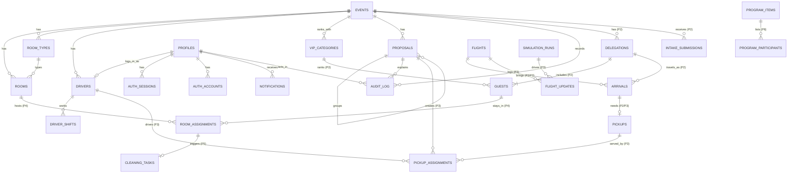

# 05 — Backend Schema & API Surface

**Status:** v2.3, 2026-10-20. **P1, P2 and P3 tables are built** (`db/migrations/20261016100000…100400`, `20261019100000_guests_intake.sql`, `20261020100000_flights_transport.sql`) and covered by tests; tables for later phases are **planned** and marked as such. Update this file in the same change as any migration.

**Database:** PostgreSQL 18, self-hosted on the droplet (see [`02-TRD.md`](02-TRD.md) §5). Extensions: `btree_gist` (P1), `pg_trgm` (P2, duplicate detection).

**Conventions:**
- `uuid` primary keys (`gen_random_uuid()`), except the append-only `audit_log` (`bigint` identity).
- All times are `timestamptz` (UTC, displayed in `events.timezone`). `date` columns travel as `YYYY-MM-DD` strings end to end.
- `snake_case` everywhere, including API JSON.
- `created_at` and `updated_at` on every mutable table (`updated_at` maintained by a trigger).
- A `version int` column, bumped by a trigger, on records edited concurrently (`delegations`, `arrivals`, `guests`, `pickups`; optimistic locking).
- Every business table carries `event_id`, defaulting to the single event (`private.current_event_id()`). The MVP has exactly one event (a unique index enforces it).
- Every business table has the `audit_row_change` trigger and row-level security (§6).

---

## 1. Entity-relationship overview

Relationships marked P4 or later are planned; the rest are built (P1–P3).

**Core idea (unchanged):** a **delegation** is the VIP plus their entourage; an **arrival** is a party travelling together; a **flight** is tracked once and shared; a **pickup** belongs to an arrival; rooms are allocated **per guest** through `room_assignments`.

## 2. Enumerated types

| Type | Values | Status |
|---|---|---|
| `app_role` | `super_admin`, `admin`, `coordinator`, `programs`, `driver`, `accommodation`, `housekeeping` | ✅ |
| `actor_type` | `user`, `system`, `copilot`, `guest_intake` | ✅ |
| `housekeeping_status` | `clean`, `needs_cleaning`, `cleaning` | ✅ |
| `proposal_kind` | `room_plan`, `room_assignment`, `driver_assignment`, `driver_reassignment`, `release_pickup`, `copilot_action` | ✅ |
| `proposal_status` | `pending`, `approved`, `rejected`, `superseded`, `expired`, `failed` | ✅ |
| `arrival_mode` | `flying`, `own_transport`, `pickup` | P2 |
| `submission_source` | `form`, `pasted_message` | P2 |
| `submission_status` | `received`, `processing`, `auto_processed`, `needs_review`, `approved`, `rejected`, `linked_duplicate` | P2 |
| `duplicate_kind` | `none`, `exact`, `likely` | P2 |
| `member_role` | `principal`, `assistant`, `security`, `performer`, `representative`, `family`, `other` | P2 |
| `proximity_priority` | `high`, `normal`, `low` | P2 |
| `guest_status` | `expected`, `arrived`, `checked_in`, `checked_out`, `cancelled` | P2 |
| `flight_phase` | `scheduled`, `in_air`, `landed`, `cancelled`, `diverted`, `unknown` | ✅ P2 |
| `pickup_kind` | `airport`, `location` | ✅ P2 |
| `pickup_status` | `pending_assignment`, `assigned`, `en_route`, `picked_up`, `completed`, `cancelled` | ✅ P2 |
| `flight_update_source` | `live`, `simulated`, `manual` | ✅ P3 |
| `assignment_status` | `active`, `released` (moved to another driver or the pickup released), `completed` | ✅ P3 |
| `stay_status` | `planned`, `checked_in`, `checked_out`, `cancelled` | P4 |
| `cleaning_status` | `queued`, `in_progress`, `done`, `cancelled` | P5 |
| `program_item_status` | `draft`, `published`, `cancelled` | P6 |
| `participant_role` | `speaker`, `honoree`, `performer`, `attendee`, `other` | P6 |

## 3. Tables

### 3.1 Event, accounts and auth — ✅ built (P1)

**`events`**: one row (unique index on a constant).

| Column | Type | Notes |
|---|---|---|
| id | uuid PK | |
| name, venue_name | text | 1–200 characters |
| timezone | text | IANA name, validated against `pg_timezone_names`; default `UTC` |
| starts_on, ends_on | date | `ends_on ≥ starts_on` |
| arrival_airports | text[] | IATA codes (`^[A-Z]{3}$`) used in validation |
| intake_token | text unique | 32 hex chars (122 random bits). Not writable by the API; changed only by `regenerate_intake_token()`. |
| intake_open | boolean | default false |
| intake_window_days | int default 3 | 0–30. Allowed arrival dates: `starts_on − N … ends_on` |
| airport_exit_buffer_min | int default 30 | 0–240. Landing → pickup time |
| airport_travel_min | int default 60 | 0–600. Fixed airport ↔ venue travel time |
| local_travel_min | int default 45 | 0–600. Location pickups |
| delay_threshold_min | int default 15 | 0–240. Flight is "delayed" above this |
| cleaning_delay_buffer_min | int default 15 | 0–240 |
| program_lead_time_min | int default 30 | 0–240 |
| flight_mode | text (`live`, `simulated`) default `simulated` | Only a Super Admin may change it (trigger) |
| auto_process_enabled | boolean default true | Kill switch for intake auto-processing |
| created_at, updated_at | timestamptz | |

**`profiles`**: staff accounts. This is Better Auth's `user` model (field mapping in `lib/auth/auth.ts`).

| Column | Type | Notes |
|---|---|---|
| id | uuid PK | |
| full_name | text | 1–200 characters (Better Auth `name`) |
| email | text unique | Lower-case |
| email_verified, image | boolean, text | Better Auth fields (unused) |
| role | app_role | One role per user (PRD §3) |
| banned | boolean default false | **Inverse of the PRD's `is_active`.** A banned account has no role in RLS and cannot sign in. |
| ban_reason, ban_expires | text, timestamptz | Exposed by the API as `deactivation_reason` |
| must_change_password | boolean default true | Set for new accounts and password resets |
| phone | text | E.164 (`+2348012345678`) |
| created_at, updated_at | timestamptz | |

Triggers: `guard_last_super_admin` (never zero active Super Admins); `audit_row_change('skip_anonymous')` (Better Auth's own writes are skipped; account changes are recorded with the acting admin, see §5).

**`auth_sessions`**, **`auth_accounts`**, **`auth_verifications`**: Better Auth's tables (session tokens, password hashes, verification codes). Only `vip_system` can read them; the API role has no privileges on them. Columns follow Better Auth's schema in snake_case (`user_id`, `expires_at`, `ip_address`, `user_agent`, `provider_id`, `account_id`, `password`, …).

### 3.2 Reference data — ✅ built (P1)

**`vip_categories`**: id, event_id, name (unique per event), rank smallint 1–99 (1 = highest; unique per event, **deferrable** so `reorder_vip_categories` can swap ranks), preferred_room_tier smallint null, timestamps.

**`room_types`**: id, event_id, name (unique per event), tier smallint 1–99 (1 = best), default_capacity 1–20, cleaning_minutes 5–600, timestamps.

**`rooms`**

| Column | Type | Notes |
|---|---|---|
| id | uuid PK | |
| event_id | uuid FK | |
| number | text | unique per event; up to 20 letters, digits, spaces, `.`, `-`, `_` |
| floor | smallint | −5…200; 0 = ground |
| wing | text | |
| position | int default 0 | Order along the corridor, for the proximity distance |
| room_type_id | uuid FK → room_types | Deleting a type still in use is refused (409 `in_use`) |
| capacity | smallint 1–20 | Defaults to the room type's `default_capacity` when omitted (trigger) |
| is_accessible, out_of_service | boolean | |
| housekeeping_status | housekeeping_status default `clean` | Not editable through the venue API; changed by the cleaning workflow (P5) |
| notes | text ≤ 2000 | |

**`drivers`**: id, event_id, profile_id (unique, FK → profiles, null; must be a `driver` account — trigger), full_name, phone (E.164), vehicle_label, vehicle_capacity 1–60, is_active, timestamps.

**`driver_shifts`**: id, driver_id (FK, cascade), starts_at, ends_at (`ends_at > starts_at`, ≤ 24 h). `EXCLUDE USING gist (driver_id WITH =, tstzrange(starts_at, ends_at) WITH &&)` prevents overlapping shifts.

### 3.3 Decisions, audit, notifications — ✅ built (P1)

**`proposals`**

| Column | Type | Notes |
|---|---|---|
| id | uuid PK | |
| event_id | uuid FK | |
| parent_id | uuid FK → proposals null | Room plan → lines |
| kind, status | proposal_kind, proposal_status | |
| title, summary | text | Human-readable ("Reassign EK783 pickup to Driver B") |
| rationale | jsonb | Scores, rules met/missed, alternatives, triggering change |
| payload | jsonb | Executable spec, re-validated on approval |
| target_type, target_id | text, uuid | Main entity affected; a new proposal supersedes older pending ones for the same target |
| created_by_type, created_by | actor_type, uuid | |
| trigger_type, trigger_id | text | e.g. `flight_update`, `123` |
| created_at, updated_at, expires_at | timestamptz | |
| decided_at, decided_by, decision_note | | Check: `decided_at` is set exactly when status ≠ pending |
| superseded_by | uuid FK null | |
| execution_error | text | When approval failed re-validation |

**`audit_log`**: append-only (no runtime role may update or delete; undo writes new rows).

| Column | Type | Notes |
|---|---|---|
| id | bigint identity PK | |
| event_id | uuid | |
| occurred_at | timestamptz | |
| actor_type, actor_id | actor_type, uuid null | From `app.user_id`; `system` when there is no user |
| action | text | `<table>.<insert\|update\|delete>`, or a named action (`profiles.create`, `proposals.reject`, `rooms.undo`, `seed`, …) |
| entity_type, entity_id | text, uuid | |
| before, after | jsonb | Full row images (no secrets: password hashes live in `auth_accounts`, which is not audited) |
| reason | text | |
| proposal_id | uuid FK null | |
| is_automatic | boolean | True for system actions |
| undoable | boolean | Defaults to `is_automatic` |
| undo_of_audit_id | bigint **unique** FK null | Set on the undo entry; unique so an entry can be undone only once |

**`notifications`**: id, event_id, recipient_id (FK → profiles), kind (`^[a-z_]+$`), priority (`normal`, `high`), title, body, entity_type, entity_id (deep link), created_at, read_at. An insert fires `pg_notify('vip_notifications', {id, recipient_id, kind, priority})` (§8).

### 3.4 Guests and intake — ✅ built (P2)

**`delegations`**: id, event_id, name (the principal's display name, kept in step when the coordinator renames the principal), principal_guest_id (FK → guests, deferrable), status (`expected`, `arrived`, `departed`, `cancelled`), created_from_submission_id, contact_name, contact_email, contact_phone (E.164), notes, version.

**`guests`**: id, event_id, delegation_id, member_role, full_name (null when `is_placeholder`), is_placeholder, title, organisation, position, vip_category_id (**set by the coordinator only**), proximity_priority (default `normal`), share_group (same value = share a room), arrival_id, expected_departure_at (departure date at 12:00 event time), dietary text[], accessibility, phone, email, status, notes, version. Indexes: `gin (full_name gin_trgm_ops)`, `(delegation_id)`, `(arrival_id)`.

**`guest_requirements`**: id, guest_id, category (`dietary`, `accessibility`, `room_preference`, `security`, `transport`, `schedule`, `medical`, `other`), detail, source (`form`, `extraction`, `coordinator`; `extraction` covers Claude and the offline rules, the submission's `ai_model` says which), source_submission_id, needs_attention, conflicts_with, resolved_at, resolved_by.

**`intake_submissions`**: id, event_id, reference_code (unique, `VIP-` + 4 unambiguous characters), source, submitted_at, payload (as received: the form, or `{text}`), normalized (form-shaped, edited during review), extraction (`{items, method, error}`, Zod-validated), issues (`[{code, field, severity: error|warning|info, message}]`), duplicate_kind, matched_delegation_id, is_high_confidence, status, delegation_id, ai_model (`rules` or the Claude model), ai_input_tokens, ai_output_tokens, ai_latency_ms, client_ip_hash (HMAC-SHA256, never the raw IP), created_by, reviewed_by, reviewed_at, review_note.

**`intake_rate_limits`**: (ip_hash, window_start) PK, count. vip_system only; old windows are deleted as each IP returns.

**Lifecycle.** Public form: `processing` → `auto_processed` (records created) | `linked_duplicate` (exact duplicate) | `needs_review`. Pasted messages start at `needs_review`. Review: `approved` | `linked_duplicate` | `rejected`. **Undo automatic processing** returns an `auto_processed` submission to `needs_review` and deletes the delegation it created.

### 3.5 Flights and transport — ✅ built (P2 basic tables, P3 tracking and assignments)

**`flights`** ✅: one row per flight number + local arrival date, shared by every arrival on it. id, event_id, flight_number (IATA, e.g. `EK783`), airline_iata, arrival_date_local, origin_iata, destination_iata (set when the event has one arrival airport), scheduled/estimated/actual_arrival_at, manual_arrival_at (a coordinator's time; wins until cleared), **delay_minutes** (generated: best known landing − scheduled), phase, provider, last_checked_at, next_check_at (adaptive schedule; index on `next_check_at` for phases not yet final), last_payload; unique (event_id, flight_number, arrival_date_local). P2 fills the schedule from the guest's stated landing time; P3 ingestion fills the rest. Best known landing = manual → actual → estimated → scheduled.

**`flight_updates`** ✅ (P3): append-only history and metrics: id (bigint), flight_id, observed_at (the provider's or scenario's time), source (`live`, `simulated`, `manual`), changes (`{field: [old, new]}`), payload, simulation_run_id, created_at (= start of ingestion), cascade_completed_at, cascade_ms (ingestion → cascade done; PRD §8 M2). Coordinator+ read; written only by vip_system.

**`arrivals`** ✅: id, event_id, delegation_id, mode, flight_id (required when flying), pickup_address + requested_pickup_at (required for pickup), stated_arrival_at (required for own transport; the stated landing time when flying), expected_at_venue_at (derived: landing + exit buffer + airport travel; pickup + local travel; own transport = arrival; moved by the cascade), **attention** (P3: e.g. "Flight HF404 cancelled"), status, version; check constraint on the required columns per mode.

**`pickups`** ✅: id, event_id, arrival_id (at most one non-cancelled per arrival), kind (`airport`, `location`), pickup_location, dropoff_location (the venue), pickup_at (landing + exit buffer, or the requested time), **previous_pickup_at**, **changed_at** (P3: the last move, shown to drivers and on the boards), passenger_count (kept equal to the party size), status, notes, version. The cascade creates the airport pickup once a flight's landing time is known.

**`pickup_assignments`** ✅ (P3): id, event_id, pickup_id, driver_id, status (`active` counts for availability; one active row per pickup and driver), proposal_id, acknowledged_at ("Got it"; cleared when the trip moves), en_route_at, picked_up_at, completed_at, released_at, created_by, created_at, updated_at. Written only by `approve_proposal` (executors) and the driver functions; never directly by the API. Trip window = pickup ± the event's travel time (`private.trip_window`).

### 3.6 Rooms and cleaning — planned (P4/P5)

**`room_assignments`**: id, event_id, room_id, guest_id (one `planned`/`checked_in` assignment per guest), expected_check_in_at, expected_check_out_at, status, checked_in_at/by, checked_out_at/by (**first confirmation wins**), checkout_reversed_at/by, proposal_id, is_manual_override, override_reason, acknowledged_violations, version.

**`cleaning_tasks`**: id, event_id, room_id (one open task per room), room_assignment_id, status, estimated_ready_at, needed_by, created_at, started_at/by, completed_at/by, cancelled_at, cancel_reason.

### 3.7 Program — planned (P6)

**`program_items`**: id, event_id, title, kind (`session`, `ceremony`, `meal`, `performance`, `other`), starts_at, ends_at, location, description, status, created_by, version.

**`program_participants`**: (program_item_id, guest_id) PK, role.

### 3.8 Co-Pilot, simulation, ops — simulation and ops ✅ built (P3), Co-Pilot planned (P7)

**`copilot_conversations`** (P7): id, user_id, started_at, title. **`copilot_messages`** (P7): id, conversation_id, role, content, input_mode, transcript_raw, transcript_edited, tool_calls, proposal_ids, model, input/output tokens, latency_ms, created_at.

**`simulation_runs`** ✅ (P3): id, event_id, scenario_key (scenarios are versioned with the code in `lib/domain/simulation/scenarios.ts`; the planned `simulation_scenarios` table is not needed), status (`running`, `stopped`, `completed`; one running run per event), speed (1–3600 virtual seconds per real second), flight_ids (≤ 10; the flights the steps act on, fixed at start), virtual_start, real_start, steps_applied, started_by, stopped_at. Coordinators insert (`running` only) and may change only `status` and `stopped_at`; the worker advances `steps_applied`.

**`provider_usage_daily`** ✅ (P3): (day, provider) PK, calls. Live flight-status calls per UTC day; coordinator+ read.

**`worker_leases`** ✅ (P3): name PK, holder, expires_at. The background worker's 30-second lease so only one process works at a time; vip_system only.

## 4. Views — planned

| View | Purpose | Phase |
|---|---|---|
| `v_arrivals_board` | Arrival + principal + VIP category + flight phase/delay + pickup + driver(s) + room readiness | ✅ P3 as a repository query (`lib/repositories/arrivals.ts`); room readiness joins in P4 |
| `v_driver_schedule` | Active assignments with trip windows per driver | ✅ P3 as a repository query (`lib/repositories/transport.ts`) |
| `v_room_status` | Room + current/next stay + open cleaning task + readiness | P4 |
| `v_cleaning_queue` | Open cleaning tasks by `needed_by`, `estimated_ready_at`. **Room data only, no guest names.** | P5 |
| `v_program_conflicts` | Participants whose `expected_at_venue_at + lead_time > starts_at` | P6 |
| `v_pending_decisions` | Pending proposals + submissions needing review | P2 (proposals part is served by `GET /api/decisions` today) |

## 5. Database functions

Functions in `public` are called by the API (granted to `vip_app`); `private` holds helpers. All `SECURITY DEFINER` functions pin `search_path = ''` and check the caller's role explicitly (enforced by the security-baseline test).

| Function | Who | Does | Status |
|---|---|---|---|
| `public.get_event_context()` | any signed-in staff | Safe event fields (name, venue, timezone, dates, flight mode) without the intake token | ✅ |
| `public.regenerate_intake_token()` | admin+ | New intake token; old link stops working | ✅ |
| `public.complete_password_change()` | the signed-in user | Clears `must_change_password` after a Better Auth password change | ✅ |
| `public.reorder_vip_categories(ids)` | coordinator+ | Sets every category's rank in one step | ✅ |
| `public.undo_audit_entry(id, reason)` | coordinator+ | Reverts an undoable entry if the row still matches; else 409 `undo_conflict` naming who changed it and when | ✅ |
| `public.reject_proposal(id, note)` | coordinator+ | Rejects a pending proposal and its pending lines | ✅ |
| `public.approve_proposal(id, line_ids)` | coordinator+ | Expires stale proposals; otherwise re-validates and executes. **Driver executors (P3)**: `driver_assignment` / `driver_reassignment` re-check shift, overlap and seats, release the old driver(s) and tell them, assign the new one(s) and tell them; `release_pickup` cancels the pickup and tells its driver. A proposal that no longer fits is marked **failed** with `execution_error` (`driver_busy`, `driver_off_shift`, `driver_inactive`, `not_enough_seats`, `pickup_closed`) and returns `{status: 'failed', error}`. Room (P4) and Co-Pilot (P7) kinds still answer 501 | ✅ P1 + P3 executors |
| `private.create_proposal(...)` | vip_system | Inserts a proposal, supersedes older pending ones for the same target, notifies coordinators | ✅ |
| `private.notify_users(...)` / `private.notify_roles(...)` | vip_system | Notification fan-out (active accounts only) | ✅ |
| `private.audit_profile_change(id, action)` | admin+ | Records account creation / password reset with the acting admin | ✅ |
| `private.set_audit_context(...)` | server code | Transaction-local actor type, action name, reason, automatic/undoable flags | ✅ |
| `public.intake_link_context(token)` | vip_system | Is the registration link open; event name, venue, timezone, dates (never the token or other settings) | ✅ |
| `public.similarity(text, text)` (pg_trgm) | vip_app, vip_system | Name similarity for duplicate candidates | ✅ |
| Record creation for a submission | — | Done in TypeScript inside one audited transaction (`lib/services/intake/records.ts`), not a SQL function: shared by auto-processing, approval, manual entry and the seed | ✅ (replaces the planned `create_records_from_submission`) |
| Flight ingestion and the transport cascade | vip_system | Done in TypeScript (`lib/services/flights/ingest.ts` → pure plan `lib/domain/transport/cascade.ts` → `lib/services/transport/apply.ts`) inside one audited transaction: diff, update the flight and `next_check_at`, record `flight_updates`, move venue ETAs and pickups, create missing pickups, keep drivers who can still make it (they confirm again), propose reassignments / releases, withdraw suggestions made for a pickup time that moved, alert coordinators | ✅ (replaces the planned `ingest_flight_update`) |
| `private.trip_window(pickup)` · `private.driver_unavailability(driver, window, exclude_pickup)` | vip_system (and the executors) | The busy window of a trip; why a driver cannot take it (`inactive`, `off_shift`, `busy`) or null — the same rules as the TypeScript matcher | ✅ P3 |
| `public.my_driver_pickups(day)` | driver (linked to an active driver record) | The signed-in driver's trips that day with principal, passengers and flight; 403 `not_a_driver` otherwise | ✅ P3 |
| `public.acknowledge_assignment(id)` | driver | "Got it" on the driver's own active trip | ✅ P3 |
| `assign_room`, `check_in_stay`, `check_out_stay`, `reverse_checkout` | coordinator+ / accommodation | Rooms and turnaround | P4/P5 |
| `public.set_trip_status(id, status)` | driver | `en_route` → `picked_up` → `completed` on the driver's own active trip (409 `not_active`, `not_picked_up`); completing marks the arrival, guests and delegation arrived | ✅ P3 |
| `start_cleaning`, `complete_cleaning` | housekeeping | Staff app status buttons | P5 |

## 6. Access model and row-level security

**Roles.** `vip_app` (login; RLS applies) runs every API request; `vip_system` (no login) is reachable only through the separate login `vip_service`, used by Better Auth's pool, the scripts and, from P3, the worker. `vip_app` cannot switch to `vip_system` and cannot set the audit context. `undo_audit_entry` only reverts the operational tables (`room_types`, `rooms`, `drivers`, `driver_shifts`, `vip_categories`; later phases add theirs explicitly), never accounts, event settings or proposals. Each request's transaction sets `role = vip_app` and `app.user_id`; policies call `private.current_user_id()` and the role helpers `private.has_role(...)`, `private.is_coordinator_plus()`, `private.is_admin_plus()` (a banned account has no role). Every table has `system_all` for `vip_system`.

**P1 matrix** (R = read, W = write; Super Admin and Admin include everything Coordinator has):

| Table | super_admin | admin | coordinator | programs | driver | accommodation | housekeeping |
|---|---|---|---|---|---|---|---|
| events | RW (incl. flight mode) | RW (not flight mode) | R | R | – (safe context only) | – (safe context only) | – (safe context only) |
| profiles | RW all | RW below admin | R all | R self | R self | R self | R self |
| auth_* | – | – | – | – | – | – | – |
| vip_categories | RW | RW | RW | R | – | – | – |
| room_types, rooms | RW | RW | R | – | – | R | R |
| drivers, driver_shifts | RW | RW | R | – | R (own) | – | – |
| proposals | R + functions | R + functions | R + functions | – | – | – | – |
| audit_log | R | R | R | – | – | – | – |
| notifications | R/mark read (own) | same | same | same | same | same | same |

**P2 rows:**

| Table | super_admin / admin / coordinator | programs | accommodation | driver, housekeeping |
|---|---|---|---|---|
| delegations, guests, guest_requirements, arrivals, flights, pickups | RW | R | R | – |
| intake_submissions | R; insert pasted-message drafts only; update review columns only | – | – | – |
| intake_rate_limits | – (vip_system only) | – | – | – |

**P3 rows:**

| Table / function | super_admin / admin / coordinator | programs | accommodation | driver | housekeeping |
|---|---|---|---|---|---|
| pickup_assignments | R (writes only through `approve_proposal`) | R | R | R own; status/ack through the driver functions | – |
| flight_updates, provider_usage_daily | R | – | – | – | – |
| simulation_runs | R; insert `running`; update `status`, `stopped_at` | – | – | – | – |
| worker_leases | – (vip_system only) | – | – | – | – |
| `my_driver_pickups`, `set_trip_status`, `acknowledge_assignment` | – | – | – | own trips only | – |

Work done for a signed-in coordinator outside RLS (a manual landing time, "Check now", "Suggest a driver") runs as vip_system with `app.user_id` set to that coordinator (`withSystem({ onBehalfOf })`), so the activity log names them.

Column-level grants add to this: the API cannot write `events.intake_token`, `profiles.email`, `notifications` columns other than `read_at`, or a submission's `payload`, `source`, `client_ip_hash` and `submitted_at`. Public registrations are written by vip_system with the audit actor `guest_intake`. Planned tables follow the matrix in the PRD (e.g. housekeeping never sees guest names; drivers see only their own pickups).

Tests: `tests/db/*.test.ts` check each cell above as the relevant role.

## 7. API surface (Next.js route handlers)

**Envelope.** Every response is `{ success, data, error, meta? }`. Errors are `{ code, message, details? }` with a stable `code` (`validation_failed`, `forbidden`, `not_found`, `already_exists`, `in_use`, `overlap`, `undo_conflict`, `password_change_required`, `rate_limited`, …). Lists accept `?page=&limit=` (max 200) and return `meta: { total, page, limit }`.

**Auth.** Same-origin clients use the session cookie; others send `Authorization: Bearer <token>` (from the `set-auth-token` sign-in header). Origins listed in `API_ALLOWED_ORIGINS` get CORS. JSON bodies need `Content-Type: application/json`.

### Built (P1)

| Method | Path | Who | Purpose |
|---|---|---|---|
| POST | `/api/auth/sign-in/email` | public | Sign in `{ email, password }` (5 attempts/min per IP) |
| POST | `/api/auth/sign-out` · GET `/api/auth/get-session` | signed in | Better Auth (only an allowlist of its endpoints is exposed) |
| GET | `/api/health` | public | Liveness + database check |
| GET | `/api/me` | any (also with a pending password change) | User, role, home route, event context |
| POST | `/api/account/password` | any (also pending) | `{ current_password, new_password }`; signs out other sessions; returns a new token |
| GET / POST / PATCH | `/api/admin/event` | GET coordinator+; POST/PATCH admin+ | Event settings; POST is first-time setup |
| POST | `/api/admin/event/intake-token` | admin+ | Regenerate the intake link token |
| GET / POST | `/api/admin/users` | admin+ | List (`?role=&active=&search=`) / create (returns the temporary password once) |
| GET / PATCH | `/api/admin/users/[id]` | admin+ | Read / update `full_name`, `phone`, `role`, `active`, `deactivation_reason` |
| POST | `/api/admin/users/[id]/reset-password` | admin+ | New temporary password; signs the account out |
| GET / POST | `/api/admin/room-types` · GET / PATCH / DELETE `/[id]` | read: coordinator+, accommodation, housekeeping; write: admin+ | Room types |
| GET / POST | `/api/admin/rooms` · GET / PATCH / DELETE `/[id]` | same | Rooms (`?floor=&wing=&room_type_id=`) |
| POST | `/api/admin/rooms/import` | admin+ | CSV body (`text/csv`, ≤ 2 MB); `?dry_run=true` previews; all-or-nothing upsert by room number |
| GET / POST | `/api/admin/drivers` · GET / PATCH / DELETE `/[id]` | read: coordinator+, driver (own); write: admin+ | Drivers (`?active=`) |
| GET / POST | `/api/admin/driver-shifts` · GET / PATCH / DELETE `/[id]` | same | Shifts (`?driver_id=&from=&to=` overlap window) |
| GET / POST | `/api/admin/vip-categories` · GET / PATCH / DELETE `/[id]` | read: coordinator+, programs; write: coordinator+ | VIP categories |
| POST | `/api/admin/vip-categories/reorder` | coordinator+ | `{ ids: [highest … lowest] }` |
| GET | `/api/audit` | coordinator+ | Activity log (`?entity_type=&entity_types=a,b&actor_type=&entity_id=&actor_id=&automatic=&from=&to=`), with `actor_name` and `undone` |
| POST | `/api/audit/[id]/undo` | coordinator+ | `{ reason? }` |
| GET | `/api/notifications` | any | Own notifications + `unread_count` (`?unread_only=`) |
| POST | `/api/notifications/read` | any | `{ ids? }`; omit to mark all read |
| GET | `/api/notifications/stream` | any | Server-Sent Events (§8); max 5 open streams per account |
| GET | `/api/decisions` | coordinator+ | Pending proposals, soonest-expiring first |
| GET | `/api/dashboard/summary` | coordinator+ | Dashboard counters: rooms by readiness, open decisions (each phase adds its counters) |
| POST | `/api/proposals/[id]/approve` · `/reject` | coordinator+ | `{ line_ids? }` / `{ note? }` |

### Built (P2)

| Method | Path | Who | Purpose |
|---|---|---|---|
| GET | `/register/[token]` · `/register/[token]/done` (pages) | public | Registration form and confirmation (receipt kept in the browser tab only) |
| GET | `/api/intake/[token]` | public, 30/min per IP | Link context `{ open, event_name, venue_name, timezone, starts_on, ends_on, turnstile_site_key }`; 404 `invalid_link` |
| POST | `/api/intake/[token]` | public, 30/min per IP + 10 per 15 min per IP hash | `{ form, consent: true, turnstile_token? }` → 201 `{ reference_code, follow_up, summary }`; 409 `intake_closed`, 403 `bot_check_failed`, 429 |
| POST | `/api/intake/read-message` | coordinator+, 10/min | `{ text }` → `{ fields, extraction }`; saves nothing |
| GET / POST | `/api/intake/submissions` | coordinator+ (POST 10/min) | Queue (`?tab=review|duplicates|missing|flagged|processed|rejected&search=&source=`) with `tabs` counts and the registration `link`; POST `{ text }` saves a pasted message as a draft |
| GET / PATCH | `/api/intake/submissions/[id]` | coordinator+ | Detail with the matched delegation for comparison; PATCH `{ fields }` saves corrections and re-checks |
| POST | `/api/intake/submissions/[id]/approve` | coordinator+ | `{ fields?, vip_category_id? }` → records; 400 `intake_incomplete` with the field problems; 409 `already_reviewed` |
| POST | `/api/intake/submissions/[id]/link` · `/reject` | coordinator+ | `{ delegation_id, note? }` / `{ note? }` |
| POST | `/api/intake/submissions/[id]/undo` | coordinator+ | Undo automatic processing; 409 `not_auto_processed` |
| GET / POST | `/api/guests` | GET coordinator+, programs, accommodation; POST coordinator+ | One row per delegation (`?tab=all|today|attention|arrived&search=&category_id=`) with `tabs` and `totals`; POST `{ fields, vip_category_id?, allow_duplicate? }` adds a guest by hand (409 `possible_duplicate`) |
| GET / PATCH / DELETE | `/api/guests/[id]` | GET as above; PATCH/DELETE coordinator+ | Profile (a delegation id resolves to its principal); PATCH with `version` (409 `stale_version`); DELETE removes a companion (409 `cannot_remove_principal`) |
| POST | `/api/delegations/[id]/members` | coordinator+ | `{ member_role, full_name?, dietary?, accessibility?, requirement_id? }` (named or placeholder; resolves the issue it came from) |
| POST | `/api/guest-requirements/[id]/resolve` | coordinator+ | Dismiss an open issue (409 `already_resolved`) |

`GET /api/dashboard/summary` now also returns `guests`, `arrivals_today`, `pickups_today` and `intake_to_review`.

### Built (P3)

| Method | Path | Who | Purpose |
|---|---|---|---|
| GET | `/api/arrivals` | coordinator+ | Arrivals board for `?day=` (default: today, or the next day with arrivals): rows with status (`landed`, `delayed`, `cancelled`, `due`), flight, pickup, drivers, pending suggestion; `days`, `updated_at` |
| GET | `/api/transport` | coordinator+ | Transport board for `?day=`: pending driver decisions, pickups needing a driver, drivers with shifts, state and trips (incl. suggested ghosts), timeline `range` |
| POST | `/api/flights/[id]/refresh` | coordinator+ | Ask the event's provider now (counts towards the daily limit: 429 `quota_reached`; 409 `no_provider` in live mode without a key) → `{ changed, proposal_ids }` |
| POST | `/api/flights/[id]/override` | coordinator+ | `{ manual_arrival_at: ISO with offset \| null }` → cascade → `{ changed, proposal_ids }` |
| POST | `/api/pickups/[id]/suggest` | coordinator+ | Matcher suggestion as a proposal → `{ proposal_id }` or `{ reason: 'no_driver_free' \| 'already_covered' }`; 409 `pickup_closed` |
| GET | `/api/driver/pickups` | driver | Own trips for `?day=` (default today) |
| POST | `/api/driver/assignments/[id]/status` · `/acknowledge` | driver | `{ status: 'en_route' \| 'picked_up' \| 'completed' }` / Got it |
| GET | `/api/simulation/options` | coordinator+ | Scenarios, upcoming flights and active drivers for the what-if form, flight mode |
| GET / POST | `/api/simulation/runs` | coordinator+ | Recent runs / start `{ scenario_key, speed }` (409 `not_simulated`, `not_enough_flights`, `already_exists` while one runs) |
| POST | `/api/simulation/runs/[id]/stop` | coordinator+ | 409 `not_running` |
| POST | `/api/simulation/what-if` | coordinator+ | `{ kind: 'flight_delay', flight_id, minutes }` or `{ kind: 'driver_unavailable', driver_id, from? }` → `{ headline, decisions, lines }`; writes nothing |

The background worker (in-process by default, or `pnpm worker`) polls flights, advances simulation runs and suggests drivers; no `/api/jobs/*` routes are needed.

### Planned

| Method | Path | Phase |
|---|---|---|
| POST | `/api/delegations/[id]/split-arrival` | later (not needed by P3) |
| POST | `/api/webhooks/flights` (optional AeroDataBox push) | P8 if adopted |
| POST | `/api/allocation/{run,check}`, `/api/room-assignments`, `/[id]/{check-in,check-out,reverse-checkout}` | P4/P5 |
| POST | `/api/cleaning-tasks/[id]/{start,complete}` | P5 |
| GET / POST / PATCH / DELETE | `/api/program-items`, PUT `/[id]/participants` | P6 |
| POST | `/api/copilot/chat`, `/api/copilot/transcribe` | P7 |
| PATCH | `/api/admin/system` (data export/purge) | P8 |

## 8. Realtime

| Channel | Source | Delivered to |
|---|---|---|
| `vip_notifications` (Postgres NOTIFY) | Trigger on `notifications` insert | `GET /api/notifications/stream` → `event: notification` with `{ id, kind, priority }` for the recipient's open streams ✅ |

Clients refresh the affected list (decisions, arrivals, transport, the driver's trips, rooms, cleaning) when a notification arrives; P3 sends `pickup_time_changed`, `pickup_assigned`, `pickup_moved`, `pickup_cancelled` to drivers and `flight_disrupted`, `transport_alert`, `provider_quota` (and proposal notices) to coordinators. If later phases need live views without a notification (e.g. the room grid), they add a NOTIFY channel and a stream route the same way.

## 9. Seed data

✅ `pnpm db:seed` (Docker Postgres) and `pnpm local:setup` (PGlite, event starting today) use `db/tooling/seed.ts` (tested). On an empty database they create the Figma demo venue: "Lagos Leadership Summit 2026" at Harbour Point Hotel (4 days, Africa/Lagos), 4 room types, **120 rooms** over 6 floors in West (x01–x07), East (x08–x14) and Garden (x15–x20) wings, 4 VIP categories, **15 named drivers** with vehicles and two overlapping shifts a day (05:00–14:00 and 11:00–21:00 UTC), and one named account per role (`coordinator@vipgcs.test` is Ada Nwosu, `admin@vipgcs.test` is Tolu Adebayo, …) sharing one printed password. Seed writes are audited as non-undoable system actions.

✅ P2 adds the 6 Figma delegations (17 guests, 4 flights, 5 pickups; created by the same code as an approved registration, `db/tooling/seed-guests.ts`) and 3 submissions in the review queue: a likely duplicate, a registration with a flagged note and a pasted message. ✅ P3 (`db/tooling/seed-transport.ts`, through the real pipeline): two trips assigned (ET512 to the driver login's Emeka Oladipo), ET512 then 40 minutes late (Emeka keeps it and must confirm the new time) and matcher suggestions for the other pickups. Planned (P4+): about 60 delegations across categories, arrival modes and entourage sizes, plus scenario fixtures for delays, cancellations, shared flights and room conflicts (`00` decision 5).
