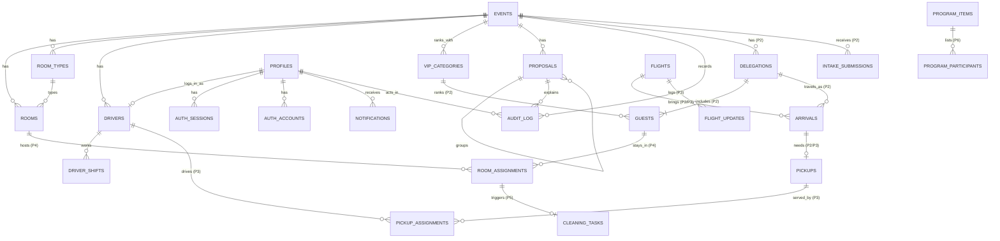

# 05 — Backend Schema & API Surface

**Status:** v2, 2026-10-16. **P1 tables are built** (`db/migrations/20261016100000…100400`) and covered by tests; tables for later phases are **planned** and marked as such. Update this file in the same change as any migration.

**Database:** PostgreSQL 18, self-hosted on the droplet (see [`02-TRD.md`](02-TRD.md) §5). Extension: `btree_gist` (P1); `pg_trgm` arrives with intake in P2.

**Conventions:**
- `uuid` primary keys (`gen_random_uuid()`), except the append-only `audit_log` (`bigint` identity).
- All times are `timestamptz` (UTC, displayed in `events.timezone`). `date` columns travel as `YYYY-MM-DD` strings end to end.
- `snake_case` everywhere, including API JSON.
- `created_at` and `updated_at` on every mutable table (`updated_at` maintained by a trigger).
- A `version int` column on records edited concurrently (planned tables, for optimistic locking).
- Every business table carries `event_id`, defaulting to the single event (`private.current_event_id()`). The MVP has exactly one event (a unique index enforces it).
- Every business table has the `audit_row_change` trigger and row-level security (§6).

---

## 1. Entity-relationship overview

Relationships marked with a phase are planned; the rest are built (P1).

**Core idea (unchanged):** a **delegation** is the VIP plus their entourage; an **arrival** is a party travelling together; a **flight** is tracked once and shared; a **pickup** belongs to an arrival; rooms are allocated **per guest** through `room_assignments`.

## 2. Enumerated types

| Type | Values | Status |
|---|---|---|
| `app_role` | `super_admin`, `admin`, `coordinator`, `programs`, `driver`, `accommodation`, `housekeeping` | ✅ |
| `actor_type` | `user`, `system`, `copilot`, `guest_intake` | ✅ |
| `housekeeping_status` | `clean`, `needs_cleaning`, `cleaning` | ✅ |
| `proposal_kind` | `room_plan`, `room_assignment`, `driver_assignment`, `driver_reassignment`, `release_pickup`, `copilot_action` | ✅ |
| `proposal_status` | `pending`, `approved`, `rejected`, `superseded`, `expired`, `failed` | ✅ |
| `arrival_mode` | `flying`, `own_transport`, `pickup` | P2 |
| `submission_source` | `form`, `pasted_message` | P2 |
| `submission_status` | `received`, `processing`, `auto_processed`, `needs_review`, `approved`, `rejected`, `linked_duplicate` | P2 |
| `duplicate_kind` | `none`, `exact`, `likely` | P2 |
| `member_role` | `principal`, `assistant`, `security`, `performer`, `representative`, `family`, `other` | P2 |
| `proximity_priority` | `high`, `normal`, `low` | P2 |
| `guest_status` | `expected`, `arrived`, `checked_in`, `checked_out`, `cancelled` | P2 |
| `flight_phase` | `scheduled`, `in_air`, `landed`, `cancelled`, `diverted`, `unknown` | P3 |
| `pickup_kind` | `airport`, `location` | P3 |
| `pickup_status` | `pending_assignment`, `assigned`, `en_route`, `picked_up`, `completed`, `cancelled` | P3 |
| `assignment_status` | `active`, `superseded`, `cancelled` | P3 |
| `stay_status` | `planned`, `checked_in`, `checked_out`, `cancelled` | P4 |
| `cleaning_status` | `queued`, `in_progress`, `done`, `cancelled` | P5 |
| `program_item_status` | `draft`, `published`, `cancelled` | P6 |
| `participant_role` | `speaker`, `honoree`, `performer`, `attendee`, `other` | P6 |

## 3. Tables

### 3.1 Event, accounts and auth — ✅ built (P1)

**`events`**: one row (unique index on a constant).

| Column | Type | Notes |
|---|---|---|
| id | uuid PK | |
| name, venue_name | text | 1–200 characters |
| timezone | text | IANA name, validated against `pg_timezone_names`; default `UTC` |
| starts_on, ends_on | date | `ends_on ≥ starts_on` |
| arrival_airports | text[] | IATA codes (`^[A-Z]{3}$`) used in validation |
| intake_token | text unique | 32 hex chars (122 random bits). Not writable by the API; changed only by `regenerate_intake_token()`. |
| intake_open | boolean | default false |
| intake_window_days | int default 3 | 0–30. Allowed arrival dates: `starts_on − N … ends_on` |
| airport_exit_buffer_min | int default 30 | 0–240. Landing → pickup time |
| airport_travel_min | int default 60 | 0–600. Fixed airport ↔ venue travel time |
| local_travel_min | int default 45 | 0–600. Location pickups |
| delay_threshold_min | int default 15 | 0–240. Flight is "delayed" above this |
| cleaning_delay_buffer_min | int default 15 | 0–240 |
| program_lead_time_min | int default 30 | 0–240 |
| flight_mode | text (`live`, `simulated`) default `simulated` | Only a Super Admin may change it (trigger) |
| auto_process_enabled | boolean default true | Kill switch for intake auto-processing |
| created_at, updated_at | timestamptz | |

**`profiles`**: staff accounts. This is Better Auth's `user` model (field mapping in `lib/auth/auth.ts`).

| Column | Type | Notes |
|---|---|---|
| id | uuid PK | |
| full_name | text | 1–200 characters (Better Auth `name`) |
| email | text unique | Lower-case |
| email_verified, image | boolean, text | Better Auth fields (unused) |
| role | app_role | One role per user (PRD §3) |
| banned | boolean default false | **Inverse of the PRD's `is_active`.** A banned account has no role in RLS and cannot sign in. |
| ban_reason, ban_expires | text, timestamptz | Exposed by the API as `deactivation_reason` |
| must_change_password | boolean default true | Set for new accounts and password resets |
| phone | text | E.164 (`+2348012345678`) |
| created_at, updated_at | timestamptz | |

Triggers: `guard_last_super_admin` (never zero active Super Admins); `audit_row_change('skip_anonymous')` (Better Auth's own writes are skipped; account changes are recorded with the acting admin, see §5).

**`auth_sessions`**, **`auth_accounts`**, **`auth_verifications`**: Better Auth's tables (session tokens, password hashes, verification codes). Only `vip_system` can read them; the API role has no privileges on them. Columns follow Better Auth's schema in snake_case (`user_id`, `expires_at`, `ip_address`, `user_agent`, `provider_id`, `account_id`, `password`, …).

### 3.2 Reference data — ✅ built (P1)

**`vip_categories`**: id, event_id, name (unique per event), rank smallint 1–99 (1 = highest; unique per event, **deferrable** so `reorder_vip_categories` can swap ranks), preferred_room_tier smallint null, timestamps.

**`room_types`**: id, event_id, name (unique per event), tier smallint 1–99 (1 = best), default_capacity 1–20, cleaning_minutes 5–600, timestamps.

**`rooms`**

| Column | Type | Notes |
|---|---|---|
| id | uuid PK | |
| event_id | uuid FK | |
| number | text | unique per event; up to 20 letters, digits, spaces, `.`, `-`, `_` |
| floor | smallint | −5…200; 0 = ground |
| wing | text | |
| position | int default 0 | Order along the corridor, for the proximity distance |
| room_type_id | uuid FK → room_types | Deleting a type still in use is refused (409 `in_use`) |
| capacity | smallint 1–20 | Defaults to the room type's `default_capacity` when omitted (trigger) |
| is_accessible, out_of_service | boolean | |
| housekeeping_status | housekeeping_status default `clean` | Not editable through the venue API; changed by the cleaning workflow (P5) |
| notes | text ≤ 2000 | |

**`drivers`**: id, event_id, profile_id (unique, FK → profiles, null; must be a `driver` account — trigger), full_name, phone (E.164), vehicle_label, vehicle_capacity 1–60, is_active, timestamps.

**`driver_shifts`**: id, driver_id (FK, cascade), starts_at, ends_at (`ends_at > starts_at`, ≤ 24 h). `EXCLUDE USING gist (driver_id WITH =, tstzrange(starts_at, ends_at) WITH &&)` prevents overlapping shifts.

### 3.3 Decisions, audit, notifications — ✅ built (P1)

**`proposals`**

| Column | Type | Notes |
|---|---|---|
| id | uuid PK | |
| event_id | uuid FK | |
| parent_id | uuid FK → proposals null | Room plan → lines |
| kind, status | proposal_kind, proposal_status | |
| title, summary | text | Human-readable ("Reassign EK783 pickup to Driver B") |
| rationale | jsonb | Scores, rules met/missed, alternatives, triggering change |
| payload | jsonb | Executable spec, re-validated on approval |
| target_type, target_id | text, uuid | Main entity affected; a new proposal supersedes older pending ones for the same target |
| created_by_type, created_by | actor_type, uuid | |
| trigger_type, trigger_id | text | e.g. `flight_update`, `123` |
| created_at, updated_at, expires_at | timestamptz | |
| decided_at, decided_by, decision_note | | Check: `decided_at` is set exactly when status ≠ pending |
| superseded_by | uuid FK null | |
| execution_error | text | When approval failed re-validation |

**`audit_log`**: append-only (no runtime role may update or delete; undo writes new rows).

| Column | Type | Notes |
|---|---|---|
| id | bigint identity PK | |
| event_id | uuid | |
| occurred_at | timestamptz | |
| actor_type, actor_id | actor_type, uuid null | From `app.user_id`; `system` when there is no user |
| action | text | `<table>.<insert\|update\|delete>`, or a named action (`profiles.create`, `proposals.reject`, `rooms.undo`, `seed`, …) |
| entity_type, entity_id | text, uuid | |
| before, after | jsonb | Full row images (no secrets: password hashes live in `auth_accounts`, which is not audited) |
| reason | text | |
| proposal_id | uuid FK null | |
| is_automatic | boolean | True for system actions |
| undoable | boolean | Defaults to `is_automatic` |
| undo_of_audit_id | bigint **unique** FK null | Set on the undo entry; unique so an entry can be undone only once |

**`notifications`**: id, event_id, recipient_id (FK → profiles), kind (`^[a-z_]+$`), priority (`normal`, `high`), title, body, entity_type, entity_id (deep link), created_at, read_at. An insert fires `pg_notify('vip_notifications', {id, recipient_id, kind, priority})` (§8).

### 3.4 Guests and intake — planned (P2)

**`delegations`**: id, event_id, name, principal_guest_id (FK → guests, deferrable), status (`expected`, `arrived`, `departed`, `cancelled`), created_from_submission_id, notes, version.

**`guests`**: id, event_id, delegation_id, member_role, full_name (null when `is_placeholder`), is_placeholder, title, organisation, position, vip_category_id (**set by the coordinator**; required for principals before allocation), proximity_priority (default `normal`), share_group (same value = share a room), arrival_id, expected_departure_at, dietary text[], phone, email, status, notes, version. Indexes: `gin (full_name gin_trgm_ops)`, `(delegation_id)`, `(arrival_id)`.

**`guest_requirements`**: id, guest_id, category (`dietary`, `accessibility`, `room_preference`, `security`, `transport`, `schedule`, `medical`, `other`), detail, source (`form`, `ai_extraction`, `coordinator`), source_submission_id, needs_attention, conflicts_with, resolved_at, resolved_by.

**`intake_submissions`**: id, event_id, reference_code (unique, e.g. `VIP-7K3Q`), source, submitted_at, payload (raw), normalized, extraction (AI output, Zod-validated), issues (`[{code, field, severity, message}]`), duplicate_kind, duplicate_of_submission_id, matched_delegation_id, is_high_confidence, status, delegation_id, ai_model, ai_input_tokens, ai_output_tokens, ai_latency_ms, client_ip_hash, created_by, reviewed_by, reviewed_at, review_note.

**`intake_rate_limits`**: (ip_hash, window_start) PK, count.

### 3.5 Flights and transport — planned (P2/P3)

**`flights`**: one row per flight number + local arrival date. id, event_id, flight_number (IATA, e.g. `EK783`), airline_iata, arrival_date_local, origin_iata, destination_iata, scheduled/estimated/actual_arrival_at, manual_arrival_at (override wins), phase, delay_minutes (generated), provider, last_checked_at, next_check_at, last_payload; unique (event_id, flight_number, arrival_date_local).

**`flight_updates`**: append-only history and metrics: flight_id, observed_at, source (`live`, `simulated`, `manual`), changes (`{field: [old, new]}`), payload, simulation_run_id, cascade_completed_at, cascade_ms.

**`arrivals`**: id, event_id, delegation_id, mode, flight_id (required when flying), pickup_address + requested_pickup_at (required for pickup), stated_arrival_at (required for own transport), expected_at_venue_at (derived), status, version; check constraint on the required columns per mode.

**`pickups`**: id, event_id, arrival_id (at most one non-cancelled per arrival), kind, pickup_location, dropoff_location, pickup_at (derived, auto-updated on flight change), passenger_count, status, notes, version.

**`pickup_assignments`**: id, pickup_id, driver_id, status (only `active` counts for availability), proposal_id, acknowledged_at, en_route_at, picked_up_at, completed_at, created_at, created_by.

### 3.6 Rooms and cleaning — planned (P4/P5)

**`room_assignments`**: id, event_id, room_id, guest_id (one `planned`/`checked_in` assignment per guest), expected_check_in_at, expected_check_out_at, status, checked_in_at/by, checked_out_at/by (**first confirmation wins**), checkout_reversed_at/by, proposal_id, is_manual_override, override_reason, acknowledged_violations, version.

**`cleaning_tasks`**: id, event_id, room_id (one open task per room), room_assignment_id, status, estimated_ready_at, needed_by, created_at, started_at/by, completed_at/by, cancelled_at, cancel_reason.

### 3.7 Program — planned (P6)

**`program_items`**: id, event_id, title, kind (`session`, `ceremony`, `meal`, `performance`, `other`), starts_at, ends_at, location, description, status, created_by, version.

**`program_participants`**: (program_item_id, guest_id) PK, role.

### 3.8 Co-Pilot, simulation, ops — planned (P3/P7)

**`copilot_conversations`**: id, user_id, started_at, title. **`copilot_messages`**: id, conversation_id, role, content, input_mode, transcript_raw, transcript_edited, tool_calls, proposal_ids, model, input/output tokens, latency_ms, created_at.

**`simulation_scenarios`**: id, event_id, name, description, steps jsonb, created_by. **`simulation_runs`**: id, scenario_id, started_by, started_at, virtual_start_at, speed, status, ended_at.

**`provider_usage_daily`**: (provider, day) PK, calls, units.

## 4. Views — planned

| View | Purpose | Phase |
|---|---|---|
| `v_arrivals_board` | Arrival + principal + VIP category + flight phase/delay + pickup + driver(s) + room readiness | P3 |
| `v_driver_schedule` | Active assignments with trip windows per driver | P3 |
| `v_room_status` | Room + current/next stay + open cleaning task + readiness | P4 |
| `v_cleaning_queue` | Open cleaning tasks by `needed_by`, `estimated_ready_at`. **Room data only, no guest names.** | P5 |
| `v_program_conflicts` | Participants whose `expected_at_venue_at + lead_time > starts_at` | P6 |
| `v_pending_decisions` | Pending proposals + submissions needing review | P2 (proposals part is served by `GET /api/decisions` today) |

## 5. Database functions

Functions in `public` are called by the API (granted to `vip_app`); `private` holds helpers. All `SECURITY DEFINER` functions pin `search_path = ''` and check the caller's role explicitly (enforced by the security-baseline test).

| Function | Who | Does | Status |
|---|---|---|---|
| `public.get_event_context()` | any signed-in staff | Safe event fields (name, venue, timezone, dates, flight mode) without the intake token | ✅ |
| `public.regenerate_intake_token()` | admin+ | New intake token; old link stops working | ✅ |
| `public.complete_password_change()` | the signed-in user | Clears `must_change_password` after a Better Auth password change | ✅ |
| `public.reorder_vip_categories(ids)` | coordinator+ | Sets every category's rank in one step | ✅ |
| `public.undo_audit_entry(id, reason)` | coordinator+ | Reverts an undoable entry if the row still matches; else 409 `undo_conflict` naming who changed it and when | ✅ |
| `public.reject_proposal(id, note)` | coordinator+ | Rejects a pending proposal and its pending lines | ✅ |
| `public.approve_proposal(id, line_ids)` | coordinator+ | Expires stale proposals; otherwise re-validates and executes. **Executors arrive in P3 (driver), P4 (rooms), P7 (Co-Pilot)**; until then it answers 501 `not_implemented` | ✅ skeleton |
| `private.create_proposal(...)` | vip_system | Inserts a proposal, supersedes older pending ones for the same target, notifies coordinators | ✅ |
| `private.notify_users(...)` / `private.notify_roles(...)` | vip_system | Notification fan-out (active accounts only) | ✅ |
| `private.audit_profile_change(id, action)` | admin+ | Records account creation / password reset with the acting admin | ✅ |
| `private.set_audit_context(...)` | server code | Transaction-local actor type, action name, reason, automatic/undoable flags | ✅ |
| `create_records_from_submission`, `link_duplicate_submission` | system / coordinator | Intake (§3.4) | P2 |
| `ingest_flight_update` | vip_system | Diff, update flight, arrivals, pickups; return affected ids | P3 |
| `assign_room`, `check_in_stay`, `check_out_stay`, `reverse_checkout` | coordinator+ / accommodation | Rooms and turnaround | P4/P5 |
| `start_cleaning`, `complete_cleaning`, `set_trip_status` | housekeeping / driver | Staff app status buttons | P3/P5 |

## 6. Access model and row-level security

**Roles.** `vip_app` (login; RLS applies) runs every API request; `vip_system` (no login) is reachable only through the separate login `vip_service`, used by Better Auth's pool, the scripts and, from P3, the worker. `vip_app` cannot switch to `vip_system` and cannot set the audit context. `undo_audit_entry` only reverts the operational tables (`room_types`, `rooms`, `drivers`, `driver_shifts`, `vip_categories`; later phases add theirs explicitly), never accounts, event settings or proposals. Each request's transaction sets `role = vip_app` and `app.user_id`; policies call `private.current_user_id()` and the role helpers `private.has_role(...)`, `private.is_coordinator_plus()`, `private.is_admin_plus()` (a banned account has no role). Every table has `system_all` for `vip_system`.

**P1 matrix** (R = read, W = write; Super Admin and Admin include everything Coordinator has):

| Table | super_admin | admin | coordinator | programs | driver | accommodation | housekeeping |
|---|---|---|---|---|---|---|---|
| events | RW (incl. flight mode) | RW (not flight mode) | R | R | – (safe context only) | – (safe context only) | – (safe context only) |
| profiles | RW all | RW below admin | R all | R self | R self | R self | R self |
| auth_* | – | – | – | – | – | – | – |
| vip_categories | RW | RW | RW | R | – | – | – |
| room_types, rooms | RW | RW | R | – | – | R | R |
| drivers, driver_shifts | RW | RW | R | – | R (own) | – | – |
| proposals | R + functions | R + functions | R + functions | – | – | – | – |
| audit_log | R | R | R | – | – | – | – |
| notifications | R/mark read (own) | same | same | same | same | same | same |

Column-level grants add to this: the API cannot write `events.intake_token`, `profiles.email` or `notifications` columns other than `read_at`. Planned tables follow the matrix in the PRD (e.g. housekeeping never sees guest names; drivers see only their own pickups).

Tests: `tests/db/*.test.ts` check each cell above as the relevant role.

## 7. API surface (Next.js route handlers)

**Envelope.** Every response is `{ success, data, error, meta? }`. Errors are `{ code, message, details? }` with a stable `code` (`validation_failed`, `forbidden`, `not_found`, `already_exists`, `in_use`, `overlap`, `undo_conflict`, `password_change_required`, `rate_limited`, …). Lists accept `?page=&limit=` (max 200) and return `meta: { total, page, limit }`.

**Auth.** Same-origin clients use the session cookie; others send `Authorization: Bearer <token>` (from the `set-auth-token` sign-in header). Origins listed in `API_ALLOWED_ORIGINS` get CORS. JSON bodies need `Content-Type: application/json`.

### Built (P1)

| Method | Path | Who | Purpose |
|---|---|---|---|
| POST | `/api/auth/sign-in/email` | public | Sign in `{ email, password }` (5 attempts/min per IP) |
| POST | `/api/auth/sign-out` · GET `/api/auth/get-session` | signed in | Better Auth (only an allowlist of its endpoints is exposed) |
| GET | `/api/health` | public | Liveness + database check |
| GET | `/api/me` | any (also with a pending password change) | User, role, home route, event context |
| POST | `/api/account/password` | any (also pending) | `{ current_password, new_password }`; signs out other sessions; returns a new token |
| GET / POST / PATCH | `/api/admin/event` | GET coordinator+; POST/PATCH admin+ | Event settings; POST is first-time setup |
| POST | `/api/admin/event/intake-token` | admin+ | Regenerate the intake link token |
| GET / POST | `/api/admin/users` | admin+ | List (`?role=&active=&search=`) / create (returns the temporary password once) |
| GET / PATCH | `/api/admin/users/[id]` | admin+ | Read / update `full_name`, `phone`, `role`, `active`, `deactivation_reason` |
| POST | `/api/admin/users/[id]/reset-password` | admin+ | New temporary password; signs the account out |
| GET / POST | `/api/admin/room-types` · GET / PATCH / DELETE `/[id]` | read: coordinator+, accommodation, housekeeping; write: admin+ | Room types |
| GET / POST | `/api/admin/rooms` · GET / PATCH / DELETE `/[id]` | same | Rooms (`?floor=&wing=&room_type_id=`) |
| POST | `/api/admin/rooms/import` | admin+ | CSV body (`text/csv`, ≤ 2 MB); `?dry_run=true` previews; all-or-nothing upsert by room number |
| GET / POST | `/api/admin/drivers` · GET / PATCH / DELETE `/[id]` | read: coordinator+, driver (own); write: admin+ | Drivers (`?active=`) |
| GET / POST | `/api/admin/driver-shifts` · GET / PATCH / DELETE `/[id]` | same | Shifts (`?driver_id=&from=&to=` overlap window) |
| GET / POST | `/api/admin/vip-categories` · GET / PATCH / DELETE `/[id]` | read: coordinator+, programs; write: coordinator+ | VIP categories |
| POST | `/api/admin/vip-categories/reorder` | coordinator+ | `{ ids: [highest … lowest] }` |
| GET | `/api/audit` | coordinator+ | Activity log (`?entity_type=&entity_id=&actor_id=&automatic=&from=&to=`), with `actor_name` and `undone` |
| POST | `/api/audit/[id]/undo` | coordinator+ | `{ reason? }` |
| GET | `/api/notifications` | any | Own notifications + `unread_count` (`?unread_only=`) |
| POST | `/api/notifications/read` | any | `{ ids? }`; omit to mark all read |
| GET | `/api/notifications/stream` | any | Server-Sent Events (§8); max 5 open streams per account |
| GET | `/api/decisions` | coordinator+ | Pending proposals, soonest-expiring first |
| POST | `/api/proposals/[id]/approve` · `/reject` | coordinator+ | `{ line_ids? }` / `{ note? }` |

### Planned

| Method | Path | Phase |
|---|---|---|
| GET / POST | `/intake/[token]` (page) · `/api/intake/[token]` | P2 |
| POST | `/api/intake/paste`, `/api/submissions/[id]/{approve,reject,link,reprocess}` | P2 |
| GET / PATCH | `/api/guests/[id]` · POST `/api/delegations/[id]/split-arrival` | P2 |
| POST | `/api/flights/[id]/{refresh,override}`, `/api/pickups/[id]/propose`, `/api/trips/[assignmentId]/status` | P3 |
| POST | `/api/webhooks/flights` (optional), `/api/simulation/runs`, `/api/simulation/runs/[id]/stop` | P3 |
| POST | `/api/allocation/{run,check}`, `/api/room-assignments`, `/[id]/{check-in,check-out,reverse-checkout}` | P4/P5 |
| POST | `/api/cleaning-tasks/[id]/{start,complete}` | P5 |
| GET / POST / PATCH / DELETE | `/api/program-items`, PUT `/[id]/participants` | P6 |
| POST | `/api/copilot/chat`, `/api/copilot/transcribe` | P7 |
| PATCH | `/api/admin/system` (data export/purge) | P8 |

The P3 flight polling and simulation ticks run in the **worker** process, so the old `/api/jobs/*` routes are not needed.

## 8. Realtime

| Channel | Source | Delivered to |
|---|---|---|
| `vip_notifications` (Postgres NOTIFY) | Trigger on `notifications` insert | `GET /api/notifications/stream` → `event: notification` with `{ id, kind, priority }` for the recipient's open streams ✅ |

Clients refresh the affected list (decisions, arrivals, rooms, cleaning) when a notification arrives. If later phases need live views without a notification (e.g. the room grid), they add a NOTIFY channel and a stream route the same way.

## 9. Seed data

✅ `pnpm db:seed` (`db/tooling/seed.ts`, tested) on an empty database creates: an event starting in 30 days (4 days, Africa/Lagos), 4 room types, **126 rooms** over 6 floors × 3 wings, 4 VIP categories, **15 drivers** with two shifts a day, and one account per role (`coordinator@vipgcs.test`, `super.admin@vipgcs.test`, …) sharing one printed password. Seed writes are audited as non-undoable system actions.

Planned (P2+): about 60 delegations (200 guests) across categories, arrival modes and entourage sizes, plus scenario fixtures for duplicates, missing information, contradictions, delays, cancellations, shared flights and room conflicts (`00` decision 5).
