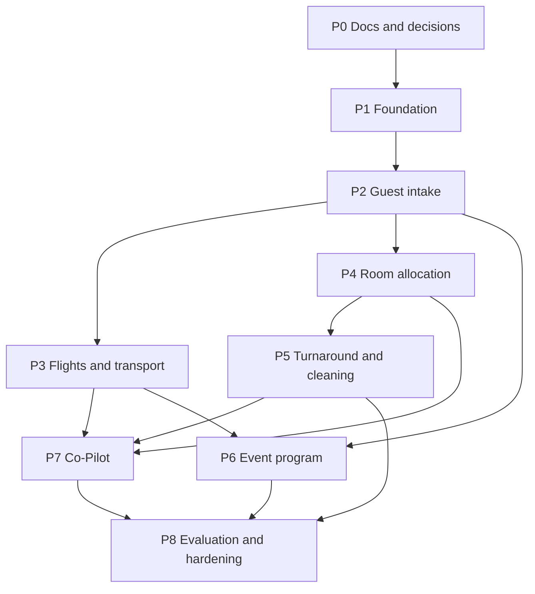

# 06 — Implementation Plan

**Status as of 2026-10-21:** P0 decisions confirmed. **P1 is done** (backend 2026-10-16; the Figma Make frontend "Hostmark" ported into the Next.js app 2026-10-19). **P2 guest intake is done** (2026-10-20): public registration, the intake pipeline, the review queue, pasted messages, guests and guest profiles, dashboard counters, demo data and the intake evaluation. **P3 flights and transport is done** (2026-10-20): flight ingestion and the transport cascade, the driver matcher and proposals, the background worker, the arrivals and transport boards, the driver app, the simulation screen (what-if previews and scripted runs) and the cascade evaluation. **P4 room allocation is done** (2026-10-21): stays and the hard-rule checks in the database, the allocator with its baseline and evaluation, plan review with partial approval, manual moves with "assign anyway", incremental suggestions and re-planning, the rooms grid and the front desk check-in. **P5 turnaround and cleaning is done** (2026-10-27): check-out (first wins) and its reversal, cleaning tasks with live ready estimates and priority order, the housekeeping phone and the coordinator's Sanitation screen, readiness feeding the allocator, and the cleaning evaluation. **P6 event programme is done** (2026-10-27): programme items with VIP participants, the arrival conflict check kept by triggers (a flight delay flags the item and alerts the programs team and coordinators), the programme timeline and the programs team's editor. External services stay behind interfaces with offline stand-ins until keys are issued (Claude → offline rules, Turnstile → skipped, AeroDataBox → no live polling; see [`02`](02-TRD.md) §4). Next: P7 Co-Pilot. One git commit per phase.

**Rule from [`00` §10](00-Project-Breakdown.md#10-boundaries-to-keep-the-project-realistic):** a phase is done when it **works end to end and can be measured**, not when it has the most features. Each phase below has explicit exit criteria.

Legend: ⬜ pending · 🟨 in progress · ✅ done · ⏸ deferred

---

## 1. Phase overview and dependencies

- **Critical path:** P0 → P1 → P2 → P4 → P5 → P7 → P8.
- **Can run in parallel after P2:** P3 (transport) alongside P4 (rooms). P6 (program) is small and can slot in after P3.
- **Evaluation is continuous:** each phase adds its own eval dataset and runner, and P8 consolidates them for the report.
- **Dates:** not scheduled yet. Waiting for the project submission/demo dates (see §4).

| Phase | Status | Modules | Depends on |
|---|---|---|---|
| P0 Docs and decisions | ✅ (venue airports and dates still open, §4) | — | — |
| P1 Foundation | ✅ backend · ✅ frontend (Hostmark) | M0 Platform | P0 |
| P2 Guest intake | ✅ | M1 | P1 |
| P3 Flights and transport | ✅ (live AeroDataBox run waits for a key) | M2 | P2 |
| P4 Room allocation | ✅ | M3 | P2 |
| P5 Turnaround and cleaning | ✅ | M5 | P4 |
| P6 Event program | ✅ | M6 | P2 (P3 for conflict checks) |
| P7 Co-Pilot | ⬜ | M4 | P3, P4, P5 |
| P8 Evaluation and hardening | ⬜ | All | All |

## 2. Phases in detail

### P0 — Docs and decisions 🟨
- ✅ Revised project understanding: [`00-Project-Breakdown.md`](00-Project-Breakdown.md) (v2, decisions of 2026-10-12)
- ✅ Six core docs drafted (`01`–`06`)
- ✅ Word export of all docs: `tools/docx-export` (`./build.sh` regenerates `docs/*.docx` from the Markdown)
- ⬜ Confirm the [Proposed] items ([`01-PRD.md` §9](01-PRD.md#9-open-questions-need-your-input))
- ⬜ Venue country/timezone/arrival airports → **flight API coverage test** ([`02-TRD.md` §4.1](02-TRD.md#41-flight-data-api--recommendation))
- ⬜ Agree success-metric targets with the supervisor

**Exit:** open questions answered, AeroDataBox confirmed (or the fallback chosen).

### P1 — Foundation (M0) ✅

Backend (built 2026-10-16):
- ✅ Scaffold: Next.js 16 + TypeScript 5.9, Vitest 5 (unit / db / integration projects), pnpm 11 with the release-age supply-chain check respected
- ✅ PostgreSQL 18 + dbmate migrations: foundation (roles, enums, helpers), events + profiles + Better Auth tables, audit, reference data (`vip_categories`, `room_types`, `rooms`, `drivers`, `driver_shifts`), proposals + notifications
- ✅ Auth (FR-PL-01): Better Auth sign-in, admin-created accounts with temporary passwords, forced password change, deactivation, password reset; HTTP surface limited to an allowlist
- ✅ **RLS deny-by-default** with `vip_app` / `vip_system` and a per-transaction `app.user_id` (FR-PL-02); every cell of the P1 matrix tested per role; security-baseline tests
- ✅ Cross-cutting: `audit_log` with a generic trigger and undo with conflict detection (FR-PL-07); notifications with real-time SSE (FR-PL-08); proposals with reject / expire and an approve skeleton (FR-PL-09)
- ✅ API for admin screens: event settings + intake token, users, room types, rooms + CSV import (dry run), drivers, shifts, VIP categories + reorder, activity log, decisions, `/api/me` (FR-PL-03…06)
- ✅ Injected clock utility; `flight_mode` setting (Super Admin only)
- ✅ Seed generator v1 (`pnpm db:seed`): venue, drivers with shifts, one account per role; `pnpm admin:create` for the first Super Admin
- ✅ Droplet deployment files: `Dockerfile`, `compose.yaml` (Caddy + app + Postgres + migrate), `Caddyfile`; `compose.dev.yml` for local Postgres
- ✅ Security and code review (2026-10-16): no critical findings; fixed: separate `vip_service` login, last-Super-Admin race, undo limited to operational tables, streamed body limits + Caddy limits, Origin check on cookie writes, SSE lifetime/cleanup, notification hub races, superseded plan lines, expired items hidden from the queue, undo conflicts. 206 tests pass.

Frontend (2026-10-19, from the Figma Make export in `design/figma-make/`):
- ✅ Design system ported: the prototype's CSS split by screen (`styles/01–18`) plus app additions (`19-app.css`); Tailwind dropped (unused); Plus Jakarta Sans and the venue photo self-hosted; one tertiary grey darkened for WCAG AA
- ✅ Shared components (`components/ui`: Icon, Button, status pills, Modal with focus trap, FormDialog, Toast, empty/error states) and the console and staff shells (`components/shell`: sidebar by role, top bar with event clock, Simulated badge (FR-PL-10), notifications drawer with live SSE refresh, Co-Pilot drawer placeholder)
- ✅ Server-side page guards (`lib/auth/page-access.ts`, `page-guard.ts`): sign-in, inactive accounts, forced password change, role per page; routes follow the design (`03` §2)
- ✅ Screens on the P1 API: sign in, choose a new password, dashboard (approvals with one-tap approve/reject, recent activity with Undo, room tiles), activity (day, who and type filters, field changes, Undo), settings (users, rooms + CSV import, drivers + shifts, VIP categories with reorder, event / registration link / flight mode)
- ✅ API additions: `GET /api/dashboard/summary`; `actor_type` and `entity_types` filters on `/api/audit`
- ✅ `pglite://` development mode (`pnpm local:setup`, no Docker needed) with the Figma demo venue in the seed
- ✅ ESLint (Next.js + TypeScript + React hooks rules), UI tests (jsdom + Testing Library)
- ⬜ Playwright E2E + axe (P8, browser installed: `PLAYWRIGHT_BROWSERS_PATH=0`)
- ⬜ CI (GitHub Actions): typecheck, lint, all Vitest projects, build (P8)
- ⬜ Run the stack once on Docker locally and on the droplet (the Docker images have not been built yet)

**Exit:** each role can sign in and sees only its own shell. Admin can configure the full venue. RLS tests pass for every role ✅. An audited write + undo works on one sample entity ✅.

### P2 — Guest intake and validation (M1) ✅
- ✅ Migration `20261019100000_guests_intake.sql`: `delegations`, `guests`, `guest_requirements`, `arrivals`, `flights` (basic), `pickups` (basic), `intake_submissions`, `intake_rate_limits`, `pg_trgm`, RLS + column grants, `intake_link_context()`
- ✅ Public form `/register/[token]` (4 steps, fields by arrival mode, companions, consent, optional Turnstile) and confirmation page; per-IP-hash limit in Postgres (10 per 15 min) plus 30/min in memory (FR-IN-01…03)
- ✅ One Zod intake schema shared by the form, the API, the review screen and AI structured output (`lib/domain/intake/schema.ts`)
- ✅ Normalisers: titles split from names, casing, E.164 phones, IATA flight numbers, dates/times to UTC in the event zone (FR-IN-07)
- ✅ Free-text reading behind one interface: Claude (structured output, prompt-injection wrapping, every failure falls back and forces review) or the offline rules (no key) — "anything else" items and pasted-message drafts (FR-IN-04/05)
- ✅ Rule checks (required by mode, flight format, airline vs prefix, date window, departure ≥ arrival, AI-flagged items) and duplicate detection (exact → linked, likely → review; trigram + same date/flight/contact, or a partial name with the same date/flight/contact) (FR-IN-06/08)
- ✅ High-confidence gate and record creation (delegation, principal, named or placeholder companions, arrival, shared flight, pickup) in one audited transaction; a failure falls back to review (savepoint); **Undo automatic processing** per submission (FR-IN-09). Implemented in TypeScript (`lib/services/intake/records.ts`) rather than the planned SQL function, so the same code serves auto-processing, approval, manual entry and the seed.
- ✅ Intake queue (tabs by reason, search, source filter, copy link) and review screen (original vs what was read, checks, side-by-side duplicate, approve / link / treat as new / reject); paste drawer (FR-IN-10)
- ✅ Guests list (tabs, search, category filter, Add guest with duplicate warning) and guest profile (party, arrival, transport, room placeholder, open issues with Dismiss / Add as guest, history, edit with optimistic locking: VIP category, proximity, share group) (FR-IN-11)
- ✅ Dashboard: VIP guests, arrivals today, pickups today tiles; Intake badge in the sidebar. Review items live on Intake (the approvals card keeps proposals only).
- ✅ Demo data: 6 Figma delegations through the real record builder + 3 queued submissions (likely duplicate, flagged note, pasted message)
- ✅ **Eval:** `eval/datasets/intake.jsonl` (135 synthetic labelled items: 110 notes, 25 messages; `pnpm eval:build`) + `pnpm eval:intake`. Offline rules, 2026-10-20: category F1 88.6%, attention accuracy 100%, contradiction F1 100%, problem-detection F1 100%, auto-processing 35.5% (expected 35.5%), pasted-message field F1 100%. **The set is synthetic** and the rules were written alongside it, so these numbers are a regression baseline, not real-world accuracy; volunteer notes (P8) and a Claude run (`--reader claude`, needs a key) give the reportable figures.

**Exit:** ✅ a phone registration goes end to end (Playwright run, no browser errors); clean submissions auto-create records, unclear ones land in review; the eval script produces the M1 metrics.

**Known gaps carried forward:** linking a duplicate does not copy chosen field updates (F3 "apply chosen updates") ⏸; global test coverage is 64% of lines against the 80% target, mostly P1 screens without component tests (settings, activity, shells) — closing it is in P8.

### P3 — Flight tracking and transport (M2) ✅
- ✅ Migration `20261020100000_flights_transport.sql`: `flight_updates`, `pickup_assignments`, `simulation_runs`, `provider_usage_daily`, `worker_leases`; `flights.delay_minutes` (generated), `arrivals.attention`, `pickups.previous_pickup_at/changed_at`; RLS + grants; feasibility functions (`private.trip_window`, `private.driver_unavailability`); approval executors for driver assignment/reassignment and pickup release (`approve_proposal` re-checks shift, overlap and seats and marks a stale proposal **failed** with the reason); driver functions (`my_driver_pickups`, `set_trip_status`, `acknowledge_assignment`)
- ✅ `FlightProvider` interface; `SimulatedProvider` (phase follows the clock); `AeroDataBoxProvider` (only with `AERODATABOX_API_KEY`) (FR-FT-10)
- ✅ Adaptive polling (`nextCheckAt`: T−24h, every 2 h to T−6h, 30 min to T−2h, then 10 min; none once final), one provider call per flight outside any transaction, daily quota counter with a coordinator warning at 80% and a pause at 100% (FR-FT-02/03)
- ✅ Ingestion `ingestFlightUpdate` → pure cascade plan (`lib/domain/transport/cascade.ts`) → `applyCascadePlan`: new venue ETA, moved pickups, missing pickups created, drivers who can still make it **kept and told** (they confirm again), otherwise a reassignment proposal or a coordinator alert; cancellations/diversions flag the party and propose releasing the pickup (FR-FT-04/05/07/08). Implemented in TypeScript rather than the planned `ingest_flight_update` SQL function, so the what-if preview runs the very same planner without writing.
- ✅ Driver matcher (pure TS): active, one shift covering the whole trip window, no overlapping trip; ranking keeps the current driver, then fewest jobs, smallest idle gap, smallest adequate vehicle; large parties get the fewest vehicles that seat everyone; up to two alternatives (FR-FT-06). A driver named in a **pending suggestion is held** for it, and a suggestion made for a pickup time that has since moved is **withdrawn** (found by the cascade evaluation, below).
- ✅ Suggestions outside a flight change: "Suggest a driver" on the board, and the worker suggests for every upcoming pickup without a driver or a pending suggestion
- ✅ Background worker: in-process with the app server (`WORKER_MODE=in-process`, default) or `pnpm worker`; one pass every 5 s (simulation steps), flight checks and suggestions every minute; a short lease row (`worker_leases`) instead of an advisory lock so only one process works at a time, and a crashed holder's lease simply runs out
- ✅ Arrivals board (`/arrivals`: hour groups, live status, changed times, pickup, driver, suggestion chips, window/status/search filters, day switch), transport board (`/transport`: decision cards with Approve/Reject, timeline per driver positioned from real times, off-shift shading, "Needs a driver" row with Suggest, driver drawer), manual landing time and "Check now" on the guest profile, attributed to the coordinator in the activity log (FR-FT-11)
- ✅ Driver app (`/driver`): today/tomorrow, the current trip big with one button (start → picked up → dropped off), "Got it" for moved or new trips, moved-away and done sections, trip details sheet, notifications (FR-FT-09)
- ✅ Simulation (`/simulation`): **what-if preview** (flight delay, driver unavailable from a time; read-only, same planner) and **scripted scenarios** (5 versioned in `lib/domain/simulation/scenarios.ts` instead of a `simulation_scenarios` table; 1×–600×; one run at a time; simulated mode only) through the live ingestion (FR-PL-10, FR-FT-10). Room scenarios moved to P5 (they need turnaround to be meaningful); "Send to Co-Pilot" with P7.
- ✅ Demo data: two seeded trips, ET512 runs 40 min late through the real pipeline (its driver keeps it and must confirm), and matcher suggestions for the rest; seeded shifts overlap at midday
- ✅ **Eval:** `pnpm eval:cascade` (synthetic day generated from a seed instead of fixture files: 30 flights, 48 pickups, 18 drivers, 150 changes). 2026-10-20, seed 42: latency ingestion → cascade done **p50 8 ms, p95 10 ms, max 20 ms** (target p95 ≤ 5 s); **64 / 64** proposals feasible when made; of the 15 still pending at the end of the day, 12 approve and 3 fail safely (`driver_busy`: the driver's other trip moved into the window and nobody else was free — the coordinator was alerted); 3 double bookings before approvals, 2 after (each with an open alert). The evaluation found both rules: the first run (14 drivers) showed pending suggestions naming the same driver for overlapping trips; with the "held driver" rule but before "withdraw stale suggestion", the run above gave 57 / 58 feasible and 17 of 32 end-of-day approvals failing.

- ✅ **Security review** (2026-10-20, security-reviewer): no critical or high findings. Fixed: approvals lock the drivers' rows (no double booking when two coordinators approve at once); "Check now" cooldown, manual cap and no checks of finished flights (the daily quota cannot be drained by hand); the worker renews its lease between units of work and simulation steps are claimed atomically (never applied twice); runs stop when the event leaves simulated mode; drivers see only the time and party of a trip moved to someone else, and only event days; trip steps in order and not on closed pickups; `onBehalfOf` must be a user id; a malformed proposal payload is marked failed instead of erroring; release suggestions are withdrawn when a flight flies again. Left as is: the suggestion pass reloads the driver context after each suggestion (bounded by 48 h and one event).

**Exit:** ✅ a simulated 45-minute delay moves the pickup, keeps the driver who can still make it (told in the driver app, which asks to confirm) or proposes a replacement, within the latency target; approving reaches the driver in real time (SSE); Playwright run of every P3 screen with no browser errors. ⏸ One real flight tracked end to end in live mode waits for an AeroDataBox key (the provider is unit-tested against recorded response shapes).

**Known gaps carried forward:** live AeroDataBox run (needs a key, TRD §4.1); notifications for repeated "no driver free" alerts are not de-duplicated; "Call coordinator" from the Figma driver app is left out until staff phone numbers are part of the event settings.

### P4 — Room allocation (M3) ✅
- ✅ Migration `20261021100000_rooms_allocation.sql`: `room_assignments` (one current stay per guest, audited, no direct writes), `private.guest_stay_window` and `private.room_unavailability` (capacity-aware, share groups, cleaning time after each stay, readiness by arrival), executors for room plans (chosen lines; each line approved or failed with its reason) and single room proposals (re-checked for the guest's window **at approval**), `assign_room` (assign anyway), `check_in_party` / `undo_check_in`, release of a cancelled guest's planned stay (trigger) (FR-RA-01, -03, -06, -09)
- ✅ Allocator (pure TS, `lib/domain/rooms/`): hard filter → weighted score (tier, accessible, ground floor, proximity to the principal by priority) → greedy by rank and party size, principal first → pairwise-swap local search re-scoring only what a swap touches; per-line "why", preference results and match level (FR-RA-01…04)
- ✅ Naive "first free room" baseline (`allocateFirstFree`)
- ✅ Rooms (`/rooms`): seven status tiles that filter, wing/floor/search filters, building grid, room inspector, **Run allocator**; plan review (`/rooms/plan/[id]`) with partial approval, reasons per line and unplaced guests (FR-RA-04/08). The Figma "unallocated tray" became the header count and the plan's "No room found for …" note
- ✅ Manual assign/move with a dry-run rule check and the warning dialog: broken rules, lost preferences, "Assign anyway" with every warning acknowledged and a reason of ≥ 10 characters, kept on the stay and in Activity (FR-RA-06). The guest profile's Room card shows each member's room or suggestion with Change room / Assign a room
- ✅ Incremental proposals for guests added after allocation started (worker, every minute); planned stays follow a moved arrival and a room that no longer works gets a move proposal or an alert (FR-RA-05/07); pending suggestions hold their rooms
- ✅ Front desk (`/staff/front-desk`): arriving / in house / leaving, **Check in** for the whole party with confirm, Undo (10 min) and "already checked in by …" (FR-RA-09); guests list and dashboard show rooms
- ✅ Demo data: three rooms needing cleaning, two being cleaned, one out of service, and a plan for all 17 guests waiting for approval
- ✅ **Eval:** `pnpm eval:allocation` (synthetic venues and guests from a seed instead of dataset files; an independent hard-rule checker). 2026-10-21, 10 seeds × 3 scenarios: **hard rules 100%** (0 violations); preference satisfaction **84.1% / 83.1% / 75.9%** vs baseline 51.3% / 49.4% / 46.0% (**+30 to +34 points**); the swap pass adds 2–8 points; runtime ≤ 74 ms per plan (details in `02` §3.4). The first run measured 0.9 s per plan and 15 s for 300 guests; re-scoring only what a swap touches gave identical plans 36× faster.
- ⏸ Optional: ILP comparison on small instances
- ✅ **Security review** (2026-10-21, security-reviewer): no critical findings. Fixed: **(high)** a suggestion approved after its guest's arrival moved was placed for the old window — every room proposal is now checked and placed for the guest's window at approval, and pending holds use it too; **(medium)** a cancelled guest kept their room (trigger releases it; assign and check-in refuse cancelled guests); "assign anyway" accepted any reason without the coordinator acknowledging the warnings (the client now sends what it showed; reason ≥ 10 characters; a stale dialog gets a fresh 409); check-in did not refuse a room someone else is still checked into (`room_occupied`); undoing a check-in could undo a checked-in guest's move (`moved_from_id`, excluded); **(low)** one lock order guest → room → stay everywhere and share-locked rooms during check-in; override reasons hidden from the front desk (profile and notification); allocator runs limited to 6/min and serialised; no uuid casts of proposal payloads in reads. Left as is: the front desk's database role can read VIP category rows (the API serves names only; accepted for the front desk's category label).

**Exit:** ✅ the allocator plans the seeded venue with 100% hard-rule satisfaction and beats the baseline on preferences by about 33 points; the coordinator approves a plan (all or some lines) and overrides by hand with warnings; check-in records who and when, and the allocator never moves checked-in guests. Playwright run of every P4 screen with no browser errors.

**Known gaps carried forward:** check-out and its reversal, cleaning tasks and the housekeeping app (P5); room scenarios in the simulation (P5); "same team near each other" is scored only through proximity to the principal; the Figma "Change room" on plan lines is replaced by "View guest" (move after approving).

### P5 — Room turnaround and cleaning (M5) ✅
- ✅ Migration `20261027100000_turnaround_cleaning.sql`: `cleaning_tasks` (one open task per room, the stays it covers, problem reports; column grant hides `stay_ids`), `room_assignments.checkout_reversed_at/by`; `check_out_party` (per delegation, first wins), trigger `queue_cleaning` (any check-out that empties a room — including a checked-in guest's move — queues it and notifies housekeeping by room number), `reverse_checkout`, `start_cleaning` / `complete_cleaning` / `undo_complete_cleaning`, `report_cleaning_problem`, `cleaning_queue(since)` (rooms only, no guest data) (FR-CL-01/02/05/06)
- ✅ Estimated ready time + priority ordering (FR-CL-03/04): FR-CL-03 stored at check-out; live estimate and working order (in progress, then soonest next guests, then earliest ready) in pure `lib/domain/cleaning/queue.ts` instead of a `v_cleaning_queue` view
- ✅ Room readiness feeds back: `private.room_ready_at` (a started clean counts from its start) drives the `not_ready` hard rule in the database and the allocator (`AllocRoom.ready_at`); the dashboard and rooms grid read the room status the workflow now keeps
- ✅ Front desk: **Check out** on In house and Leaving with a confirm sheet; a lost race says "Already checked out by … at …"
- ✅ Housekeeping app (`/staff/sanitation`): summary and progress, ordered cards, Start cleaning → Mark ready (confirm sheet, Undo for 10 min), Report a problem, Profile with sign out
- ✅ Coordinator Sanitation (`/sanitation`): summary tiles, queue table with checked-out time, live ready estimate, "Ready N min after it is needed", needed by, reported problems, **Reverse check-out** (unstarted only), Done today
- ✅ Activity log names stays and cleaning tasks ("checked out the stay", "finished the cleaning task"); demo seed gives the five dirty/cleaning rooms their tasks
- ✅ **Eval:** `pnpm eval:cleaning` (2026-10-27, seed 42): **100 / 100** check-outs produced the task and every housekeeper's notification, check-out → visible p50 3 ms, p95 4 ms, max 11 ms (target ≥ 99 % within 5 s). Estimate error of the FR-CL-03 formula, 40 check-outs: over an 8-hour day MAE 11.8 min with 8 cleaners ✓, 18.6 with 6, 57.5 with 4, 112.5 with 3; over a 5-hour peak 17.9–161.7 min (8 → 3 cleaners). Priority ordering left **0** rooms ready after their next guests in every setting. Finding: the formula ignores the queue ahead of a room, so it meets ≤ 15 min only while housekeeping keeps up; a queue-aware estimate needs housekeeping shifts (open item 6)
- ✅ First wins tested in the database, through the API, and with two simultaneous check-outs (one 200, one 409, one task)
- ✅ Security review (2026-10-27): no critical/high; fixed — Undo of Mark ready after the room was turned around again (was a 500, now 409 `room_in_use`), a reversal can no longer restore more than one party (409 `shared_room`), reversal re-reads the task's stays under lock (409 `changed`), housekeeping cannot select `stay_ids`. Left for P8: rate limit on problem reports
- ⏸ Simulation room scenarios (room out of service, extra guests) carried from P4 → P8 demo script; they need scenario steps that act on rooms, not flights

**Exit:** met — a check-out reaches housekeeping (task + notification) in milliseconds and the phone refreshes on the notification stream; a double check-out shows who did it; the reversal works; MAE is reported with the staffing it depends on.

### P6 — Event program (M6) ✅
- ✅ Migration `20261027110000_programme.sql`: `program_items` (draft / published / cancelled; `at_risk` kept by the database), `program_participants` (speaker, honoree, performer, attendee); RLS — programs and Admin edit everything, coordinators read what is not a draft, other staff nothing; `private.program_item_risks` instead of a `v_program_conflicts` view (FR-PG-01…03)
- ✅ At-risk check on every relevant change: triggers on items, participants, arrivals (so the flight cascade flags items) and guests; alerts programs + coordinators when a published item becomes at risk or is published at risk; the flag and "team notified" clear by themselves
- ✅ Programme screen (`/programme`, Figma "Programme"): day tabs over the event days, timeline (on track / at risk / done / cancelled, drafts marked), the at-risk detail open by default ("… is expected at the venue at 16:55. Welcome briefing starts at 17:00.") with **Open guest** and **Notify programme team** for coordinators, item detail with participants (late ones highlighted), side panel with the at-risk count and venues. The programs team gets **Add item** / **Edit item** (the design's "form, designed later": title, type, day, times, venue with suggestions, description, status, participants with roles, delete). Coordinator view read-only (FR-PG-04)
- ✅ Activity log names programme items; demo seed: day-one timeline from the design, day-two sessions, a day-three draft, and a welcome briefing at risk from the delayed ET512 party
- ✅ Security review (2026-10-27): no critical/high; fixed — per-item (not per-participant) late lookup, programme alerts can no longer abort a flight cascade and lock items in a fixed order, "Notify programme team" once per risk (409 `already_notified`) and the mark clears with the risk, the item row is locked while its flag is recomputed (no duplicate alerts), `status` required on edits (no silent unpublish). Left: changing the event's lead time does not re-check existing items until they next change; items outside the event days are accepted but not shown
- ⏸ Dashboard "Programme at risk" glance card (the Figma dashboard's "At a glance" card was not ported in phase F); the notification bell carries the alert

**Exit:** met — `tests/integration/programme.test.ts` applies a simulated delay through `ingestFlightUpdate`; the briefing turns at risk for the programs team and the coordinator (both notified), and clears when the flight recovers.

### P7 — Co-Pilot (M4) ⬜
- ⬜ Read tools as typed query functions running as the user (RLS) (FR-CP-02)
- ⬜ Chat route with the tool runner, streaming, citations/links (FR-CP-01/03)
- ⬜ Write tools → proposals with inline cards (FR-CP-04)
- ⬜ Conversation logging (FR-CP-06)
- ⬜ Voice: push-to-talk, `/api/copilot/transcribe` with keyterms, editable transcript (FR-CP-05)
- ⬜ **Eval:** `eval/datasets/copilot.jsonl` (≥ 50 questions, ≥ 20 actions) + `pnpm eval:copilot`; `voice/` WER with vs without keyterms

**Exit:** the Co-Pilot meets the accuracy targets on the fixed seed, can never write without approval (tested), and voice works on a phone.

### P8 — Evaluation and hardening ⬜
- ⬜ Consolidated `pnpm eval:all` → Markdown/JSON tables for the report
- ⬜ Volunteer data round (consented) through the real intake link
- ⬜ Small usability test: 3 coordinator tasks vs a spreadsheet + chat baseline
- ⬜ Accessibility audit (axe + manual keyboard/screen reader pass) against `04` §7
- ⬜ Security review: RLS matrix re-test, secrets, rate limits, intake abuse, Co-Pilot prompt-injection via guest free-text (P2 intake and P3 transport reviewed 2026-10-20, P4 rooms 2026-10-21, see those commits)
- ⬜ Coverage to ≥ 80% lines/branches: component tests for settings, activity, shells, sign-in (2026-10-21: 76% lines, 66% branches overall; P4 modules 92–98% lines)
- ⬜ Content-Security-Policy in Caddy (allow `challenges.cloudflare.com` for scripts and frames when Turnstile is on)
- ⬜ Performance check against the `02` §7 targets
- ⬜ Demo script using simulated mode
- ⬜ Droplet operations: nightly `pg_dump` to DigitalOcean Spaces, weekly droplet backups, a restore drill, firewall (22/80/443), unattended upgrades
- ⬜ Post-event purge procedure tested

**Exit:** every PRD §8 metric has a measured value with a reproducible script, and the demo runs end to end.

## 3. Cross-cutting rules while building

- Update [`05-Backend-Schema.md`](05-Backend-Schema.md) **in the same change** as any migration, and update this file's checkboxes as items land.
- Every new write path goes through the audit log. Every resource-committing action goes through `proposals` ([`01` §4 P1](01-PRD.md#4-core-principles)).
- Domain logic stays pure (no DB/network in `lib/domain`), so the eval harness can call it directly.
- Treat guest-supplied free text as **untrusted data** in AI prompts (it may contain instructions). The Co-Pilot's tools enforce permissions regardless of what the model is told.

## 4. Blockers and open items

| # | Item | Blocks |
|---|---|---|
| 1 | Confirm [Proposed] items in `01` §9 | Final scope of P1–P7 |
| 2 | Venue country, timezone, arrival airport(s) | Flight API coverage test (P0 exit), droplet region, privacy regime |
| 3 | Submission and demo dates | Scheduling these phases |
| 4 | ~~Brand colors~~ Hostmark design adopted | — |
| 5 | ~~Figma Make design~~ received 2026-10-19 and ported | — |
| 6 | Queue-aware cleaning estimate: the FR-CL-03 formula meets MAE ≤ 15 min only with enough cleaners (P5 eval). Estimating from the queue needs how many housekeepers are on shift (not modelled yet). Decide: accept and report, or add housekeeping shifts | M5 estimate target |
| 6 | Domain name pointing at the droplet | Production deploy (HTTPS via Caddy) |
