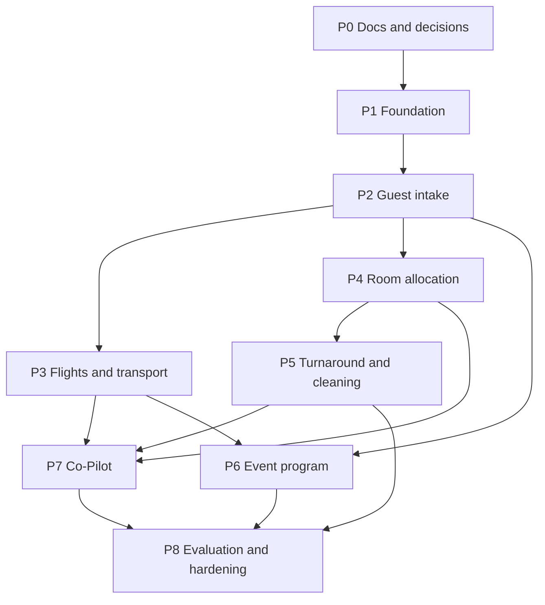

# 06 — Implementation Plan

**Status as of 2026-10-16:** P0 docs drafted (confirmations still pending). **P1 backend built, reviewed and tested** (206 automated tests, 93% statement / 90% branch coverage). The P1 frontend waits for the Figma Make design. Hosting moved from Vercel + Supabase to one DigitalOcean droplet (decision 12 in `00`).

**Rule from [`00` §10](00-Project-Breakdown.md#10-boundaries-to-keep-the-project-realistic):** a phase is done when it **works end to end and can be measured**, not when it has the most features. Each phase below has explicit exit criteria.

Legend: ⬜ pending · 🟨 in progress · ✅ done · ⏸ deferred

---

## 1. Phase overview and dependencies

- **Critical path:** P0 → P1 → P2 → P4 → P5 → P7 → P8.
- **Can run in parallel after P2:** P3 (transport) alongside P4 (rooms). P6 (program) is small and can slot in after P3.
- **Evaluation is continuous:** each phase adds its own eval dataset and runner, and P8 consolidates them for the report.
- **Dates:** not scheduled yet. Waiting for the project submission/demo dates (see §4).

| Phase | Status | Modules | Depends on |
|---|---|---|---|
| P0 Docs and decisions | 🟨 drafted, awaiting confirmation of [Proposed] items | — | — |
| P1 Foundation | 🟨 backend ✅ · frontend ⬜ (Figma Make) | M0 Platform | P0 |
| P2 Guest intake | ⬜ | M1 | P1 |
| P3 Flights and transport | ⬜ | M2 | P2 |
| P4 Room allocation | ⬜ | M3 | P2 |
| P5 Turnaround and cleaning | ⬜ | M5 | P4 |
| P6 Event program | ⬜ | M6 | P2 (P3 for conflict checks) |
| P7 Co-Pilot | ⬜ | M4 | P3, P4, P5 |
| P8 Evaluation and hardening | ⬜ | All | All |

## 2. Phases in detail

### P0 — Docs and decisions 🟨
- ✅ Revised project understanding: [`00-Project-Breakdown.md`](00-Project-Breakdown.md) (v2, decisions of 2026-10-12)
- ✅ Six core docs drafted (`01`–`06`)
- ✅ Word export of all docs: `tools/docx-export` (`./build.sh` regenerates `docs/*.docx` from the Markdown)
- ⬜ Confirm the [Proposed] items ([`01-PRD.md` §9](01-PRD.md#9-open-questions-need-your-input))
- ⬜ Venue country/timezone/arrival airports → **flight API coverage test** ([`02-TRD.md` §4.1](02-TRD.md#41-flight-data-api--recommendation))
- ⬜ Agree success-metric targets with the supervisor

**Exit:** open questions answered, AeroDataBox confirmed (or the fallback chosen).

### P1 — Foundation (M0) 🟨 backend done, frontend pending

Backend (built 2026-10-16):
- ✅ Scaffold: Next.js 16 + TypeScript 5.9, Vitest 5 (unit / db / integration projects), pnpm 11 with the release-age supply-chain check respected
- ✅ PostgreSQL 18 + dbmate migrations: foundation (roles, enums, helpers), events + profiles + Better Auth tables, audit, reference data (`vip_categories`, `room_types`, `rooms`, `drivers`, `driver_shifts`), proposals + notifications
- ✅ Auth (FR-PL-01): Better Auth sign-in, admin-created accounts with temporary passwords, forced password change, deactivation, password reset; HTTP surface limited to an allowlist
- ✅ **RLS deny-by-default** with `vip_app` / `vip_system` and a per-transaction `app.user_id` (FR-PL-02); every cell of the P1 matrix tested per role; security-baseline tests
- ✅ Cross-cutting: `audit_log` with a generic trigger and undo with conflict detection (FR-PL-07); notifications with real-time SSE (FR-PL-08); proposals with reject / expire and an approve skeleton (FR-PL-09)
- ✅ API for admin screens: event settings + intake token, users, room types, rooms + CSV import (dry run), drivers, shifts, VIP categories + reorder, activity log, decisions, `/api/me` (FR-PL-03…06)
- ✅ Injected clock utility; `flight_mode` setting (Super Admin only)
- ✅ Seed generator v1 (`pnpm db:seed`): venue, drivers with shifts, one account per role; `pnpm admin:create` for the first Super Admin
- ✅ Droplet deployment files: `Dockerfile`, `compose.yaml` (Caddy + app + Postgres + migrate), `Caddyfile`; `compose.dev.yml` for local Postgres
- ✅ Security and code review (2026-10-16): no critical findings; fixed: separate `vip_service` login, last-Super-Admin race, undo limited to operational tables, streamed body limits + Caddy limits, Origin check on cookie writes, SSE lifetime/cleanup, notification hub races, superseded plan lines, expired items hidden from the queue, undo conflicts. 206 tests pass.

Frontend and tooling (pending):
- ⬜ App shell: console layout (sidebar, top bar, event clock), staff-app shell (PWA manifest), design tokens from `04` (light/dark) — from the Figma Make design
- ⬜ Admin screens on top of the P1 API; SimBanner
- ⬜ ESLint/Prettier; Playwright
- ⬜ CI (e.g. GitHub Actions): typecheck, unit, db and integration tests (all run without Docker), build, on every push
- ⬜ Run the stack once on Docker locally and on the droplet (verified so far: the full test suite on PGlite and `next build`; the Docker images themselves have not been built yet)

**Exit:** each role can sign in and sees only its own shell. Admin can configure the full venue. RLS tests pass for every role ✅. An audited write + undo works on one sample entity ✅.

### P2 — Guest intake and validation (M1) ⬜
- ⬜ Migrations: `delegations`, `guests`, `guest_requirements`, `arrivals`, `flights` (basic), `pickups` (basic), `intake_submissions`, `intake_rate_limits`
- ⬜ Public form `/intake/[token]` with conditional arrival-mode fields, members, consent, Turnstile, rate limit (FR-IN-01…03)
- ⬜ Zod intake schema (shared by the form, API and AI structured output)
- ⬜ Normalizers (names/titles, phone E.164, flight numbers, dates→UTC) (FR-IN-07)
- ⬜ AI extraction of the "others" field + pasted-message draft (FR-IN-04/05)
- ⬜ Validation checks (FR-IN-06) + duplicate detection (exact / likely, `pg_trgm`) (FR-IN-08)
- ⬜ Rule-based high-confidence gate + `create_records_from_submission` RPC (FR-IN-09)
- ⬜ Intake review screen (issues, side-by-side duplicates, approve/link/reject, paste tool) (FR-IN-10)
- ⬜ Guests list + guest/delegation detail: VIP category, members, share groups, proximity priority (FR-IN-11)
- ⬜ Dashboard v1: decisions queue (review items), counters
- ⬜ **Eval:** `eval/datasets/intake.jsonl` (≥ 100 items, synthetic + volunteer) + `pnpm eval:intake` → field F1, problem detection P/R, auto-processing rate

**Exit:** a volunteer can submit on a phone. Clean submissions auto-create records, and unclear ones land in review. The eval script produces the M1 metrics.

### P3 — Flight tracking and transport (M2) ⬜
- ⬜ `FlightProvider` interface; `SimulatedProvider`; `AeroDataBoxProvider` (FR-FT-10)
- ⬜ `flight_updates`, `pickup_assignments`, `simulation_scenarios`, `simulation_runs`, `provider_usage_daily`
- ⬜ Worker process (own Compose service): one-minute loop with a Postgres advisory lock → flight poll with the adaptive schedule (FR-FT-03) + quota counter
- ⬜ `ingest_flight_update` RPC: ETA → arrivals → pickups (FR-FT-04/05)
- ⬜ Driver matcher (pure TS) + proposals for assignment/reassignment (FR-FT-06/07); cancellations/diversions (FR-FT-08)
- ⬜ Flight board, transport board (driver lanes), manual refresh/override (FR-FT-11)
- ⬜ Driver app: my pickups, acknowledge, status button (FR-FT-09)
- ⬜ Simulation screen + worker simulation ticks + scenario fixtures
- ⬜ **Eval:** `eval/datasets/scenarios/*` + `pnpm eval:cascade` → latency p50/p95, proposal feasibility %

**Exit:** a simulated 45-minute delay produces the right automatic updates or reassignment proposal within the latency target. Approving it reaches the driver's phone in real time. One real flight is tracked end to end in live mode.

### P4 — Room allocation (M3) ⬜
- ⬜ `room_assignments` + capacity-aware availability checks in RPCs
- ⬜ Allocator (pure TS): hard filter → weighted score → greedy by rank → local search; per-line explanations (FR-RA-01…04)
- ⬜ Naive baseline allocator (for evaluation)
- ⬜ Room grid UI, unallocated tray, plan review with partial approve (FR-RA-04/08)
- ⬜ Manual assign/move with dry-run rule check + RuleWarningDialog (FR-RA-06)
- ⬜ Incremental proposals for new guests; re-plan of not-checked-in stays on change (FR-RA-05/07)
- ⬜ Accommodation app: today's arrivals, **Check in** (FR-RA-09)
- ⬜ **Eval:** `eval/datasets/allocation/*` + `pnpm eval:allocation` → hard-rule satisfaction (must be 100%), preference % vs baseline, runtime
- ⏸ Optional: HiGHS ILP comparison on small instances

**Exit:** the allocator plans the seeded venue with 100% hard-rule satisfaction and beats the baseline on preferences. The coordinator can approve a plan and override by hand with warnings. Check-in locks stays.

### P5 — Room turnaround and cleaning (M5) ⬜
- ⬜ `cleaning_tasks`; `check_out_stay` (first wins), `reverse_checkout`, `start/complete_cleaning` RPCs (FR-CL-01/02/06)
- ⬜ Estimated ready time + priority ordering (`v_cleaning_queue`) (FR-CL-03/04)
- ⬜ Accommodation app: **Check out** with the "already checked out by…" state
- ⬜ Housekeeping app: ordered list, Start → Done (FR-CL-05)
- ⬜ Room readiness feeds back into the allocator's hard rule and the dashboard
- ⬜ **Eval:** scripted checkout trials → notification reliability %, estimate MAE; a concurrency test for first-wins

**Exit:** a checkout appears on the housekeeping phone within 5 s. A double checkout shows the right message. The reversal works. MAE is reported.

### P6 — Event program (M6) ⬜
- ⬜ `program_items`, `program_participants`, `v_program_conflicts` (FR-PG-01…03)
- ⬜ Programs editor + item page; coordinator read-only timeline (FR-PG-04)
- ⬜ At-risk notifications on arrival changes

**Exit:** a simulated delay flags the right program item for the programs team and the coordinator, and the flag clears when resolved.

### P7 — Co-Pilot (M4) ⬜
- ⬜ Read tools as typed query functions running as the user (RLS) (FR-CP-02)
- ⬜ Chat route with the tool runner, streaming, citations/links (FR-CP-01/03)
- ⬜ Write tools → proposals with inline cards (FR-CP-04)
- ⬜ Conversation logging (FR-CP-06)
- ⬜ Voice: push-to-talk, `/api/copilot/transcribe` with keyterms, editable transcript (FR-CP-05)
- ⬜ **Eval:** `eval/datasets/copilot.jsonl` (≥ 50 questions, ≥ 20 actions) + `pnpm eval:copilot`; `voice/` WER with vs without keyterms

**Exit:** the Co-Pilot meets the accuracy targets on the fixed seed, can never write without approval (tested), and voice works on a phone.

### P8 — Evaluation and hardening ⬜
- ⬜ Consolidated `pnpm eval:all` → Markdown/JSON tables for the report
- ⬜ Volunteer data round (consented) through the real intake link
- ⬜ Small usability test: 3 coordinator tasks vs a spreadsheet + chat baseline
- ⬜ Accessibility audit (axe + manual keyboard/screen reader pass) against `04` §7
- ⬜ Security review: RLS matrix re-test, secrets, rate limits, intake abuse, Co-Pilot prompt-injection via guest free-text
- ⬜ Performance check against the `02` §7 targets
- ⬜ Demo script using simulated mode
- ⬜ Droplet operations: nightly `pg_dump` to DigitalOcean Spaces, weekly droplet backups, a restore drill, firewall (22/80/443), unattended upgrades
- ⬜ Post-event purge procedure tested

**Exit:** every PRD §8 metric has a measured value with a reproducible script, and the demo runs end to end.

## 3. Cross-cutting rules while building

- Update [`05-Backend-Schema.md`](05-Backend-Schema.md) **in the same change** as any migration, and update this file's checkboxes as items land.
- Every new write path goes through the audit log. Every resource-committing action goes through `proposals` ([`01` §4 P1](01-PRD.md#4-core-principles)).
- Domain logic stays pure (no DB/network in `lib/domain`), so the eval harness can call it directly.
- Treat guest-supplied free text as **untrusted data** in AI prompts (it may contain instructions). The Co-Pilot's tools enforce permissions regardless of what the model is told.

## 4. Blockers and open items

| # | Item | Blocks |
|---|---|---|
| 1 | Confirm [Proposed] items in `01` §9 | Final scope of P1–P7 |
| 2 | Venue country, timezone, arrival airport(s) | Flight API coverage test (P0 exit), droplet region, privacy regime |
| 3 | Submission and demo dates | Scheduling these phases |
| 4 | Brand colors (if any) | P1 design tokens (defaults are usable meanwhile) |
| 5 | Figma Make design | P1 frontend (app shell, admin screens) |
| 6 | Domain name pointing at the droplet | Production deploy (HTTPS via Caddy) |
